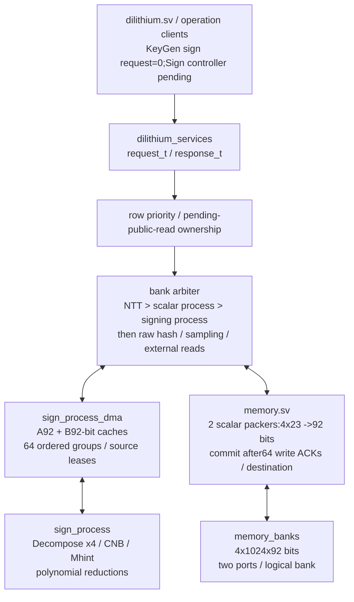
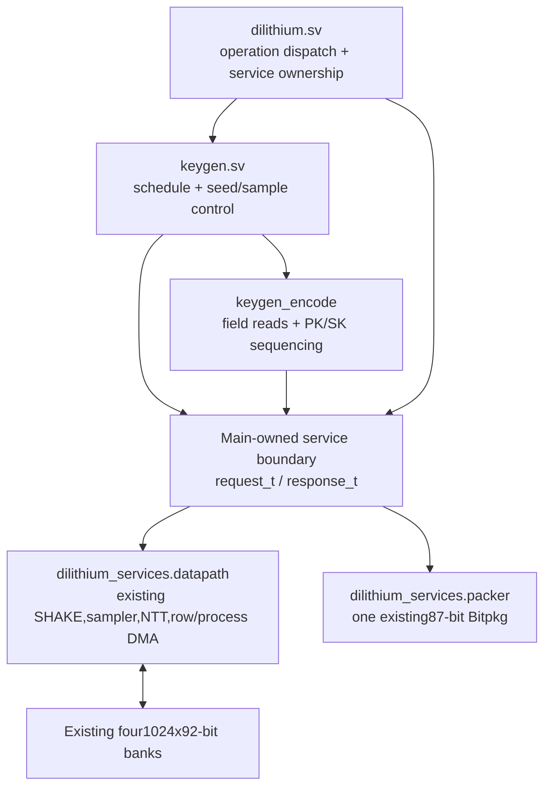
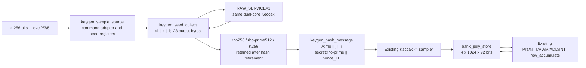
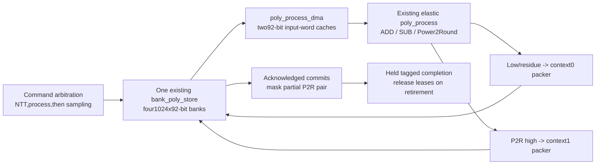
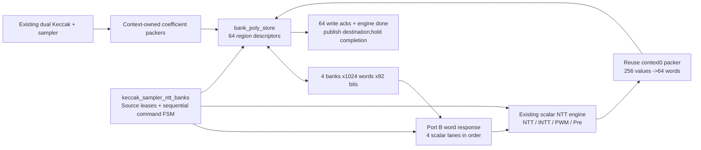
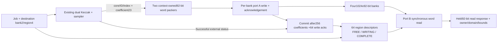
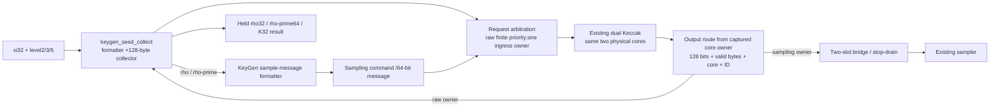

# Dilithium architecture

## Stage5N.3 shared signing memory client

The main-owned service enables SIGN_SERVICE and contains one new
sign_process_dma/sign_process instance. No polynomial payload RAM or second
Keccak/sampler/NTT/bank tree is added.



Pending public reads block signing acceptance. Row commands take priority before
acceptance;once signing owns the banks,other service commands/reads stay blocked
through done retirement. Unrelated region releases are allowed. Acceptance-edge
and ongoing leases protect sources;allocated results stay protected as well.
The two Decompose commits are serialized but share one publication mask.
Error rollback drains writes and frees tentative results. KeyGen retains its
existing output/cleanup lifetime. The earlier sections below are historical.

## Stage5N.2 signing-process arithmetic foundation

sign_process currently wraps one decompose_x4,four-lane CNB and four-lane Mhint
behind one elastic x4 transport. All use existing23-bit canonical coefficient
conventions. Decompose returns signed19-bit low lanes;the future bank DMA must
convert negative lows to canonical residues. Mhint consumes corrected-low
residues and retained6-bit high lanes,avoiding duplicate decomposition hardware
inside the hint block. CNB and hint counts reduce within one polynomial.
This source-tested unit is not yet instantiated in dilithium_services;main
Sign control and vector-wide reductions remain the following integration work.
No new engine copies,bank RAM or external top-level ports are added here.

## Stage5N.1 main-owned services

The main dilithium.sv now owns one dilithium_services instance. KeyGen and
keygen_encode are control/format clients;they no longer instantiate the
banked engine subtree or Bitpkg. The wrapper contains the same
keccak_sampler_row(RAW_SERVICE=1) and one unchanged Bitpkg. No additional
Keccak,sampler,NTT,bank memory or key RAM is added.



helpers/dilithium_service_pkg.sv defines packed request/response records.
They group existing ports without buffering,serialization,width reduction
or added pipeline registers. pack_request_t/pack_response_t are nested in
the overall records. datapath/dilithium_services.sv connects their fields
explicitly to the unchanged engine and packer ports.

Main keygen_owner is true during DISPATCH or while the KeyGen child is busy.
It stays true after main completion retirement:the main FSM may already be
IDLE while the child releases retained regions. Only after cleanup may the
request bus become all zero and another main command be accepted. Responses,
including faults and memory reservations,remain visible even without an owner.
Reset drives the request bus to zero and resets all clients/services.

Only KeyGen is connected as an operation client at this stage. There is no
implemented Sign/Verify client or tested multi-client contention/arbitration
claim yet. Future clients must use this boundary and keep ownership through
their own drain/cleanup. No duplicate engine trees are permitted.

## Prior Stage5M evidence

Stage5M ran all75 official NIST KeyGen seeds through the complete architecture
and compared complete encoded keys. At that checkpoint all46 RTL files were unchanged from
Stage5L;the new selector extends only the preparation/checking harness.

## Stage5L complete KeyGen on shared resources

dilithium(FULL_KEYGEN=1) dispatches to the existing autonomous KeyGen scheduler
with rounding enabled. Each row finishes normally,then internal control
accepts its polynomial result. Once every row is complete,keygen_encode owns
the retained sources and the existing raw service/read port.

The encoder submits a finite SHAKE256 request for the exact PK byte length,
emits rho,then streams all t1 fields through Bitpkg. PK words have separate
host/hash acknowledgement state. A fast consumer cannot receive a word twice,
and a stalled consumer sees stable data/tags. The source advances after both
acknowledgements. Four128-bit SHAKE output beats become tr;hash completion is
accepted only with the complete64 bytes. The controller emits SK headers and
s1/s2/t0 fields,waits for the final packet completion,and holds overall done.
The polynomial scheduler then releases retained regions on done acceptance.

One existing dual Keccak,one sampler,one NTT,one process DMA and the four-bank
store are reused. keygen_encode adds no engine or encoded-key RAM.
The default FULL_KEYGEN=0 mode keeps earlier polynomial/rounded gates and
their manual read interface. Sign and Verify controllers are still planned.
Stage5N.1 lifts the engine/packer instances to the main controller as described
above. Sign/Verify will join as clients of these same resources;their scheduling
and contention handling remain future work. Preserve the full-KeyGen byte gate.

## Stage5K optional rounding and Bitpkg process block

After s2 addition,the rounded KeyGen path issues P2R with source t and explicit
low/high destinations. Both outputs share the tagged operation ID and existing
store/ack/publication machinery. All rows' rounded arrays remain available until
overall completion is consumed. The previous polynomial-only mode remains
selectable.

Bitpkg accepts one tagged polynomial command,encodes canonical scalar inputs
into10/13/3/4-bit fields,and shifts them through an87-bit reservoir into64-bit
words. It can consume an old output and append a new coefficient on the same
edge. Stalled output stays stable. Final status establishes packet completeness;
invalid input/frame status cannot turn a truncated prefix into a valid packet.
No hash engine or polynomial RAM is added. Bank-to-Bitpkg routing and complete
key-field/public-key-hash scheduling are the next integration step.

## Stage5J main FSM and KeyGen polynomial scheduler

dilithium.sv accepts operation/level/ID/xi and dispatches operation0 to keygen.sv.
Sign/Verify remain unimplemented and return explicit unsupported status.
keygen.sv instantiates the existing seed-source adapter and one shared row
datapath. It schedules all k+l secret samples,then l eligible Pre transforms,
then each of the k complete matrix rows. Each row uses the existing PWM/ADD/
inverse schedule,followed by modular ADD of s2[i]. Transformed s1 is reused.

The polynomial controller states are seed,secret sampling,secret transforms,
matrix sampling,row multiply/accumulate,inverse,s2 addition,held t output,
temporary release,held overall completion,and retained-secret cleanup.
No testbench drives those internal commands. All accepted child completion
IDs/regions/codes are checked;an unexpected result halts with sticky fault.

Output row ownership lasts until the caller accepts it and its pending read
response retires. Overall completion similarly protects retained secrets until
accepted and pending reads drain. The controller then frees every owned region
before permitting another start. The next integration work is rounding and
key serialization/public-key hashing,followed by actual Sign/Verify controllers.

## Stage5I retained seed and shared hash route



The source adapter is synthesizable;the focused bench connects it to the
optional raw-service ports on keccak_sampler_row/keccak_sampler_ntt_banks.
RAW_SERVICE defaults to 0 for old clients. Row commands have priority over
external raw requests;inside the banked wrapper NTT/process commands have
priority over new raw requests. Accepted raw work owns a core until all output
bytes and its held raw completion retire. Compute accepts only when active_o
is zero. The producer gives an eligible raw request priority over sampling;
only an actual sample handshake allocates a polynomial region.

Adapter op0 replaces the retained seed;op1 samples matrix A;op2 samples a
KeyGen secret. It snapshots descriptors,validates retained-level agreement and
uses the existing formatter to validate row/column/nonce bounds. A sample
completion waits for both message completion and matching sampler retirement;
that retirement includes the store's 256 values and 64 acknowledged words.
Seed replacement invalidates old material immediately. Errors and successes
are held until accepted;reset clears seed validity with the rest of the path.

This adds seed/control registers,not an autonomous full-KeyGen controller.
The bench still schedules sampling,transforms and whole-row commands. No extra
polynomial/key buffer or change to the accepted engine RTL is introduced.

## Stage5H staged-row scheduler

keccak_sampler_row wraps one existing banked subsystem and row_accumulate.
It arbitrates the existing NTT,process,read and release interfaces;it does not
instantiate another engine or bank array. Row commands contain level,row index,
ID,three workspace regions and up to seven A/s1_hat region/owner pairs.
Row command priority blocks new external commands;pending jobs/reads retire
before acceptance. Source metadata is checked for committed state,ID,domain
and level before any child arithmetic. The accepted descriptors are retained
and protected for the whole row.

For each column,the scheduler issues PWM. The first product initializes the
single accumulator;later products occupy the reusable scratch region. An
explicit in-place modular ADD reads/caches old accumulator and scratch words,
then rewrites the same accumulator under a new ID. Scratch is released after
each ADD. Finally inverse NTT writes coefficient output u_i and the accumulator
is released. The output/source leases last through held whole-row completion.
Invalid/busy/aliased descriptors reject without child work;unexpected child
protocol failures halt until reset. See MEMORY_MAP.md for dimensions/addresses.

The in-place store marks the old accumulator WRITING and permits private reads
only at or beyond its write frontier. No partially rewritten word is treated
as old data. External reads are blocked during row/process ownership and reset
invalidates all descriptors. Tests capture actual old-word data/frontiers and
check every rewrite/commit. Both ordinary NTT and Pre-NTT produce retained
secret transforms. Matrix row sampling is complete before row arithmetic;
sampling/compute overlap and the full KeyGen controller are later work.

## Stage5G shared bank/process client



PROCESS_SERVICE=1 enables the process command ports on keccak_sampler_ntt_banks.
The default0 preserves the NTT-only gate. Sampling,NTT and process execute
sequentially;an existing public read must retire before either compute client
can accept. NTT has command priority,then process,then sampling. This adds one
coefficient arithmetic unit/client,not another hash/NTT engine or polynomial RAM.

The process client reads metadata before allocation,leases sources immediately,
and waits for caller-selected distinct destinations. ADD/SUB require matching
domain/parameters;P2R requires coefficient domain. Each binary word group loads
A then B,then processes its four lanes. The elastic arithmetic output stays
held until its residue/low write accepts and,for P2R,its high write accepts.
P2R low is converted to canonical modulo q before storage. The two existing
packers own separate destinations,so same-bank port serialization stays valid.

After256 coefficients and64 acknowledgements per output,the client commits low
then high. Public complete bits hide both until the pair is committed;read access
is exclusive and the completion is held. Source/result release locks last through
completion retirement. Reset clears metadata/leases and cancels partial work.
Source-preservation,write acknowledgements and actual partial-publication
snapshots pass Python/C checks. Full row scheduling/KeyGen control remains next.

## Stage5F complete banked sampling and NTT connection



Sampling and compute are mutually exclusive in this initial controller. Source
regions are leased on command acceptance and cannot be released until the held
completion is consumed. The controller owns the only external read/release path;
its complete bitmap masks leased sources. The underlying store descriptors stay
COMPLETE for internal DMA reads. No other client may bypass this ownership layer.

Checks read source metadata before destination allocation. A destination alias
is rejected;an occupied distinct destination waits for release. A held external
read must retire before compute acceptance. One92-bit response remains held
through four23-bit NTT input handshakes. PWM reads all A then all B. Result
writeback reuses packer0 after both sampler contexts drain. Its domain comes
from the operation,not the inherited sampling mode. Publication waits for engine
completion,256 results and64 acknowledgements. The result region remains protected
while its completion is held. Reset clears ownership/leases,not RAM payload.

The banked path is selector5/bank_ntt;the legacy Stage4 top and synthesis top
remain separate baselines. Shared seed/raw hashing and process arithmetic are
tested helpers awaiting main-controller scheduling. No new timing/area claim.

## Stage5E real sampling to owned bank regions



keccak_sampler_banks instantiates the existing producer and new bank_poly_store.
Natural-order packing is separate for each context;bank writes never mix jobs.
Read requests are checked against committed descriptors and block matching
release until the response is consumed. The geometry and primitive collision
rules are unchanged. This path is now connected and tested for all sampling
modes/parameters. Stage5F above adds NTT DMA/result ownership;full-controller
scheduling remains next. The legacy Stage4 top is preserved.

## Stage5D selected memory foundation

User selected LightHD's published memory rather than either proposed scalar
pool. memory_banks.sv instantiates four poly_bram banks,each1024x92 bits with
independent A/B interfaces. Capacity46KiB;four coefficients per word. See
MEMORY_MAP.md for a dimensioned diagram and the published peak Sign region map.

Each port accepts a full-word read/write and returns an elastic read response
or write acknowledgement. Same-address read/read may proceed together;A-priority
serialization prevents same-edge read/write or write/write collisions. Reset
clears only interface state. Stage5E adds sampling region ownership,domain/
bounded metadata and coefficient packing. Stage5F adds NTT DMA/leases;process
schedules remain controller/adaptor work.

The Stage4 connected top remains on its verified scalar pool during migration.
The new bank foundation is separately exercised through the common launcher.
The Stage5E sampling-to-bank connection is above;physical RAM inference remains
unmeasured.

## Stage5C shared raw-SHAKE service and seed collector



The focused Stage5C harness implements this path and compares sampled outputs
from the RTL-collected seeds. The current Stage4 main top continues to disable
RAW_SERVICE;its memory interface and four-slot capacity stay unchanged.

Per-core raw/type/ID/remaining-byte state captures destination at acceptance.
The latest accepted descriptor selects the shared absorption source;Keccak
accepts no new descriptor until its prior message has been ingested. Output
selection uses the core's stored type,not the current command or ingress owner.
Raw beats bypass the sampler bridge. A raw core remains owned through its held
completion,including after the hash itself is idle. Completion selection is
registered so a newly finished peer cannot replace a blocked offer. Raw and
sampling jobs can own different cores;the single output arbiter still serializes
their beats. No cycle/throughput optimization claim follows from this test.

RAW_SERVICE defaults to0. Old wrappers tie all raw inputs off explicitly. The
existing bridge hierarchy and standalone Keccak/sampler/NTT RTL are preserved.
No new persistent key memory is chosen by adding a128-byte seed-result register.
Main KeyGen memory is now selected as the four-bank design above;the actual
port/lifetime/controller migration remains to be implemented.

## Stage5B KeyGen absorption-message builder

keygen_hash_message.sv snapshots seed,parameter,ID and coordinates/nonce;
it emits a held descriptor,then five or nine64-bit words,then held completion.
Invalid commands issue only an error completion. Final FIPS204 bytes are used
with level2/3/5 labels for44/65/87. See SPECIFICATION.md for the byte table.

The focused test connects one existing dual-Keccak instance to the formatter.
It does not add another engine to the Stage4 top. Shared service arbitration
between raw hashes and sampling,plus rho/rho-prime/K collection,are now tested
by Stage5C;the full main-controller connection remains next.
Message completion precedes hash completion;the service must preserve ownership.

## Preserved Stage5A isolated process unit

controller/process/poly_process.sv adds one elastic stage for canonical modular
ADD/SUB and Power2Round. It transports opcode,ID,index and last with each beat;
Power2Round exposes high10,signed low14 and packed-low13 separately. A stalled
result blocks/replaces inputs correctly;reset cancels the pending beat.

The current Quartus top remains keccak_sampler_ntt. Stage5G above connects this
unit through the banked process DMA,including two-input reads,result reservations
and rounding output lifetimes. Byte packing remains future work. Final FIPS204 bytes are selected;KeyGen
memory is now selected;key-output transport/controller details remain. Do not
infer a full KeyGen datapath.

## Preserved scalar boundary:Stage4

```text
messages/jobs -> keccak_sampler_ntt
                    | producer (unchanged Keccak + sampler)
                    v
                 four-slot memory <--- NTT result writeback
                    |    ^                     ^
                    |    | compute reservation  |
                    v    | / source locks      |
                 sequential DMA ------------> ntt_engine
                    |                         NTT/INTT/PWM/Pre
                    +--> public readback when idle
```

The new helper arbitrates sampling commands,compute commands and public reads.
Accepted compute descriptors latch both slot/expected-ID pairs,opcode and new
result ID. Memory checks eligibility,locks sources and chooses a free separate
destination. The DMA serially loads256 A values and,for PWM,256 B values.
The unchanged NTT emits256 results into that destination. Engine completion
precedes publication and the held ready/valid completion reply.

Compute has priority over a new sampling command/public read request;an old
read response drains before command acceptance. Sampling is not overlapped
with compute in this first implementation. Source release is refused while
locked;an unrelated completed slot may be released while destination reservation
is waiting for capacity. The source data remains intact after completion.

Domain/Pre/parameter/ID checks are hardware checks,not assumptions based solely
on the testbench. SPECIFICATION.md and MEMORY_MAP.md define them. This top
does not implement seed/nonce assembly,full polynomial schedules or full
KeyGen/Sign/Verify. Whole-system PPA optimization remains deferred.

## Preserved Stage3 producer/storage boundary

The approved four-slot memory now receives real sampled polynomials:

```text
commands/messages -> keccak_sampler_memory
                         | atomic job + slot allocation
                         v
                    keccak_sampler
                    Keccak -> sampler
                         | tagged coefficient stream
                         v
                    memory.sv (4 x256 x23)
                         | synchronous ready/valid reads
                         v
                  testbench;NTT consumer follows
```

Allocation and producer-command acceptance share one handshake. The actual
assigned core,job ID,mode and parameter bind to the slot. Status retirement and
memory commit share another handshake. The producer cannot accept a job when
the pool is full. Completed slots survive context reuse until explicit release.
Reads and writes use separate logical ports;payload RAM is not bulk-reset.
MEMORY_MAP.md defines publication,invalidation,release conflicts and fault handling.

The synthesis project now selects keccak_sampler_ntt;Stage4 source checking
passes. Existing Stage2 fitted metrics do not include memory or the NTT.

## Preserved Stage2 producer boundary

```text
Job descriptor + complete absorption message
             |                     64-bit ready/valid
             v                            |
  controller/keccak_sampler.sv            v
     ownership/atomic start --> dual Keccak cores
             |                            |
             |               shared128-bit data/bytes/core
             |                            v
             |                 two-slot credit bridge
             |                            |
             +-- matching context --> sampler
                                          |
                         tagged23-bit coefficients + status
                                          |
                              external sink (testbench)
```

This helper will be controlled by the future `src/controller/dilithium.sv`.
No main algorithm controller,NTT connection or complete KeyGen/Sign/Verify
implementation is present yet. Sampler RTL remains unchanged. The Stage2
producer's external sink is memory when instantiated by the Stage3 wrapper.
The Keccak wrapper has a registered offset-ready decode,and each core has a
registered absorb-ready decode without changing its processing cycles.
The user selected an initial combined target of about148MHz;the
Quartus project uses6.757ns and is not silently relaxed to close timing.
On2026-10-20 the user deferred PPA optimization until full-operation outputs
are correct. Timing closure does not block the next memory integration step.

## Command and context ownership

`job_valid_i && job_ready_o` atomically starts Keccak and sampler for the core
actually assigned by Keccak. The descriptor contains job ID,sampling mode,
parameter encoding,and the absorption-message byte count. The source supplies
those message bytes on the shared64-bit ready/valid port. Seed/nonce assembly
is external at this stage;the adapter does not implement full algorithm encoding.

Mode0 explicitly selects SHAKE128;all other sampling modes select SHAKE256.
The decode uses a dedicated scalar wire. Quartus treated the original
package-qualified constant in a port expression as an implicit net despite
Questa accepting it. That build was stopped and excluded;the current adapter
uses explicit net declarations and `default_nettype none`.

Two ownership bits keep a descriptor live until the external status handshake.
Sampler activity always implies ownership:reset clears both,accepted commands
set both,and ownership releases only on the sampler's external status handshake.
Thus !owned already guarantees sampler-ready for a new command. The helper
does not feed the redundant sampler_job_ready mux back into Keccak start;
source assertions check this invariant and readiness at every accepted command.
An idle Keccak core cannot be reused while its old sampler job/status still owns
it. The inherited Keccak dispatch preference can cause head-of-line command
waiting when its chosen idle core is still owned;this baseline favors simple
ownership over new dispatch scheduling. Performance optimization follows later.

## Bridge and backpressure

Two shared slots store128 data bits,a5-bit byte count and a core tag each.
Registered occupancy and read/write pointers own the slots. Required data is
forwarded in order;the existing sampler handles64-bit chunks internally. A push
and pop can occur on the same edge. Hash ready uses registered free space or
registered drain state;sampler ready/source_stop no longer propagate through
the bridge into Keccak's same-cycle output-ready logic. A full queue may stall
the peer stream. This is a small register queue,not polynomial memory.

Sampler `source_stop` explicitly cancels surplus unaccepted sampler-input offers.
Such offers belong to the old job and must not enter its replacement. This is a
documented internal cancellation boundary;ordinary public coefficient/status
offers remain stable under backpressure until accepted or reset.

## Drain,stop and completion

The adapter never wires sampler stop directly to Keccak stop:

1. The sampler requests stop after successful generation or an error.
2. The adapter marks that context draining and cancels its surplus bridge beat.
3. It accepts/discards a further offered SHAKE beat for that context. This
   handshake releases the shared Keccak output lock,even under downstream stalls.
4. It registers Keccak stop AFTER that handshake and holds stop through any
   intervening permutation until the core returns idle.
5. It exposes the sampler's status only when that core is idle and neither queue slot has a
   token from the job. Status acceptance releases ownership.

The peer context is retained throughout. The selected sampler status may wait
for its hash core,so another status can experience head-of-line waiting. Arbitrary
permanent sink stalls or missing declared message bytes cannot guarantee progress.
The producer must send the declared message;coordinated reset cancels a job that
cannot finish absorption. This stage has no independent per-job cancel command.

Continuous SHAKE uses `output_len_i=0`;sampler input_last is0. Bounded-XOF
exhaustion/refill is outside this stage's interface and is not simulated by
calling a rate-block boundary the end of a polynomial.

## Reset and validation hooks

One shared clock is used. Hold active-high reset through rising edges so both
the asynchronous Keccak controls and synchronous sampler controls reset.
Ownership,bridge valid and stop/drain state cancel together. The focused test
then reuses job IDs with different messages to expose stale-state leakage.

Source assertions reject unowned hash/bridge tokens,premature reuse and invalid
hash byte counts. The testbench additionally checks stable coefficient/status/
Keccak offers and proves every stop rise follows a discarded release handshake.
The combined TimeQuest helper checks the original accepted sampler payload and
reservation register counts with hierarchy-qualified patterns. These checks
complement tests;they are not formal proof or full security signoff.

## Historical Stage2 timing work (further optimization deferred)

The initial routed critical path ends at a shared Keccak1600-bit state enable.
Rejected timing trial2 qualified absorption writes by64-bit destination lane. Absorbing
one word XORs data into one lane;the absorb unit returns the previous value
for every other lane,so leaving those registers untouched preserves the state.
Padding and permutation still write the whole state on their original edges.
That change passed correctness but worsened routed timing and area,so it was
rejected. Trial3 dedicated global enable routing also worsened timing and was
rejected. Trial4 restores exact initial RTL and uses a local synthesis
assignment to implement only the two state arrays' hold behavior through data
feedback muxes instead of register clock-enable ports. Trial5 additionally
registers the launch-offset-zero flag while preserving the exact countdown and
launch interval;the source checks its equality to the counter. Trial6
adds the two-slot queue described above. External interfaces and the engines'
processing stages remain unchanged;queueing latency under stalls can change.
Standalone sampler RTL is unchanged. Active trial7 restores ordinary clock-enable
mapping and predecodes absorb-ready in each core to shorten the wide write control.
Trial8 additionally removes a redundant sampler-ready condition from command
launch;ownership and source assertions enforce atomic acceptance. This is the
current verified functional source. Its main fit is137.74MHz with-0.503ns setup;
structural guards pass. See THROUGHPUT.md for historical trial results.
