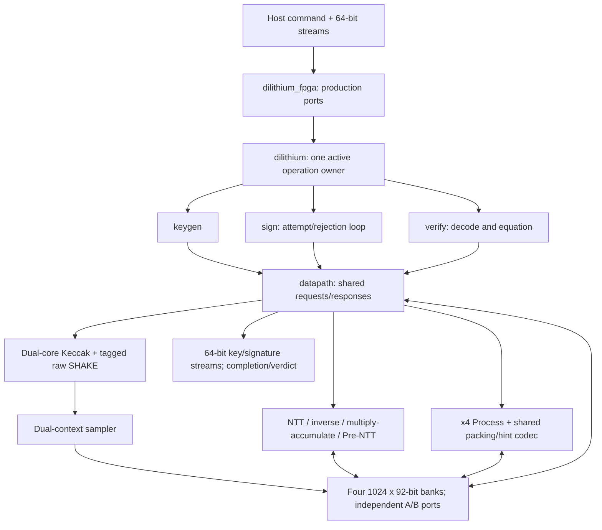

# Current Dilithium architecture

The design reconstructs the published LightHD organization with final FIPS 204
byte formats and local integration/pipeline decisions. LightHD RTL was not
available; source-identical replication is not claimed.

## Main control

`src/controller/dilithium.sv` accepts one public command at a time and grants
the selected KeyGen, Sign or Verify controller ownership of the shared
datapath. The main FSM uses IDLE, EXECUTE, RETIRE, ERROR_REPORT and HALT.
Registered owner selection matches that state decode. A second command is
not accepted while the current operation owns resources.

The selected child latches its command fields. Completion carries the accepted
job ID and is published only when the child completion and shared-resource
drain conditions agree. A fatal fault quarantines further work until reset.
Malformed host commands and normal signature invalidity are distinct outcomes.

## Shared engines and transport

Keccak accepts ordered 64-bit message words and supplies tagged 128-bit output
beats, including byte count, job ID and core identity. The hash/sampler boundary
keeps the two jobs separate and serializes bytes into the sampler's 64-bit
processing path. Raw hashes use the same physical cores. Having two cores does
not mean two independent public KeyGen/Sign/Verify commands execute together;
the operation scheduler issues eligible internal hash jobs.

The sampler handles uniform matrix coefficients, small secrets, mask values
and SampleInBall. Compact secret storage feeds the specialized Pre-NTT path;
general transforms and pointwise products use the shared NTT engine. Matrix
expansion produces the sampled NTT-domain matrix representation used by the
arithmetic schedule.

`datapath/process_dma.sv` reads four coefficients per 92-bit word, feeds the
elastic Process pipeline and independently credits low-result writes, packed
high results and hints. The shared BitPkg and hint codec serve operations at
different times. A private validated hint-mask cache supports Verify emission.
Two result slots retain the low coefficients, selected packing fields and
result metadata together. BitPkg checks all lanes for each supported format
in parallel, then selects the check for the requested format.
The integrated finite SHAKE input queue and formatting pipeline preserve data,
job identity, ordering and held-output stability under backpressure.

## Memory and storage lifetimes

The coefficient payload lives in four logical dual-port banks. Fixed roles
and phase schedules reuse addresses after earlier values become dead.
`helpers/dilithium_pkg.sv` defines the role map. `memory_router`, `memory`,
`memory_port`, request queues and `memory_banks` coordinate ownership,
physical issue, read responses and retirement. Admission is not the same
event as RAM commitment. See [MEMORY_MAP.md](MEMORY_MAP.md).

There is no separate public encoded-key RAM interface. Keys/signatures are
streamed with valid-byte count, index, last and ID. Verification returns a
completion-qualified valid/invalid result. Public/debug separation and the
full current port list are in [PIN_CONFIG.md](PIN_CONFIG.md).

## Current verification boundary

The production source list is `quartus/dilithium/dilithium_full.qsf`.
`tb/tb_dilithium/tb_main.sv` exercises that production boundary for file capture;
`tb_uvm/tb_uvm_dilithium/` contains the reusable full UVM environment. Focused
unit benches and independent references remain under `tb/tb_dilithium/`.
Current functional evidence does not establish timing closure, post-fit
equivalence, FPGA operation, side-channel resistance or fault-attack security.
