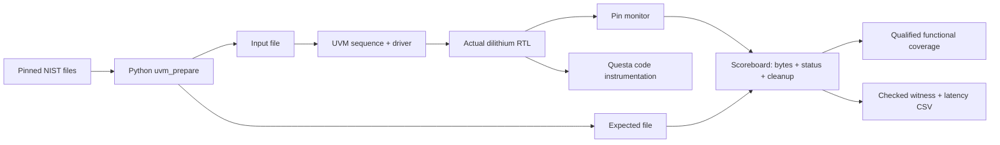

# Dilithium UVM coverage

Trial-by-trial history has been removed. Qualified evidence is retained in evidence/. Current measurements and active work are recorded in AGENTS.md and sim/dilithium/.

## Stage7A foundation and counting rules

Stage7B.1 reruns all33 scenarios with30 checked completions/3 resets and zero
errors. Its functional result stays121/170=71.18%; raw enabled DUT module
code is316363/399028=79.28%. The changed instrumentation scope and denominator
are not a verification gain. See the package-function limitation below.
Its separate59-case helper gate and118/118 checker faults pass; those are not
merged into main coverage. All30 completion timestamps match Stage7A exactly.

Completed first campaign: **30 checked completions and 3 reset aborts**, with
zero UVM errors/fatals. Functional coverage is **121/170 = 71.18%**. Raw DUT
code coverage is **314371/393251 = 79.94%**:

| Enabled kind | Hit / defined |
|---|---:|
|Statements|6759 / 7671|
|Branches|4581 / 5564|
|Conditions|994 / 2117|
|Expressions|1949 / 2946|
|Toggles|300088 / 374953|

No FSM counters were inferred in this run. Evidence is the completed
stage7a_uvm_diagnostic.log and copied stage7a_positive UCDB/code/functional
reports. All 33 scenarios ran; IterationLimit=200 is a delta-cycle limit.
The 30 checked outcomes include four keypairs (21216 bytes), seven signatures
(23132 bytes), thirteen Verify verdicts (4 valid/9 invalid), and six expected
command errors. The three reset aborts each have a checked recovery.
An accidental second positive invocation was stopped and overwrote the CSVs;
this checkpoint therefore makes no CSV latency claim. Regenerate those with
the next complete campaign. Its reports are not added to the completed run.

The actual full-operation main is instantiated in
`tb_uvm/tb_uvm_dilithium/tb_top.sv`: FULL_KEYGEN=1, ENABLE_SIGN=1,
ENABLE_VERIFY=1. This is a UVM agent with a sequencer, driver and independent
pin monitor, an output scoreboard, and a separate coverage subscriber.
The earlier focused integration benches do not supply these coverage numbers.



The input and expected files are separate. The driver reads original inputs;
the scoreboard alone reads the consolidated published expected outputs.
`dilithium_scoreboard::write` checks every accepted input byte and output
byte, IDs, word indices, valid-byte count, last flags, result codes/verdicts
and retry-counter consistency. Normal Verify equation cases require all
three frames; structural-invalid cases may stop after the checked signature
prefix. Results are held until the monitor observes retirement with an empty
memory pool. Only then does the scoreboard publish a coverage-qualified event.

Transport-tail observations accumulate privately during work. They are sampled
only after the corresponding operation has passed its result and retirement
checks. Expected command errors credit outcome coverage, not successful-operation
groups. A reset abort earns no success bins; reset/recovery coverage waits for
the subsequent independently checked successful command. No input stimulus
alone credits successful functionality.

| Group | What is observed and checked before sampling |
|---|---|
|operation_cg|Actual operation and parameter after checked completion/cleanup; all nine combinations|
|command_cg|Accepted ID, context and message sizes matching the original input fixture|
|outcome_cg|Checked successful, invalid-signature or expected-error outcome|
|transport_cg|Actual input blocking, output stalls and held completion observed at the pins|
|tail_cg|Actual accepted word sizes and checked input/output bytes; unused output tails must be zero|
|retry_cg|Published signature match and attempts/rejections/nonce consistency|
|sequence_cg|Ordered pairs of independently checked retired commands|
|memory_cg|Observed peak reserved regions, with all regions empty at retirement|
|reset_cg|Observed active-command reset followed by a checked recovery|

The initial model has **9 groups, 22 coverpoints, 8 crosses and 170 defined
bins**. Legal unhit cases remain visible. Fixed eight-byte encoded key words
and the absence of an encoded Verify output have explicit structural exclusions.
Unsupported prehash/external-mu/internal-message APIs are separately audited;
they are not claimed as covered functionality.

The monitor also checks single services ownership, refusal while busy/held
done, stable stalled inputs/outputs, unknown control and payload values,
no exposed debug traffic in full-key mode, unexpected faults and watchdogs.
These assertions are checks, not additional automatically covered bins.

## Running and viewing results

```powershell
# Repository root; regenerate after changing source/testbench/launcher.
python sim/dilithium/dilithium_vectors.py uvm_prepare
```

```tcl
# Questa GUI Transcript, cwd sim/
do dilithium/run_uvm.do
```

The GUI opens the Wave, Covergroups and code-analysis panes. At completion,
the same Questa Transcript prints raw functional hits/defined bins, a DUT
code summary and the overall raw DUT code total. Files under sim/dilithium/:
stage7_uvm.ucdb, stage7_uvm.wlf, stage7_uvm_functional.rpt,
stage7_uvm_code.rpt, stage7_uvm_checked.csv and stage7_uvm_latency.csv.
The CSV witness identifies each checked case and source fingerprint.

RTL modules compile with statement, branch, condition, expression, toggle
and FSM instrumentation. Report only counters enabled and present in the
actual DUT hierarchy; package/type files and the UVM environment are not added
to the DUT total. Overall code coverage is summed hits / summed enabled bins,
not a mean of percentages. Toggle bins may dominate. FSM state/transition
coverage exists only where Questa actually infers an FSM.

Stage7B.1 introduced executable checked_handle_set code in the service package.
That launcher excluded packages from instrumentation, so its raw DUT
module percentage did not include that function. The separate equivalence
gate verifies its behavior but is not merged into UVM coverage. Do not claim
an executable-RTL coverage improvement merely because code moved out of the
instrumented modules. Stage7B.2 resolves that reporting gap by instrumenting
the replacement handle_mask/handle_count functions and explicitly adding
their package counters once, as described above.

The separate instrumented equivalence run does report the package explicitly
using vcover report -package=dilithium_service_pkg: 9/9 statements, 4/4 branches
and 3/3 focused condition items. These are unit-only results over45841 cases,
not extra main-UVM credits and not a substitute for broader system stimulus.

The negative gate sets DILITHIUM_INJECT_BAD_KEY=1 before the same launcher.
It changes the first observed key byte before the scoreboard, requiring a
specific byte-mismatch failure, zero checked completions and 0/170 functional
bins. A compile/startup failure does not qualify as a successful negative gate.

## Remaining campaign work

This is the first whole-main UVM checkpoint, not verification closure. Expand
input framing errors, child error/publication faults, reset phases during
sampling/NTT/packing/held outputs, all ordered operation pairs, ID wrap/reuse,
message/context/tail boundaries, long retry/rejection paths and varied stalls.
Add checked internal ownership, bank hazards and detailed service/NTT phase
observations as these tests are brought into the main UVM. Keep the broader
feature list in INTEGRATION_VERIFICATION_TESTPLAN.md. Classify code misses
from the actual report before proposing RTL changes or exclusions. Do not
invent unreachable bins or suppress hits to meet a requested percentage.
