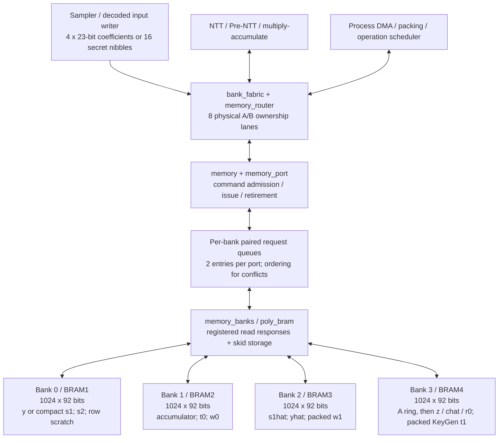

# Current polynomial memory

## Geometry and data representation

The coefficient store is **four logical dual-port banks, each 1024 words x
92 bits**. Each word contains four canonical 23-bit coefficients. One 256-term
polynomial occupies 64 full-coefficient words. Total payload is 376,832 bits =
47,104 bytes. Logical banks are not individual FPGA M10K blocks; physical block
usage must come from the current fitted report.

Compact small secrets use 16 low-64-bit words per polynomial, each holding
16 signed nibbles. Packed high parts also use low-64-bit words in the same
arrays. These are phase-specific encodings, not separate polynomial RAMs.

## Fixed roles and reuse

`src/controller/helpers/dilithium_pkg.sv` is the executable role/address map.
Rows k and columns l vary with the level. Ranges below are maximum capacities;
different phases own them at different times.

| Bank | Word addresses | Role |
|---|---|---|
| 0 | 0..447 | y, or raw compact s1 during the relevant phase |
| 0 | 448..959 | s2; Verify shifted t1 and its transform |
| 0 | 960..1023 | Row coefficients / challenge and product scratch |
| 1 | 0..63 | Row accumulator; reusable final w0 slot after accumulator retirement |
| 1 | 64..575 | t0; Verify decoded hint polynomial storage |
| 1 | 576..1023 | First seven w0 polynomials |
| 2 | 0..447 | s1hat; Verify z and its transform |
| 2 | 448..895 | yhat |
| 2 | 896..1023 | Packed w1; Verify cached challenge uses 896..959 |
| 3 | Bounded phase ring | Ahat polynomials; up to 9 slots for levels 2/3 and physical 16-slot bound for level 5 |
| 3 | 0..447 | z after matrix values become dead |
| 3 | 448..511 | chat after matrix values become dead |
| 3 | 512..1023 | r0 after matrix values become dead |
| 3 | 576..895 maximum | Packed KeyGen t1, disjoint from the nine-slot KeyGen A ring |

KeyGen's A ring occupies words 0..575; packed t1 uses 40*k words starting
at 576. In Verify, packed reconstructed w1 uses bank 1 from 576: 96 words at
levels 2/3 or 128 at level 5. The controller schedule, not this static table
alone, establishes when overlapping roles may be overwritten.

## Ports, queues and retirement

Each bank has independent A/B physical ports. `memory_router` arbitrates
NTT, sampling and Process/host clients and retains each port owner through
completion/renewal. `memory` contains two command schedulers; it is not the
RAM array itself. `memory_banks` connects four `poly_bram` arrays and paired
request queues. `bank_fabric` joins routing and storage for the shared datapath.

Each port's request payload is write + 10-bit address + 92-bit data. Two-entry
queues and per-bank age ordering stop younger conflicting accesses bypassing
older work. Registered RAM responses and skid storage retain stalled data.
Command admission, queued request acceptance, physical RAM issue, response
consumption and final retirement are distinct events. Do not treat an admitted
write as already committed. A consumed completion must not lose a same-owner
renewal reservation when the other port renews on another clock.
Each physical port records completion acknowledgement before changing
ownership. Arbitration uses the port masks captured with each command,
and dispatch checks that the request is still live. The router retains an
acknowledged completion while a staged same-owner command waits to renew it.

Read modes include sequential, stride-two, repeated compact Pre-NTT words and
natural-order compact secret groups. Tagged sampling writes can use producer
addresses within a bounded command. Commands validate counts, bounds and masks.
Reset clears ownership/validity and discards unissued requests; already committed
RAM writes remain. Required destinations are initialized before their results
can be published; stale payload must never gain valid credit.

## Storage outside coefficient banks

Scalar seeds/digests, transport queues, the sparse hint suffix, its 2048-bit
validated mask cache and NTT-internal storage are separate from the four-bank
payload capacity. Their register/block-RAM mapping is synthesis-dependent.
Encoded keys and signatures stream out through production ports rather than a
public encoded-key memory. See [ARCHITECTURE.md](ARCHITECTURE.md) and
[PIN_CONFIG.md](PIN_CONFIG.md).
