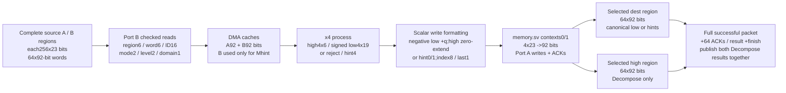
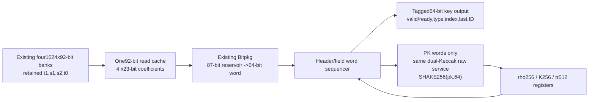
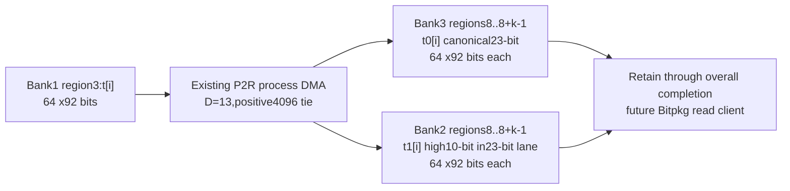
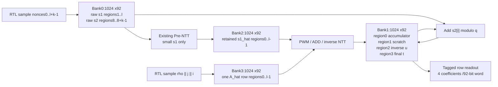
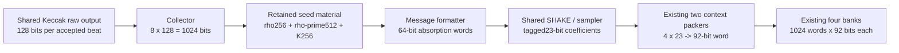
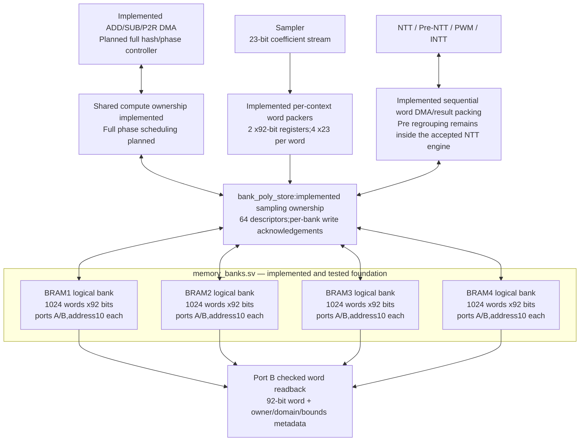
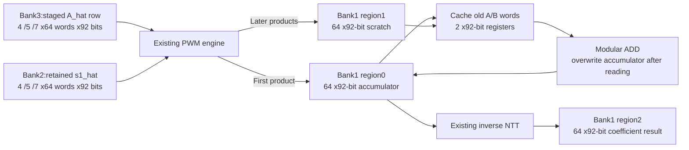
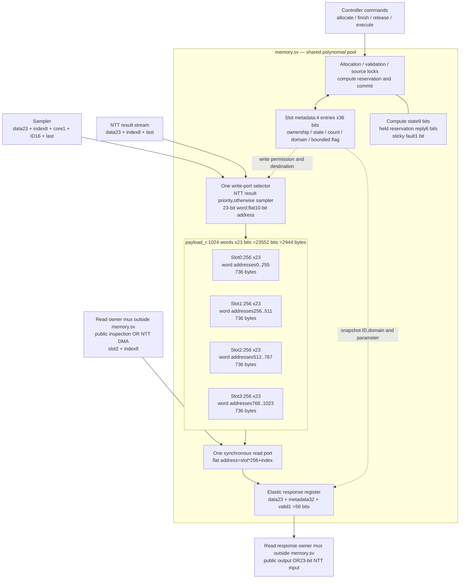

# Dilithium polynomial memory

## Stage5N.3 signing-process use of the existing four banks

Geometry and accepted KeyGen allocations below are unchanged. Signing process
commands select free scratch regions;the complete signing lifetime map is
pending its schedule. No permanent new RAM or regions are reserved here.

CNB allocates no destination. Decompose uses two scalar packing contexts;
Mhint uses context0. Sources are leased from command acceptance through done
retirement. Results stay private until success;late metadata/high/data errors
discard all owned partial results with finish_code!=0. Reset invalidates
ownership;old physical BRAM bits cannot be read as complete objects.
Full stored high23 is validated before6-bit narrowing. Production arbitration
enforces leases/publication. The historical Stage5N.2 boundary follows.

Stage5N.2 adds standalone x4 signing arithmetic but does not change this memory
map or allocate new regions. Each92-bit word naturally supplies its four23-bit
input lanes. Future DMA must store Decompose lows as canonical23-bit residues,
zero-extend highs,and keep tentative results unpublished until a full packet
passes. Sign-process protocol errors invalidate earlier tentative output.
CNB/Mhint per-polynomial reductions still need vector-level owner/control.

Stage5N.1 moves the physical banked service under dilithium.services.datapath.
All bank dimensions,regions,packing,IDs and lifetimes below remain unchanged.
KeyGen owns the services through post-completion cleanup,including cycles when
the main FSM is IDLE but the child is still busy freeing regions. The common
request/response records carry existing memory ports at full width;they add no
memory. See ARCHITECTURE.md for the main-owned service diagram.

## Stage5L full-key read ownership and cleanup

The full-key encoder owns the existing public bank-read client while the
polynomial scheduler holds its final REPORT state. No source region is freed
until the complete key-output operation retires. Reads are serialized through
one92-bit word cache;four23-bit coefficients feed the existing Bitpkg.
The packer has its existing87-bit reservoir. Additional encoder payload
registers are rho256,K256 and tr512;there is no whole encoded-key buffer.

| Encoding section | Bank regions | Source ID | Field format |
|---|---|---|---|
|0:PK t1|flat40+i =bank2/local8+i|base+768+i|10 bits/coefficient |
|1:SK s1|flat1+j =bank0/local1+j|base+16+j|eta-s,3 or4 bits |
|2:SK s2|flat8+i =bank0/local8+i|base+16+l+i|eta-s,3 or4 bits |
|3:SK t0|flat56+i =bank3/local8+i|base+768+i|4096-low,13 bits |

Every read verifies region,word,ID,level,coefficient domain and provenance
mode before feeding its cache. Headers come from retained rho/K/tr registers.
The encoder starts only after all matrix rows finish and their temporaries
are released;shared Keccak absorption cannot block future matrix sampling.
PK data is forked to host and hash with two acknowledgement bits;memory/packer
advancement waits for both. SK only requires output acceptance.

At successful overall retirement,the previous cleanup order is retained:
raw s1,transformed s1,s2,t0 and t1. The next command is accepted only after
reservations return to zero. Reset clears descriptors/handshakes,not RAM
payload bytes. Exact complete key comparison validates used field values;
the11179 encoder-read count also includes metadata-checked abort prefixes,
not a separate claim of11179 logged raw-word value comparisons.

## Stage5K retained P2R arrays

ROUND_OUTPUTS=1 extends the existing KeyGen schedule without adding banks:

| Flat regions | Physical logical bank / local region | Contents |
|---|---|---|
|40..40+k-1|Bank2 /8..8+k-1|t1[i],10-bit high zero-extended in23-bit lanes |
|56..56+k-1|Bank3 /8..8+k-1|t0[i],signed low represented canonically modulo q |

Each polynomial still occupies64 x92 bits =736 bytes. At level5,the arrays
occupy8 x736=5888 bytes each,total11776 bytes. This is existing coefficient RAM
allocation,not the eventual packed key-byte size. Bank2 regions0..l-1 retain
s1_hat;bank3 regions0..l-1 stage the current matrix row. Since l<=7,the new
regions8..15 cannot overlap either existing client.

The process client acknowledges both64-word writes and atomically exposes the
pair before row publication. Row t/u/matrix release does not release these
arrays. Following overall completion acceptance and pending-read drain,the
scheduler releases raw s1,transforms,s2,then all t0 regions and all t1 regions.
The rounded test reads every retained field and exercises resets/reuse.
Future full-key serialization must consume the arrays before accepting overall
completion. No encoded-key RAM is allocated by the standalone Bitpkg block.

## Stage5J autonomous KeyGen live ranges

Active controller:`src/controller/memory.sv` (module memory),formerly named
bank_poly_store. Physical geometry remains four1024x92-bit banks. Primitive
helpers move to controller/memory/;the former scalar memory moves to
legacy/slot_memory.sv. Historical sections retain the names used in their
evidence snapshots.

| Flat region | Bank / local region | Contents / lifetime |
|---|---|---|
|1..l|0 /1..l|Raw s1;preserved through overall completion |
|8..8+k-1|0 /8..8+k-1|Raw s2,nonce=l+i;preserved through overall completion |
|32..32+l-1|2 /0..l-1|Pre-NTT(s1);computed once,reused across all rows |
|48..48+l-1|3 /0..l-1|Current A_hat row;released after its t row is consumed |
|16|1 /0|Transform accumulator;row scheduler releases after inverse |
|17|1 /1|One PWM product scratch;released after each accumulator ADD |
|18|1 /2|Inverse row u;held through final s2 addition and row consumption |
|19|1 /3|t=u+s2[i];caller reads before accepting row result |

Each region is64 words x92 bits =256 x23-bit coefficients =736 bytes.
At level5,raw s1 uses regions1..7 and raw s2 uses8..15,which do not overlap.
This is a derived KeyGen allocation using the selected LightHD bank geometry,
not a claim that the paper publishes these exact KeyGen address tables.

After each accepted t row,the controller waits for pending public reads,then
releases t,u and that matrix row. The next row reuses the same regions.
It never regenerates or retransforms s1 between rows. After overall completion
is accepted,it waits for pending reads,then releases raw s1,s1_hat and raw s2.
Future key encoding must consume those secrets before this final cleanup;
the current polynomial-phase output is not a complete key object.

IDs are16-bit:seed=base;secret=base+16+nonce;transform=base+64+j;
matrix=base+128+8*i+j;row=base+256+32*i;t=base+512+i.
All arithmetic wraps modulo65536. Existing row helper allocates intermediate
IDs inside each32-ID row interval. The ID65500 regression checks wrap.

## Stage5I seed state;coefficient-bank geometry unchanged

The seed source retains 1024 payload bits outside coefficient RAM:rho256,
rho-prime512 and K256,plus validity/level/command control. Seed collection
uses the existing 1024-bit collection register before copying the accepted
result. The sample formatter snapshots its 512-bit seed input as before.
These are logical register dimensions,not fitted resource estimates.

No bank regions or encoded-key buffers are newly allocated by this stage.
The Stage5H layout below is reused for raw/transformed s1,staged matrix rows,
accumulator,scratch and inverse output. The caller still provides FREE
destinations. Raw seed expansion never allocates a polynomial region.
Seed state reset does not imply secure erasure of bank payload RAM.
Future s2/key-output lifetimes require the main-controller schedule.

## Selected architecture — LightHD four-bank storage

**User decision2026-10-20:**follow LightHD's published memory architecture and
reuse schedule. This supersedes the ten-slot/cached-secret and four-slot/
regeneration proposals below. Neither old proposal is selected. The first
implementation includes the tested bank foundation,Stage5E connected sampling
adapter,Stage5F banked NTT DMA/result writeback,Stage5G process DMA and Stage5H
row reuse. The old Stage4 top remains
a scalar regression/synthesis baseline;selector5/bank_ntt uses the new banks.

### Published geometry and our implementation

Source:LightHD SectionIII-B,Figure2,and SectionIV/Figure7. The paper's Figure2
and7 were visually inspected. Geometry is four independent **logical** banks,
not four physical Intel M10Ks. Each bank contains94208 bits=11776 bytes;
total376832 bits=47104 bytes=**46 KiB**. A full23-bit polynomial occupies
64 words=5888 bits=736 bytes. Thus one bank has16 full-width polynomial-sized
regions,and the whole array has64 such capacity equivalents. Actual regions
have phase-specific purposes and some fields use narrower packing.

The new foundation consists of poly_bram.sv(one bank) and memory_banks.sv(four
instances). It has eight independent handshake ports,two per bank. Full-word
writes avoid read-modify-write for individual23-bit coefficients. Lane0 is
word[22:0],lane1[45:23],lane2[68:46],lane3[91:69]. A natural-order polynomial
uses word base+floor(index/4),lane=index mod4. LightHD's Pre regrouping is a
separate address/packing transformation;the bank primitive does not perform it.

| Primitive port contract | Meaning |
|---|---|
| Port indexing |[port][bank];port0=A,1=B;bank0..3=paper BRAM1..4 |
| Request |valid,ready,write1,address10,data92 |
| Read response |Synchronous registered data92,address10,write0,valid/ready |
| Write response |Registered acknowledgement,address10,write1;response data unspecified |
| Backpressure |One response slot per port;can consume old response and accept a new request on the same edge |
| Independent banks |All eight ports can accept simultaneously when addresses/response space allow |
| Same-bank same-address read/read |Both accepted |
| Same-bank same-address pair containing write |A wins that edge;B holds until ready;no device-dependent mixed-port collision |
| Reset |Cancels requests/responses,not memory contents;ownership controller must prevent stale publication |
| Payload validity |Unwritten word data unspecified;primitive has no polynomial/domain/ID checks |

Collision serialization and elastic handshakes are our control implementation;
the paper does not publish complete RTL. Continuous conflicting A requests may
delay B indefinitely;the main scheduler must give bounded port grants. Each
port can otherwise accept one operation per cycle. No physical RAM inference,
M10K count,Fmax or area is claimed before a new synthesis.

### Stage5F compute ownership and packed DMA

keccak_sampler_ntt_banks is the tested sequential owner of bank_poly_store.
Compute descriptors name flat6-bit A,B and destination regions,source IDs16,
result ID16 and operation2. Flat region is {bank2,region4};each region contains
64 natural-order92-bit words. These are caller-selected addresses,not an
automatic whole-algorithm allocator or a second scalar polynomial payload array.

| Step | Ownership/data behavior |
|---|---|
| Accept |Wait until sampler jobs/status drain and external read retires;lease A and B(for PWM) immediately |
| Validate |Read word0 metadata;check committed source/ID,domain,parameter compatibility and actual small bounds for Pre |
| Reserve |Reject destination equal to a used source;otherwise wait for selected region FREE;unrelated completed regions may release |
| Load |One held92-bit word gives four23-bit scalar beats;64 words per unary operation,128 for PWM(A then B) |
| Writeback |Reuse context0 packer after sampling drains;256 scalar results become64 full-word writes through bank port A |
| Publish |Wait for all64 write acknowledgements plus engine completion;inherit source mode/parameter,use result ID and operation-derived domain |
| Retire |Hold completion and protect destination/source regions until its handshake;then source leases clear |
| Reset |Clear leases,descriptors,packers and response ownership;old RAM payload remains unreadable until a new complete job |

Code0=success;1=missing/stale source;2=domain/parameter/Pre-bound violation;
3=destination aliases a used source. A busy distinct destination is backpressure,
not a command error. Internal malformed write/order/count violations raise sticky
fault and require reset. The wrapper blocks external reads during compute and
masks leased sources from complete_o;the store retains their committed metadata
for DMA. There is one storage controller,so no independent client may bypass
these release/read guards. The destination's small flag is recomputed from actual
results;NTT/Pre/PWM set transform domain and INTT sets coefficient domain.

Checked:16 sample jobs,54 operations(30 successful,21 rejected,3 aborted),2944
exact92-bit reads and2952 physical writes/2951 acknowledgements. Thirty successful
computations account for1920 result words;the reset during writeback accepted8
additional words and7 acknowledgements. No phase-specific packed w1/key/hint
allocator or full KeyGen schedule is claimed. Process-block bank routing is next.

### Stage5G process DMA and Power2Round storage

The optional process client in keccak_sampler_ntt_banks shares this same store;
no extra bank or polynomial array is added. It caches two92-bit source words.
Process commands name operation2,A/B regions6,A/B IDs16,result ID16,low/residue
destination6 and high destination6. Opcodes0 ADD,1 SUB,2 Power2Round;3 rejects.

ADD/SUB lease both sources,validate identical domain/parameter metadata,and
reserve one distinct destination. P2R leases A,requires coefficient domain,and
waits for both selected destinations to be free. Destinations must differ from
A and each other;B is ignored for P2R. The controller then allocates packer0 for
residue/low and packer1 for high. Sampling/NTT cannot accept while this client
owns storage. Unrelated completed regions may release to unblock a destination.

| Output | Stored representation | Domain / lifetime |
|---|---|---|
| ADD/SUB |Four23-bit canonical residues/92-bit word;64 words |Same domain as operands;result lease through held completion |
| P2R low |Signed low converted modulo q;four canonical23-bit values/word;64 words |Coefficient domain;eligible for subsequent ordinary NTT |
| P2R high |Zero-extended10-bit high in each23-bit lane;64 words |Coefficient domain;t1 role owned by the schedule,awaiting key packing |

The source mode/parameter are inherited for provenance. They do not mean t1 is
a newly sampled secret. This is an initial full-width temporary layout,not final
10-bit public-key/13-bit secret-key byte packing. No encoded-key buffers are
silently allocated. The source and result regions are retained until explicit
release or reset;phase scheduling will assign their LightHD roles/lifetimes.

Both P2R outputs wait for256 scalar writes and64 acknowledgements each. Low
and high commit on separate internal handshakes,while the public complete mask
hides the pair until both have committed. Reads are exclusive to the client;
destination/source release stays blocked until completion acceptance. Reset
after low commit invalidates both. Actual partial-publication snapshots are
captured and independently checked,including a reset before the high commit.

Status0 success,1 missing/stale source,2 domain/parameter mismatch,3 destination
alias,4 invalid opcode. Busy distinct destinations wait. Internal arithmetic
tag/index/error violations halt the client and all new commands until reset.
Checked:71 process commands,34 successes,33 rejections,4 aborts plus15 real NTT
commands and23 samples. Full row/phase scheduling remains next.

### Stage5H row workspace and destructive accumulator reuse

The tested row layout below is derived for this compute gate,not presented as
LightHD's complete KeyGen address table. The four-bank geometry is unchanged.
Rows are fully staged before arithmetic;the sources are retained through row
completion. The caller selects all region addresses through descriptors.

| Logical bank | Local regions / word addresses | Tested role |
|---|---|---|
| Bank0 / BRAM1 |regions1..7,words64..511 |Raw sampled s1 coefficients,retained for later encoding |
| Bank1 / BRAM2 |region0,words0..63 |One transform-domain row accumulator;freed after inverse NTT |
| Bank1 / BRAM2 |region1,words64..127 |One PWM product scratch;freed after every accumulation |
| Bank1 / BRAM2 |region2,words128..191 |Coefficient-domain row output u;retained for caller consumption |
| Bank2 / BRAM3 |regions0..6,words0..447 |Retained transformed s1,from ordinary NTT or eligible Pre-NTT |
| Bank3 / BRAM4 |regions0..6,words0..447 |One staged matrix row,4/5/7 polynomials;released/restaged between rows |

Negative tests temporarily use region62 for a deliberately wrong-parameter
matrix polynomial. No full matrix or extra encoded-key buffer is allocated.
Future s2,t0,packing and Sign roles must respect the published phase lifetimes;
this provisional row layout is not a final whole-operation allocator.

process_inplace_i=1 explicitly allows ADD/SUB only when destination equals A.
The ordinary flag0 path still rejects source aliasing;P2R never allows it.
After source ID/domain validation,the store rebinds A to the new result ID and
marks it WRITING. Private reads may access only untouched words:4*read_word >=
accepted scalar write count. The DMA loads both source words before writing
any lane and advances sequentially;written/partially overwritten words cannot
be reread as old source data. The old A version is consumed;B remains retained.
In-place ADD is exercised in this row gate;in-place SUB is not part of its
workload. Reset invalidates the partially rewritten descriptor,not RAM payload.

The row owner blocks external jobs,compute,reads and releases while active.
All used source descriptors and its three workspace regions remain leased.
Internal scratch/accumulator releases are routed by the row owner;they cannot
free a retained matrix/secret region. The coefficient output becomes visible
only at whole-row completion and cannot release until that completion retires.
Busy/overlapping workspace is rejected before arithmetic rather than waited on.
Completed rows free accumulator/scratch and retain output/sources. Stage5H
checks6918 old-word reads and12544 exact public word responses without adding
payload RAM. Full phase scheduling and physical RAM inference remain future.

### Figure2 region map — peak Sign configuration

Offsets below are92-bit **word addresses**,derived from the figure's stacked
region depths. This is the published Sign-phase layout,not a claim that the
paper supplies a complete KeyGen address/FSM table. Unused regions and buffer
depths depend on level and phase.

| Paper bank | Word addresses | Depth | Figure2 role |
|---|---|---:|---|
| BRAM1 |0..447|448|y,seven polynomials |
| BRAM1 |448..959|512|s2,eight polynomials;secret cache region |
| BRAM1 |960..1023|64|Remaining region |
| BRAM2 |0..63|64|One reusable row accumulator /w0 temporary |
| BRAM2 |64..575|512|t0,eight-polynomial secret/transform cache |
| BRAM2 |576..1023|448|Other seven w0 components |
| BRAM3 |0..447|448|s1,seven-polynomial secret/transform cache |
| BRAM3 |448..895|448|Transformed y,seven polynomials |
| BRAM3 |896..1023|128|Packed w1 region |
| BRAM4 |0..447|448|z,seven polynomials;phase-reused matrix buffering |
| BRAM4 |448..511|64|Transformed challenge;phase-reused matrix buffering |
| BRAM4 |512..1023|512|w0-c*s2;phase-reused matrix buffering |

### Scheduling that the controller must implement next

- Retain s1,s2,t0 for subsequent signing;after their initial transforms,lock
  transformed secret regions for reuse in retries/future operations as permitted
  by the current key. Domain metadata must distinguish raw and transformed data.
- Generate matrix entries into a bounded BRAM4 staging region while earlier
  entries are consumed. The paper specifies a9-polynomial circular A buffer
  for levels2/3;do not extend that number to level5 without deriving its schedule.
- Compute matrix-vector products **row by row**. Reuse the same64-word BRAM2
  accumulator region across columns,then INTT/process/store the completed row
  before reusing it. This avoids retaining all product polynomials.
- Interleave A and s2 sampling during KeyGen to respect A staging capacity.
  Sampling/NTT overlap and early launch come with their port/ownership proofs;
  the current legacy sequential top does not provide them yet.
- Preserve final FIPS204 seed/hash/key bytes with level2/3/5 labels. The paper's
  pseudocode is not the selected byte-exact standard contract.

KeyGen offsets and release/overwrite times must be derived from its actual
live ranges,then checked before connection. A bank capacity decision does not
authorize an unproved overwrite. Extra7488-byte encoded-key buffers from the
old proposal are not automatically allocated. The paper does not define our
external key-byte transport;its final-standard packer/delivery contract will be
specified when the controller is connected.

### Stage5E connected sampling and ownership — implemented

`keccak_sampler_banks.sv` connects the real Keccak/sampler helper to
`bank_poly_store.sv`,which owns the same four memory_banks instances. The caller
chooses bank[1:0] and region[3:0] at job acceptance. Each region is one aligned
64-word polynomial. This is controller-addressed storage,not an automatic
free-list allocator. Role assignment for the complete KeyGen/Sign schedule
remains future work.

| Stored control | Dimensions | Purpose |
|---|---|---|
| Region descriptors |64 entries x33 logical bits|state2,mode2,parameter2,ID16,count9,domain1,bounded1 |
| Context-to-region ownership |Two valid bits plus two6-bit region numbers|Bind each live sampling core to its destination |
| Word packers |Two92-bit words plus full/sent flags and6-bit word indices|Keep interleaved contexts' partial coefficients separate |
| Acknowledgement counts |Two7-bit counters|Count0..64 committed write responses |
| Pending bank writes |Four valid bits plus four owner bits|At most one packed word awaiting acknowledgement per bank |
| Read response |92-bit data plus35 metadata/error bits|Hold address,ID,mode,parameter,domain,bounded flag and error under stall |

Natural-order coefficient index i writes lane i mod4 of word floor(i/4).
Only a complete group of four coefficients creates a bank write. The write
address is `{region4,word6}`. A full packed word stays stable until its bank
write acknowledgement returns;the selected context pauses rather than
overwriting it. Other already-packed words and the read port may progress;
the sampler's shared output can still stall behind its held context. Requests to
the same bank choose context0 first;each sampling job is bounded to256 values.

Publication requires **all** of:

1. 256 canonical,correctly indexed/tagged coefficients,with last only at255.
2. 64 packed writes acknowledged;no complete word remains pending.
3. Successful matching external sampling status handshake after hash drain.

The64-bit reserved/complete masks distinguish FREE,WRITING and COMPLETE regions.
Expected sampling errors free the reservation once pending full words drain;
partial packing is discarded. Normal backpressure is not an error. Wrong owner,
noncanonical/misframed/extra coefficients and premature/wrong-ID success set
sticky fault;publication/new work halt until coordinated reset. These are
internal protocol violations,not ordinary parameter-error responses.

Public read commands name bank2,region4,word6. Only COMPLETE regions return
data. Other requests return an error with zero ID/mode/parameter/domain/bounded
metadata. The controller has one outstanding checked read:request -> synchronous
bank response -> held external92-bit response. It checks the returned bank
address/type and snapshots owner metadata. A new read waits until the previous
response is consumed. Release waits for any matching read/response,and a
same-edge accepted read has priority over release. Successful release marks
the region FREE without clearing RAM. Reset invalidates descriptors,context
packers and pending responses;old RAM bits cannot become readable as a new job.

This path does not yet implement NTT source leases,compute-result writeback,
in-place row accumulation or the LightHD Pre regroup adapter. Narrow packed
w1/key/hint fields also need their own range/phase ownership policy;these
aligned canonical-polynomial descriptors do not define it. Those must be
connected before replacing the old Stage4 all-engine top. No new synthesis or
physical RAM mapping is claimed.

Measured:104 jobs,88 successful polynomials,8 expected parameter errors,8 reset
aborts.23173 input comparisons=22528 completed coefficients+645 aborted prefixes.
5792 packed writes=5632 completed words+160 aborted-job words.5790 acknowledgements
=5632 completed words+158 aborted-job words;two writes are reset before their
acknowledgements are accepted. Five accepted prefix coefficients never form a
full word. All5632 completed92-bit words read back exactly(22528 coefficients).
All64 regions fill,then are protected/reused across the workload;24 combinations
of core/mode/parameter are observed. Witnesses:8 occupied-region stall cycles,
1070 held-read cycles,50 read/coefficient-write overlaps,2 resets of held valid
read responses(successful and error),11 invalid reads. Eight injected protocol
fault kinds are contained;12 Python capture corruptions are rejected.

### Stage5D foundation verification

14872 accepted requests,14864 responses:9509 exact92-bit reads,5355 write
acknowledgements,and8 accepted writes whose pending acknowledgements are reset.
Eight additional blocked request offers are canceled without acceptance. All
4096 bank words are initialized and read;random traffic covers both ports/all
banks. Payload retention and canceled-write absence are checked after reset.
Witnesses:73 collisions serialized,4112 dual same-address read pairs,1031 cycles
with all eight ports accepting,3075 request stalls,3034 response stalls and14807
response replacements. Twelve checker corruptions are rejected. No keygen/
main-top migration,BRAM mapping or full-operation output is claimed by this gate.

## Preserved Stage4 implemented memory — four-slot configuration

The diagram below describes `src/controller/memory.sv` inside
`keccak_sampler_ntt`. It shows logical storage and interfaces. Physical M10K
packing for this subsystem has not been measured. Four slots are four regions
of **one declared1024 x23-bit array**,not four independently accessible RAMs.

Arrows into the pool use one selected write address;the four slot boxes are
not parallel write ports. A read accepts at most one request per cycle,and its
response is available after the clock edge. A blocked response prevents another
read unless it is consumed on that edge. The legal source/destination states
prevent reading a partially written slot. Engine-private FIFOs are separate.

### Storage and bus dimensions

| Storage/interface | Width | Depth / count | Contents and role |
|---|---:|---:|---|
| Shared coefficient payload |23 bits|1024 words|Four256-coefficient polynomials |
| Per-slot metadata |36 bits|4 entries|Fields below;not included in2944 payload bytes |
| Read response |56 bits total|1 entry|23 data +32 metadata/error +1 valid |
| Compute ownership state |9 bits|1 operation|active1,opcode2,A-slot2,B-slot2,destination2 |
| Compute reservation reply |6 bits|1 entry|valid1,code3,slot2 |
| Protocol fault |1 bit|1|Sticky until coordinated reset |
| Read/write coefficient index |8 bits|Each transaction|Index0..255 within slot |
| Slot selector |2 bits|Each transaction|Slot0..3;not a job ID |
| Flattened word address |10 bits|Each payload access|slot*256+index;no byte-address bus |

Metadata per slot:state2,mode2,parameter2,core1,poison1,ID16,count9,
compute-destination1,NTT-domain1,small-coefficient1 =36 bits. Four entries use
144 logical bits. Response metadata/error32 =slot2+index8+ID16+mode2+parameter2+
domain1+error1. The dimensions count declared logical fields,not fitted area.
For another SLOTS value,slot/address widths and metadata total change.

### What enters and leaves

1. **Sampler allocation:**reserve FREE slot;capture core/ID/mode/parameter.
   The output slot number tells the controller where the polynomial will live.
2. **Sampler writes:**tagged23-bit coefficients enter in order0..255. Their
   tags select the reserved slot. Memory checks canonical value,index and last.
3. **Sampling publication:**matching successful retirement plus256 prior writes
   changes WRITING to COMPLETE. Receiving coefficient255 alone is insufficient.
4. **NTT operation:**validate and lock one/two COMPLETE source slots as IN_USE;
   reserve a distinct FREE destination as WRITING. DMA reads source coefficients
   through the one response path and passes them to NTT. PWM loads A then B.
5. **Writeback:**256 tagged-by-reservation NTT results use the write selector.
   Engine completion commits the destination and unlocks the source slots.
6. **Inspection/release:**read COMPLETE slots via the public response;release
   only after consumers finish and no same-slot response remains pending.

Sampling and NTT are scheduled sequentially in the current top. The memory
write selector defines result priority,but does not itself implement concurrent
system scheduling. Allocation/execute replies and coefficient read responses
are separate handshakes. Faults invalidate affected work and require reset.

### Other storage boundaries

| Location | Logical storage | Relationship to the shared pool |
|---|---|---|
| Keccak |Two1600-bit permutation states plus input/output/control registers|Produces tagged128-bit hash beats;not polynomial slots |
| Keccak-to-sampler bridge |Two128-bit payload entries plus byte-count/core/pointers|Temporary hash beats,not persistent polynomials |
| Sampler |Per-context parsing/collection state;Ball512 x2-bit memory|Private implementation;see sampler SPECIFICATION.md |
| NTT coefficient FIFOs |32 x92,32 x92,16 x92 bits|Private working words,each packs four23-bit coefficients |
| NTT second PWM operand |64 x92 bits|Private256-coefficient operand copy |
| Seed collection |128-byte expansion result:rho32,rho-prime64,K32|Implemented in keygen_seed_collect;separate from polynomial pool;focused shared-service gate PASS |
| Encoded keys/signatures/message buffers |Not implemented or sized yet|Require an explicit storage/interface decision |

Do not sum these logical capacities into a physical M10K claim or assume they
replace encoded-key storage. Reset of the pool clears ownership and response
validity,not the payload;it prevents stale publication and is not secure erasure.

## Superseded ten-slot proposal — not selected or implemented

The earlier recommendation was to instantiate the configurable pool with **10 slots** for the
first full KeyGen controller,cache all transformed s1 polynomials,and add
separate addressed byte buffers for encoded public/secret keys. This proposal
was superseded by the user's LightHD memory decision above;the legacy connected
top remains at four slots until migration.

| Proposed storage | Logical capacity | Reason |
|---|---:|---|
| Polynomial pool |10 x256 x23 =58880 bits =7360 bytes|Largest l=7 cached transforms plus3 temporary slots |
| Public-key buffer |2592 x8 bits =2592 bytes|Largest level5 encoded public key;hash it to form tr |
| Secret-key buffer |4896 x8 bits =4896 bytes|Retain encoded secrets/t0 while tr is produced;deliver only after completion |
| Expansion collector |128 bytes|rho32,rho-prime64,K32;not polynomial slots |

This is14976 logical data bytes in total,excluding metadata/control and other
engines' private storage. Physical RAM block use is not measured. Compared to
the current four-slot payload,the ten-slot pool adds4416 logical bytes.
No signature/message buffer is included;Sign/Verify schedules may require
additional capacity and a separate decision.

| KeyGen phase | Largest live polynomial set |
|---|---|
| Build s1 cache |Already cached transforms + current sampled s1 + new transform;at most l+1 |
| Multiply a later matrix column |l cached transforms + accumulator + current A_hat + product =l+3 |
| Accumulate |l cached transforms + old accumulator + product + new accumulator =l+3 |
| Inverse row |l cached transforms + transform accumulator + INTT output =l+2 |
| Add s2 |l cached transforms + INTT output + s2 + resulting t =l+3 |
| Round/pack row |l cached transforms + t;stream both t1/t0 into key buffers before releasing t |

Pack each sampled s1 into its secret-key buffer position before releasing its
coefficient slot;keep only its transform in the cache. Pack s2 likewise before
releasing its temporary slot. Matrix entries are generated on demand and freed
after PWM. Source/result slots stay distinct. Modular ADD and round/pack routing
are still unimplemented;this table sizes their required lifetime rather than
claiming a completed schedule.

Cached s1 needs l forward transforms:4/5/7 for levels2/3/5. Regenerating it for
every row requires k*l=16/30/56. This recommendation saves12/25/49 forward
transforms and the corresponding repeated sampling;PWM/INTT counts are unchanged.
These are algorithmic counts,not measured cycle reductions.

Proposed byte offsets are public key rho[0..31],then t1 row i at32+320*i;
secret key rho[0..31],K[32..63],tr[64..127],then s1 at128,s2 at128+l*eta_bytes,
and t0 at128+(l+k)*eta_bytes. eta_bytes is96 or128 by parameter. Fill tr after
hashing the complete public key. Keep key-valid false until all fields are
written and checked;reset cancels pending keys. External command/key-transfer
ports will be specified before implementation;these offsets are internal.

Alternative:keep four slots and the same encoded-key buffers,but regenerate
s1 for each row as below. This saves coefficient capacity at a higher compute
cost. Neither alternative is adopted by merely documenting it.

## Earlier four-slot KeyGen live-range proposal - not implemented

Level2 needs k=l=4. Four slots are sufficient for a sequential mathematical
row schedule if secrets are regenerated when needed and results are delivered
to a separately defined key-output destination. This differs from caching all
four s1 polynomials and their transforms. No expanded memory allocation or
key-output protocol is approved by this proposal.

| Step in row i,column j | Live polynomial roles at peak | Action releasing capacity |
|---|---|---|
| Sample A_hat[i,j] and s1[j];transform s1[j] |Accumulator,A_hat,s1,s1_hat:4 |Release coefficient s1 after transform;regenerate it for later rows/key encoding|
| PWM(A_hat,s1_hat) |Accumulator,A_hat,s1_hat,product:4 |Release A_hat and s1_hat after PWM|
| Add product into NTT-domain accumulator |Old accumulator,product,new accumulator:3 |Release old accumulator/product;first column can keep product directly|
| Finish row |Accumulator,INTT result:2 |Release transform accumulator|
| Add sampled s2[i] |INTT result,s2,t:3 |Release INTT result and s2|
| Power2Round/pack |t plus external key-output storage |Release t only after both t1/t0 are delivered safely|

For this regeneration schedule,level2 uses16 forward transforms,16 PWM,12
transform-domain additions,4 inverse transforms and4 coefficient-domain error
additions. Cached s1_hat would require only4 forward transforms;the extra12
transforms are an explicit tradeoff,not an unnoticed throughput result.
These are logical operation counts,not measured hardware cycle counts.

Key output is a separate unresolved lifetime:pk needs rho and all t1 rows;
sk needs rho,K,tr,s1,s2,t0. tr depends on the complete encoded pk. t0 rows must
survive until written in the chosen output/key-storage protocol. A four-slot
coefficient pool does not itself store all encoded keys. Options to review are
addressed key-byte output or explicit byte storage;neither is implemented yet.

Raw SHAKE now has an optional finite-output route in keccak_sampler and a tested
seed collector. Raw jobs reserve a core but do not allocate polynomial slots.
Sampling jobs still publish through the memory status contract. The current
Stage4 top explicitly disables the optional raw route until the main-controller
connection is added. No second dual-core engine is instantiated by this service.
Final FIPS204 bytes are selected with level2/3/5 names. LightHD's four-bank
memory is now selected above;the earlier proposals are superseded. Main key-output
transport still needs specification. The preserved Stage4 top remains on its
old scalar pool until the verified foundation is connected through new adapters.

## Stage4 extension:NTT ownership and writeback

The approved four-slot capacity is unchanged. memory.sv now adds a sequential
compute reservation,source locks and a distinct result writer,used by
keccak_sampler_ntt.sv. The preserved Stage3 wrapper explicitly disables these
ports;its regression still checks the earlier sampling-only contract below.

Slot states are now FREE,WRITING,COMPLETE and IN_USE. Compute reservation
validates source state,expected IDs,domain,parameter agreement and bounded
Pre eligibility before changing ownership. Invalid commands return code1 or2
without allocation/engine activity. Valid commands wait for a free destination
and for an old read response to drain. The helper protects source release
immediately on command acceptance,including the destination-capacity wait.
Unrelated completed slots can still be released to supply capacity.
At reservation,sources transition COMPLETE -> IN_USE;
the destination transitions FREE -> WRITING. PWM may read one source twice.

Locked slots cannot be released/reallocated. The internal DMA may read IN_USE
slots;the public read path waits during compute. The helper accepts compute
commands only after active sampling contexts retire,and pauses new sampling
until completion is accepted. Consequently the first schedule is sequential.
The RAM's result write has priority over a sampler write;if a future scheduler
permits overlap,it must verify that arbitration and revise this contract.

After256 correct result writes and engine done,destination becomes COMPLETE
and sources return COMPLETE. Reset invalidates all roles and pending replies.
An internal write/ordering fault prevents valid publication and requires reset.
No partially written result is readable as a completed polynomial.

Domain is now an explicit metadata bit,independent of original sampling mode.
For example INTT(A) retains mode=A but has coefficient-domain output. Compute
results inherit source A's mode/parameter and receive the new result job ID.
NTT/Pre/PWM output is transform-domain;INTT output is coefficient-domain.
The per-slot bounded flag is accumulated from actual values,including writeback.

Source interfaces,run commands and measured Stage4 gates are in the shared
SPECIFICATION.md,REFERENCE_VERIFICATION.md and INTEGRATION_VERIFICATION_TESTPLAN.md.
There is no new fitted PPA/physical RAM-packing result for this extension.

## Preserved Stage3 sampling contract

The user approved the simple four-slot pool on2026-10-20. It is implemented in
src/controller/memory.sv and connected through keccak_sampler_memory.sv.
Functionality-first integration continues;PPA optimization is deferred until
correct full-operation outputs. No Stage3 synthesis/PPA result is claimed.

The implementation uses a configurable shared pool of four polynomial slots, simple
arbitration and sequential NTT scheduling. This is an initial integration
configuration, not the final capacity for full KeyGen/Sign/Verify.

| Item | Implemented contract |
|---|---|
| Polynomial |256 coefficients,23 bits each|
| Initial capacity |4 slots;4 x256 x23=23552 coefficient bits=2944 bytes|
| Slot address |2-bit slot number plus8-bit coefficient index|
| Allocation |Reserve a free slot before accepting a sampling job|
| Ownership |Record actual assigned core,job ID,mode and domain for that reservation|
| Sampling states |FREE,WRITING,COMPLETE;only FREE slots may be allocated;Stage4 adds IN_USE for compute sources|
| Writes |Accept only the owning job's next coefficient;check index,last and count|
| Completion |Exactly256 accepted coefficients plus successful matching status|
| Reads |Only COMPLETE slots return valid payload;other requests return an error response;ready/valid holds stalled responses|
| Release |Explicit controller release after all scheduled consumers finish|
| Errors/reset |Invalidate affected partial slots;reset clears metadata rather than bulk RAM contents|
| Arbitration |Shared sampler write stream plus independent synchronous read port;read wins a simultaneous same-slot release;pending responses block release|

Three slots allow two retained PWM operands and a separate result destination.
A fourth provides another reservation for the producer. This does not promise
unrestricted simultaneous dual-job sampling and NTT operation. If all slots
are reserved, stall new commands. First schedules will be serial;derive larger
capacity and ports from actual algorithm live ranges before supporting overlap.

The arithmetic above counts coefficient storage only. Metadata, handshake
registers and physical FPGA RAM packing add resources;no M10K/area result is
claimed before implementation and measurement. These are logical slots, not
a promise of four physical RAM blocks or a particular banking layout.

## Domain and interface obligations

The sampler emits tagged23-bit coefficients with8-bit index and last flag.
Retirement status follows SHAKE drain;receiving the last coefficient alone
must not publish a polynomial as valid. Job IDs can be reused after retirement;
slot ownership and lifecycle must prevent old contents from being mistaken
for a new polynomial.

Matrix A values are already in the transform domain. Secret/mask/challenge
polynomials begin in the coefficient domain. Preserve this distinction in
metadata;NTT representation/scaling metadata will be finalized in Stage4.

Successful status and slot commit are the same external handshake. Status
stall keeps the slot WRITING even after coefficient255. Ordinary sampler errors
free the reservation. An owned malformed write is consumed but poisons the slot;
wrong-owner traffic and premature success also raise sticky fault_o. A poisoned
slot cannot become COMPLETE. fault_o is an internal protocol failure,requires
coordinated reset,and must be handled by the future controller;it is distinct
from an expected sampler parameter-error status. Read errors are ordinary
responses and do not set fault_o. Error-response data is unspecified;ignore it.

Reads are synchronous with one response register,which can be replaced on the
same edge the previous response is accepted. Metadata is captured with each
read,so stalls cannot change its ID,domain or parameter. Reset clears metadata
and pending responses,not payload RAM;this provides validity isolation,not
secure erasure. Do not interpret two-bit slot addresses as permanent job IDs.

Read-only inspection of ntt_v2:src/ntt_LightHD/ntt_engine.sv confirms one23-bit
coefficient per accepted beat. NTT/INTT load256 values;PWM loads256 A followed
by256 B;results stream256 values with backpressure. Do not import that package
or implement its controller until Stage4. Memory has no dependency on its
internal bank organization.

## Stage3 verification gate

- Feed independently checked SHAKE-sampler jobs into allocated slots;read back
  and compare all256 coefficients,IDs,indices and domains.
- Interleave both contexts with different jobs and hold input/read/status
  handshakes;verify no mixing,overwrite or changing stalled response.
- Reject reads before successful retirement,including after coefficient255.
- Exercise pool exhaustion,explicit release and reuse with different contents.
- Inject expected parameter errors and reset during partial writes/read stalls;
  prove no partial or stale polynomial becomes readable afterward.
- Preserve the existing Stage2 checker and standalone module tests.

## Measured Stage3 source results

104 jobs:88 complete,8 expected errors,8 reset aborts.23180 input coefficients
match independently computed expectations:22528 complete values plus652 aborted
prefix values. All88 successful slots are read back exactly once:22528 values,
including ID,index,mode,parameter and domain.88 explicit releases and99 invalid
reads pass. Full-pool blocking is witnessed for8 cycles,read-response stalls
for1321 cycles and concurrent read/write for170 cycles in this workload.

The companion memory_protocol_test uses SLOTS=3 to check non-power-of-two bounds.
It rejects8 fault kinds:wrong index,wrong last,noncanonical value,wrong write ID,
premature success,simultaneous early write/success,extra257th coefficient,and
wrong finish ID. It also checks consecutive read-response replacement,
simultaneous same-slot read/release priority and reset of a stalled valid read.
The integrated test resets partial writes and a pending error response,checks
post-reset invalid reads,and reuses IDs with different messages.

The separate Python lifecycle checker confirms ownership,commit/release/reset,
all stored outputs and exact totals.12/12 deliberately corrupted captures are
rejected. The preserved Stage2 regression also passes104 jobs/23089 values and
12 checker faults. See REFERENCE_VERIFICATION.md for commands and evidence.
