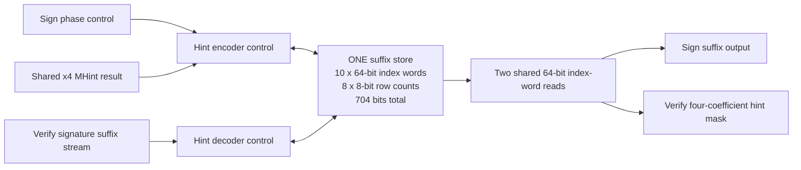
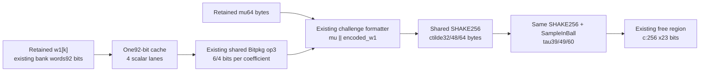
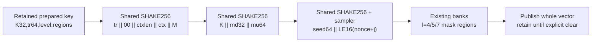
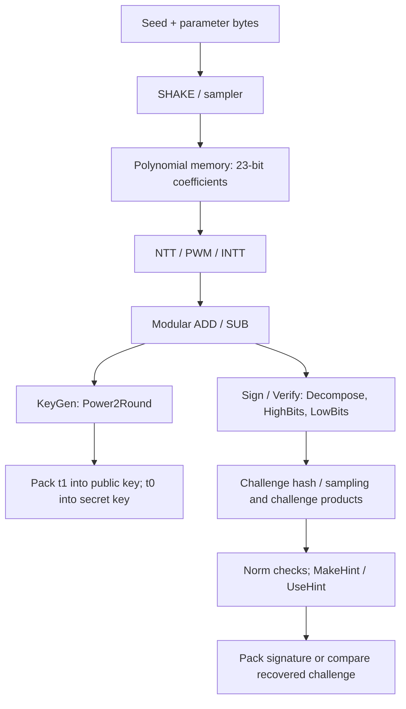

# Dilithium processing blocks

Trial-by-trial history has been removed. Qualified evidence is retained in evidence/. Current measurements and active work are recorded in AGENTS.md and sim/dilithium/.

## Shared hint encoding and decoding

The connected Process DMA now contains one `hint_codec` instance.
Sign and Verify use this same resource in their separate operation phases.
The controller supplies command, row and stream-handshake controls; MHint's
four-lane result feeds the codec directly inside Process DMA.



Encoding appends accepted coefficient indices and records cumulative row
counts. Decoding first checks counts, strictly increasing indices within
each row and zero padding, then emits the mask for each group of four
coefficients. The decoder assembles a four-byte window from two adjacent
64-bit index words. Encoding and decoding cannot own the store together.
Reset clears ownership/control; index payload is overwritten by a valid
new frame before use. Existing framing, error and backpressure checks remain.
The old standalone hint modules are retained as verification references but
are absent from the production QSF and hierarchy.

Current-source qualification passes 43 encoder packets, 106 decoder cases
with 21,510 independently checked masks, 60 alternating-direction commands
with 33,125 checked observations, all 210 official operations, 88 protocol
commands and the 33-scenario main UVM campaign. Every measured full-operation,
protocol and UVM cycle record equals C12. C14's physical checks pass: whole
placed ALMs fall from 33,056 to 31,882; worst Fmax falls from 57.38 to
56.72 MHz. Exactly 704 suffix storage bits remain in one codec. Process now
contains this resource, so its inclusive area cannot be compared with the
old Process subtree alone. See THROUGHPUT.md for the full measured tradeoff.

## Stage7C shared Process replacement

`process/poly_process.sv` is one x4 elastic arithmetic pipeline:ADD,SUB,
P2R,Decompose,CNB,MHint,UseHint and a pack-only coefficient pass-through.
Decompose uses bounded shift/add arithmetic instead of inferred constant
DSP multipliers. Four pipeline stages currently separate quotient,residual
and correction;the standalone timing trial still misses6.757ns,so final
timing closure remains open.

`datapath/process_dma.sv` streams64 memory words per polynomial.
It can expand compact signed secret nibbles directly from the fixed banks,
write the low polynomial,pack the high part,and reduce norm/hint flags across
the polynomial. Low writes and packer consumption have separate handshake
credits. A stalled destination cannot duplicate a result at the other sink.
P2R/Decompose high data can be stored as low64-bit packed memory words;
pack-only mode streams full keys,z or w1 through the SAME BitPkg instance.

The compact Sign controller also uses the Process DMA's MHint callback:
one four-bit mask, six-bit word index and last marker per accepted bank word.
The low-result, BitPkg and hint sinks have independent credits, so a stalled
sink cannot duplicate consumption at another sink. `hintpkg.sv`
records the ordered nonzero coefficient indices and cumulative row counts,
producing the final FIPS hint suffix. Its bounded640-bit index payload is
not a signature RAM. Omega overflow causes an algorithmic rejection; cancel
clears its control state before the next attempt. The actual Sign diagnostic
checks complete published signatures; full retries and reset gates are pending.

|Shared block|Input/output contract|Focused evidence so far|
|---|---|---|
|x4 arithmetic|Four canonical23-bit coefficients and operation/level/tag per beat|Every canonical input at each level checked for Decompose;other operations directed/random/boundary/stall/reset checks|
|BitPkg|Four coefficients ->64-bit words;formats t1,t0,eta,w1,z|125 packets;independent bit serialization|
|BitUnpkg|64-bit words ->four canonical coefficients,or16 secret nibbles|89 packets,29 invalid cases,6 reset recoveries|
|Process DMA|Fixed source/destination banks;one polynomial per command|64 cases,11008 low coefficients,464 packed RAM words;all5 stream formats;3 rejects/3 reset recoveries|
|Secret regroup|16 signed nibbles ->Fig5 compact words;two context states|448 words match independent Python;interleaved actual B-port RAM writes tested|

These are focused integration checks,not current main-UVM coverage or a
claim that the full production replacement is complete. After replacement sources
settle,the gates are rerun with fresh fingerprints and archived together.

### Compact Verify suffix and input path

`hintunpkg.sv` stores only the maximum84-byte sparse suffix. It checks
that cumulative counts are monotonic and at most omega, indices are strictly
increasing within each row, and unused index bytes are zero. No output is
credited before all canonical checks pass. It then emits four hint flags,
row number, six-bit bank-word index and polynomial-last marker. Its106-case
focused gate checks21510 exact masks,9 resets and18 deliberate checker faults;
these are suffix checks, not full signature verdicts.

`verify_input.sv` forks PK words into the same raw Keccak service and
shared BitUnpkg. Independent sink credits prevent duplicate words when one
sink stalls. It retains rho/tr/ctilde headers, loads shifted t1 and z directly
to fixed bank roles, checks z through the SAME CNB pipeline, then writes the
validated hint flags. Physical writes and finite hashes retire before done.
Its105-case gate covers44 qualified contexts,13 encoding-invalid signatures,
39 expected command/framing errors and9 resets, with48832 exact physical
bank readbacks. Reset recovery uses the same ID with different PK/SIG bytes.
Subsequent source/Python additions require fresh fingerprints for a final rollup.

## Stage5V.4 main Verify controller

`controller/verify.sv` owns an operation from command acceptance to complete
cleanup. INPUT invokes verify_input_prepare for PK and signature frames;
MATH invokes verify_math_prepare for ctx||M,mu,c and transforms;EQUATION
invokes verify_equation for the public verification formula and digest test.
Atomic take edges transfer each context once. A failed pre-take handoff leaves
the context with its existing owner,which the parent explicitly clears.

Completion0 carries accept1/0. A signature-length mismatch returns invalid
without consuming frames. Decoder norm/hint error5/detail2 is also converted
to normal invalidity before arithmetic. Codes1=bad parameter/context/message
command,3=input-preparation failure,4=math-preparation failure,5=equation
failure,6=child identity/publication mismatch. stage1/2/3 identifies INPUT/
MATH/EQUATION for errors;detail preserves the child code. Normal invalidity
has stage/detail0. Fatal shared/child faults halt until global reset.

The parent waits for child done retirement,clears any unadopted math/input
context,and reports only after all owned memory is gone. It retains headers
only in the existing helpers. Main dilithium.sv grants exactly one of KeyGen,
Sign or Verify throughout dispatch,execution and post-completion cleanup.
Its existing output and debug interfaces remain isolated from the active
Verify client. ENABLE_VERIFY defaults1;op3 remains unsupported (main code2).

## Stage5V.3 Verify equation and UseHint

`helpers/verify_equation.sv` reconstructs each row of A directly in NTT
representation from SHAKE128(rho||column||row). PWM multiplies Ahat by zhat;
in-place ADD accumulates the row. PWM produces chat*t1hat and in-place SUB
subtracts it **before one inverse NTT per row**. This avoids computing two
separate inverses. Existing arithmetic engines perform every operation.

`process/use_hint.sv` accepts param2,canonical coefficient23 and hint23. It
uses existing decompose to obtain high/low. Hint0 returns high;hint1 adds1
if low>0,otherwise subtracts1,modulo44(level2) or16(level3/5). Low=0 uses
the decrement branch. Invalid param3,coefficient>=q or hint>1 sets error and
high0. Full-width validation prevents hint64 from silently narrowing to0.

For example,at level2 coefficient100 decomposes into high0,low100. Hint0
returns0;hint1 returns1. Coefficient q-1 decomposes into high0,low-1;
hint1 wraps to43 (or15 at levels3/5). These boundaries are exercised by the
separate UseHint unit cases and checked against the unchanged C primitive.

The control reads one92-bit W word and one92-bit hint word,then sends their
four corrected coefficients to shared Bitpkg op3. Packing uses6 bits per
coefficient at level2 and4 bits at levels3/5. Shared sign_hash_message op2
formats mu64||packed_w1 for SHAKE256,which produces c2 of32/48/64 bytes.
`done_accept` is the exact c2==ctilde comparison,with no private key involved.

Controller code0 denotes a completed cryptographic check (accept may be0).
Codes1/2/3 denote bad context,unready/changed context,no free workspace before
take. Code4 is sampler failure;5 child arithmetic failure;6 bad read or
invalid UseHint input;7 completion/packing metadata. Details preserve child
status where applicable. After take,all adopted/new regions are released
before held completion. Read/packing errors drain the finite formatter/hash
and packer before cleanup. Fatal physical/raw identity faults halt until reset.

## Stage5V.2b Verify math preparation

`helpers/verify_math_prepare.sv` is a control client,not an arithmetic engine.
It validates and atomically adopts the decoded raw context,then uses:

| Existing block/service | Purpose |
|---|---|
|sign_hash_message op0|Format tr64,00,one context-length byte,ctx and M;check full16-bit input index,byte count and last;zero-drain malformed payload|
|Shared raw SHAKE256|Produce64-byte mu with tagged128-bit output beats|
|Shared sampler mode3|SampleInBall from the received ctilde32/48/64;produce256 canonical0/1/q-1 coefficients|
|Shared FNTT op0|Transform each shifted-t1 and z polynomial|
|Shared Pre-NTT op3|Transform small-coefficient c;must match ordinary mathematical FNTT exactly|
|Existing memory/allocator|One rotating scratch region;hold hints raw and publish complete result ownership only|

No private signing seed or masks are computed for Verify. rho expands A in
the next stage;mu and original ctilde are retained for the final challenge
comparison. Successful preparation does not establish signature validity.

Status0=prepared;1=bad command/upstream layout/identity/length;2=unready,
missing or changed upstream lease before adoption;3=malformed message payload
(formatter detail2);4=no free challenge/work region;5=sampler or NTT error
(detail child code);6=completion metadata mismatch. Fatal raw identity/count/
width or physical faults halt until reset. A pre-adoption failure leaves the
upstream owner responsible for its context;an adopted failure clears it.

## Stage5V.2a Verify frame loading and input preparation

`process/verify_frame_load.sv` wraps verify_decode and writes its canonical
23-bit stream through the existing allocator/packer. It checks section,poly,
index,ID,last-poly,last-frame before each write. PK allocates K regions;
signature allocates L+K regions. The current partial polynomial is discarded
with nonzero finish on error;already committed frame regions are released.
The entire frame is hidden until success. There is no coefficient RAM here.

`helpers/verify_input_prepare.sv` owns the first two frames of future Verify.
It validates the range/length/idle lease,starts PK decoding and a matching
SHAKE256 raw request together,and independently delivers each PK word to both.
It stores rho32,tr64,ctilde32/48/64 and context handles. It starts signature
loading only after PK load/hash retirement. Both frame outputs remain internal
until done0. It can clear them,or transfer all handles with take. Caller must
retain the shared-services lease until this owner returns idle or transfers it.

Parent status codes:0 prepared;1 bad parameter/signature length;2 prior service
or read response still active;3 range overflow/collision (detail4 collision);
4 PK load error;5 signature load error;6 loader completion metadata mismatch.
Detail on4/5 is the decoder error (1 command,2 norm/hints,3 framing). Fatal
raw tag/width/count/retirement or physical service faults halt until reset.
None of these codes is the final cryptographic Verify verdict.

The shared load request adds verify/kind/length and6 high index bits. Existing
SK loading retains verify0 and its original10-bit index interface. Verify
loading uses the concatenated16-bit index;generic header512/bytes7 is added
to the response. New descriptors wait while either loader is busy;PK raw/load
admission is paired by ID,message length,SHAKE256 mode and64-byte output.

## Stage5V.1 Verify frame decoder

`src/controller/process/verify_decode.sv` accepts one frame per command:
kind0=PK,kind1=signature,parameter0/1/2=level2/3/5,length16,operation ID16.
Input is data64/bytes4/index16/last with valid/ready. Header and coefficient
streams and held completion each have independent backpressure. Metadata is
snapshotted;high input-index bits are checked before any narrowing.

| Kind | Encoded layout | Decoded result |
|---|---|---|
|PK|rho32 followed by K*256 packed10-bit t1;1312/1952/2592 bytes|rho header,then K polynomials of canonical t1<<13 (max8380416) |
|Signature|ctilde32/48/64,z in18/20-bit fields,sparse hint suffix;2420/3309/4627 bytes|ctilde header,L canonical z polynomials,then K dense0/1 hint polynomials |

Section0=t1<<13,1=z,2=hint;every coefficient carries poly3,index8,ID16,
last-poly and last-frame. All output is **tentative until done0**;an owner must
discard the whole frame on any error/reset,including already streamed z.
Done1=bad parameter/declared length;2=z norm or malformed canonical hints;
3=input framing. z equality with gamma1-beta rejects. Hint cumulative counts
must be monotonic and<=omega;indices strictly increase within each polynomial,
may repeat across polynomials,and unused index bytes must be zero.

An84-bit reservoir decodes coefficients without encoded-key/signature RAM.
The signature suffix needs at most84 bytes (omega80+K4);it is retained until
the ending cumulative counts can be checked. Hints are emitted only after
the entire suffix passes. This small suffix buffer is not a whole-signature
buffer. This block does not perform Az-c*2^13*t1,UseHint or challenge comparison.

Stage7B.7 candidate:the suffix is arranged as eleven64-bit register words
(88 source-storage bytes,84 encoded bytes plus four unused padding bytes).
One aligned word write replaces eight variable-position byte writes. Tail
lanes are zero-masked. HEADER addressing uses its0..7 word range,while full
16-bit stream-index checks remain. The FSM and external timing are unchanged.
The existing383-case old/new trace and independent705010-value comparison
pass freshly;whole-main physical qualification is pending.

Stage5N.4h.7 verifies these unchanged blocks through the actual main Sign path
with official NIST pure/public-API vectors. No new process block is introduced.
The reference document distinguishes supported inputs from unsupported prehash
and internal signing APIs;those unsupported modes are not credited as passes.

## Stage5N.4h.6 sign.sv and main dispatch

`src/controller/sign.sv` is a control client,not another arithmetic engine.
It connects the existing key preparer,attempt/retry loop and signature encoder
to the same services. The approved two-frame host supplies SK followed by
ctx||M. The key is loaded/transformed per request and freed before main done.

| States | What to study |
|---|---|
|KEY_START/WAIT/RETIRE|SK frame,strict index narrowing,held child completion and prepared-key publication |
|ATTEMPT_START/WAIT/RETIRE|Body frame,seed/header reuse,ordinary rejection retry and accepted context |
|ENCODE_START/WAIT/RETIRE|Atomic source take and streamed final signature |
|DROP/WAIT_ATTEMPT,DROP/WAIT_KEY|Error/success cleanup in dependency order,then held REPORT |
|HALT|Fatal child/memory fault requires global reset |

`dilithium.sv` snapshots the command and grants only KeyGen or Sign. Its mux
tracks child busy through cleanup. Sign masks public debug response-valid and
read-ready so an unrelated host read cannot steal a bank response. The source
test intentionally offers those reads throughout signing and poisons command
fields after acceptance to check isolation and snapshots.

## Stage5N.4h.5 signature packing

Bitpkg adds op4:z,18/20-bit gamma1-centered_z encoding,using its same87-bit
reservoir. The command op grows to3 bits;old operation numbers are unchanged.
`sign_signature_encode` adopts the accepted attempt,streams ctilde,z and sparse
hints,then frees the adopted regions. SPECIFICATION.md gives byte counts,
error semantics and interfaces;MEMORY_MAP.md diagrams the lifetime.

Sparse hints store indices,zero padding and cumulative row counts. Example:
row0 has indices0,2 and row1 has5. The index area starts `00 02 05`;the first
counts are2,3. Index0 is legitimate;counts distinguish used entries from padding.
Read CHECK/TAKE,DIGEST/ZCMD/read/feed/drain,HSCAN/HPAD/HCOUNT and FLUSH/CLEAN/
REPORT in the helper. Only successful completion validates streamed bytes.
Unchanged C polyz_pack/pack_sig and full signing provide the independent oracle.

## Stage5N.4h.4 sign_attempt_loop

This parent controller repeats the existing attempt datapath until a candidate
passes. The first pass uses mu=SHAKE256(tr||domain/context||message),then
seed=SHAKE256(key||rnd||mu). Later attempts use the same seed with larger
16-bit polynomial nonces,so y and its challenge/products change without
rehashing the message or private seed. The mask helper's new retry command
selects its existing op3 seed||LE16(nonce) formatter. Normal rejection is
handled by retry;actual service errors return an error and clear live payloads.

Only control,handles and private headers are stored in this new parent.
All SHAKE,sampling,NTT,PWM,ADD/SUB,decomposition,CNB and hint computation
uses the same physical services. The C adapter sign_retry_reference.c calls
unchanged production functions for the complete attempt schedule,starting
from SK,ctx/message,rnd and a flat polynomial nonce. Main signature packing
and main-controller Sign dispatch are separate next steps.

## Stage5N.4h.3 sign_attempt_check

This is a control client of existing CNB,Mhint and scalar ADD hardware.
CNB checks that z and r0 do not reveal too much about the secret and that
ct0 stays within the allowed hint correction. A norm-clean attempt adds ct0
to r0,then Mhint marks coefficients whose high part needs correction during
verification. The whole hint count must fit omega80/55/75. Too many hints
or an out-of-bound norm is an ordinary signing retry,not a broken service.

Read `sign_accept_material` in the single Python file for the mathematical
oracle:compare HighBits(w1*2gamma2+combined_low) with w1. The C adapter calls
unchanged poly_chknorm/poly_make_hint. RTL retains canonical residues and
uses the existing optimized signed-low predicate inside Mhint. Result
retirement,wide weight accumulation,ownership/cleanup and retry-header
retention belong to this new helper. No duplicate CNB/Mhint engine is added.

## Stage5N.4h.2 sign_response_products

This client calculates three challenge/secret products using the same PWM
and INTT hardware. It uses the existing scalar bank ADD/SUB service to update
y+cs1 into z and w0-cs2 into r0. ct0 stays available for the later hint step;
w1 is read-only. No new arithmetic core is introduced.

Study CHECK/PLAN/TAKE for disjoint workspace and whole-context adoption;
PWM_START/WAIT/RETIRE and INV_START/WAIT/RETIRE for one product;PROCESS states
for the in-place update;FREE_PWM/FREE_INV/ADVANCE for reuse. Group0 is s1,
group1 is s2,group2 is t0. DROP_CHAT ends its last-read lifetime. REPORT/READY
retain all output handles and retry headers;CLEAN discards a whole failed
attempt. Each post-child complete check waits for the physical lease to retire.

Arithmetic success is not signature acceptance. The next stage checks centered
norms of z,r0,ct0,then makes hints and enforces their weight. A rejected attempt
must advance nonce and regenerate y from the retained private seed.

## Stage5N.4h.1 sign_challenge_transform

c is a sparse polynomial in coefficient form. Multiplying it with the
prepared secret polynomials uses chat=NTT(c),so this client first transforms
c through the existing shared NTT engine. It keeps the original c until
the destination is complete,then frees it. The secret products are the next
connection;this client does not yet calculate z or make a signature decision.

Before transforming,it adopts matrix/challenge outputs together and frees
yhat. yhat was needed for A*y;once w0/w1 and the challenge exist,it is dead.
The handoff is metadata ownership,not data movement. w0/w1 stay in place.
Study CHECK/TAKE,DROP_HATS,FIND,NTT_START/WAIT/RETIRE,DROP_C,then the held
REPORT/READY and CLEAN paths. take_valid/take_ready lets a subsequent owner
receive the whole context instead of accidentally clearing it twice.

## Stage5N.4g shared Bitpkg and sign_challenge_prepare

Bitpkg op3 serializes each w1 coefficient as6/4 bits in the final FIPS204
byte order. Level2 high parts0..43 yield192 bytes per polynomial;levels3/5
high parts0..15 yield128. Concatenating k=4/6/8 polynomials gives768/768/1024
bytes. The physical packer is the existing one used by KeyGen,with its same
87-bit reservoir,valid/ready and held completion.

The new control-only helper reads each source word,feeds four scalar lanes
to that packer,and directly forwards its64-bit output to sign_hash_message
op2. That formatter prefixes the actual retained mu. Shared SHAKE256 returns
ctilde32/48/64 bytes;the helper then submits those exact bytes to sampler
mode3,which hashes/expands them and constructs sparse c. ctilde and c remain
private until both physical stages complete and storage commits.

Study CHECK/FIND,FMT_START/PACK_START,READ_REQ/RESP/FEED,PACK_WAIT/HASH_WAIT,
then SAMPLE_START/INPUT/WAIT and REPORT/READY/CLEAN. DRAIN is the error path:
finish or retire the owned pack packet,terminate the remaining formatter
body,consume invalid raw output,and return the engines without publishing
success. It does not reset a shared engine beneath another client.



This is a working signing intermediate,not final signature acceptance. Later
work applies c to the secrets,checks z/hint bounds and retries when required.

## Stage5N.4f sign_matrix_prepare control client

This helper schedules existing blocks;it contains only descriptors,handle
maps,rho and control registers. Study CHECK/PLAN first,then NTT_START/WAIT,
A_START/WAIT,ROW_START/WAIT,DECOMP_START/WAIT/RETIRE,FREE_ROW,and READY/CLEAN.

1. Validate retained key and y;choose19/25/33 free workspace addresses.
2. Ordinary FNTT maps each wide y polynomial to its own yhat region. Pre-NTT
   eligibility applies to small secrets,not these masks. Keep original y.
3. Reuse keygen_hash_message op1 to construct rho || column || row;shared
   SHAKE128 and matrix rejection sampling produce A directly in NTT domain.
4. Existing row_accumulate computes sum(Ahat[j]*yhat[j]) and inverse NTT,
   using existing PWM/in-place ADD/INTT services and accumulator/scratch.
5. Existing sign_process_dma op0 and decompose_x4 split that w polynomial
   into w0 and w1 in distinct regions. Validate BOTH committed outputs.
6. Release A row/raw w and repeat for all k rows. Retain all yhat/w0/w1,
   publish once complete,then wait for explicit clear or later consumers.

No arithmetic datapath or standalone block is replaced. Python direct root
evaluation/inverse formulas and mathematical decomposition are checked against
unchanged C reference routines;the real-service bench checks internal scalar
writes,bank reads,tags,cleanup and reset boundaries. This is not full Sign.

## Stage5N.4e sign_mask_prepare control client

Study helpers/sign_mask_prepare.sv in this order:command plan checks,START/
WAIT_RESULT,raw digest collection,formatter/physical-owner retirement barrier,
mask status validation,then REPORT/READY/CLEAN. It invokes the existing
sign_hash_message formatter three ways:op0 mu,op1 private mask seed,op3 once
per y polynomial. mu and seed are filled from actual shared Keccak outputs;
they are not supplied as expected values by the testbench.



These are sequential uses of one physical services tree. Each handoff waits
for both formatter and engine retirement. Temporary regions roll back as a
whole on errors;the separate prepared-key owner retains all key allocations.
The focused bench connects both working clients and reads their real banks.
Full Sign still needs vector arithmetic,challenge/hints,rejection/retry and
signature encoding/control. No placeholder main sign.sv is introduced.

## Stage5N.4d sign_key_prepare control client

The helper validates a raw/scratch plan,invokes the existing streamed loader,
copies the validated rho/K/tr header,then issues one shared transform at a
time. Pre-NTT serves s1 and s2;ordinary forward NTT serves t0. Successful
result identity and complete allocation are checked before source release.
The released source becomes the next scratch;the handle array tracks order.

REPORT holds done;success moves to retained READY after acknowledgment.
READY keeps context stable and blocks replacement commands,while the outer
Sign owner may use other service clients. Clear waits for those operations/
responses to drain,invalidates exposed context,and releases every owned
prepared region. Error paths retire child status,scan owned allocations and
return a zero/invalid context. A fatal service fault halts until global reset.

This adds controller/header metadata,not polynomial RAM,another decoder,
another NTT or another memory tree. It is not yet attached to main Sign's
unfinished host interface/controller. Detailed error/ownership contracts are
in SPECIFICATION.md;actual bank tests and study pointers are in the reference
verification document.

## Stage5N.4c2 key-loader service ownership

The unchanged sign_key_load client is now instantiated inside the existing
keccak_sampler_ntt_banks arbiter and exposed through row/dilithium_services.
Its allocate/write/finish paths join the existing compute-client mux;rollback
release selects the same primitive release port. No process arithmetic changes.
KeyGen ties the new load request to zero. The main Sign schedule and retained
key/hash context are future work.

Existing owners retire before a new load starts. All tentative decoded regions
remain hidden;errors clean up before done. Held done retains exclusive bank
ownership,while done_ready passes through even if a row request is waiting.
After retirement,existing read/process clients can consume the loaded regions
using the validated ID/level/region handles.

## Stage5N.4c1 sign_key_load

This client connects sign_key_decode to the existing memory allocation,scalar
packing,finish and release interfaces. It adds control and two64-bit region
masks,not payload storage. The header stays in the decoder's existing1024-bit
registers. One active core0 packing context is reused between polynomials.

Flow:validate bounds/free plan;start decode;allocate next region;write256
values;wait for64 ACKs;finish0;repeat. Whole-key decoder success publishes
the header/region mask. Errors finish1 the active partial region and scan the
committed mask to release every earlier polynomial before reporting failure.
Internal ordering violations halt with ownership retained until reset.

The caller must provide exclusive memory-client ownership and enforce the
hidden/release-lock signals through held done. This checkpoint verifies the
client against actual memory/banks;production service wiring is next.

## Stage5N.4b signing message formatter

sign_hash_message.sv constructs the four messages listed in SPECIFICATION.md.
It stores one1024-bit selected prefix and a128-bit merge reservoir,streams
payload without whole-message RAM,and handles tr's66-byte prefix alignment.
Op1 supports zero rnd for deterministic signing or supplied32-byte rnd.
Op2 returns the final-standard32/48/64-byte challenge seed. Op3 uses full
little-endian16-bit per-polynomial nonce space through65535 and routes to
existing mask sampling. Encoded w1 is supplied as bytes;RTL high-bit packing
and final signature packing remain future work.

Malformed payload framing after descriptor launch triggers a zero-filled
error drain so the finite hash core can retire. The owner discards its output
and accepts formatter done only after service retirement. Invalid command
rejection launches nothing. Snapshot and stalled-output checks,peer-core
separation and dependent actual-RTL mu/mask-seed forwarding pass in the
focused shared-service harness. This is not the main Sign controller.

## Stage5N.4a signing-key decode

sign_key_decode.sv reverses the expanded-key byte layout:
rho32 || K32 || tr64 || s1[l] || s2[k] || t0[k].
It emits one held header and scalar canonical coefficient packets with
section/poly/index/last/ID metadata. The arithmetic decode is eta-raw for
small secrets and4096-raw for t0;negative values become residues modulo q.
Unused eta codes are explicitly rejected. Input words are indexed64-bit beats
with8 valid bytes and checked final last. See SPECIFICATION.md for all widths.

The block retains only the128-byte header and76-bit reservoir,not the whole
encoded key. It must feed a future key-ingestion memory owner,which may only
publish a key after overall code0. Error/reset invalidate partial outputs.
It is not yet connected to bank DMA or the main Sign controller. Next:signing
hash-message formatting,then key-memory/schedule integration.

## Stage5N.3 memory-connected signing processes

sign_process_dma is now instantiated in the main-owned bank service. It caches
two92-bit source words and serializes each x4 result through the existing
23-bit write interface. The mathematical blocks/bounds below are unchanged.

| Command | Reads | Results |
|---|---|---|
| Decompose |A,64 checked92-bit words |256 canonical lows in dest +256 zero-extended highs in high;publish together after both64-word ACK/finish sequences |
| CNB |A,64 checked words |No writes;return polynomial OR of bound failures. Norm failure is success with done_reject=1 |
| Mhint |A corrected low + B retained high,64 checked words each |256 canonical0/1 hints in dest;return9-bit polynomial weight |

Stored high23 is checked before narrowing,so64 cannot alias0. Signed lows
are stored as low<0 ? low+8380417 : low. Invalid reads/data free tentative
outputs after writes drain and clear arithmetic tracking before another command.
Source/result leases last through held completion. Main Sign scheduling,
vector-wide CNB reduction,omega checking,retry and final packing remain future.
See SPECIFICATION.md for command/error fields and MEMORY_MAP.md for the diagram.
The Stage5N.2 sections below record the earlier standalone arithmetic milestone.

## Stage5N.2 implemented signing arithmetic

The mathematical rules follow [FIPS204 section7.4,Algorithms36 and39](https://nvlpubs.nist.gov/nistpubs/FIPS/NIST.FIPS.204.pdf).
Five working files now exist under src/controller/process/:decompose.sv,
decompose_x4.sv,cnb.sv,mhint.sv and sign_process.sv. They pass the focused
sign_process gate. Shared-bank DMA is connected as of Stage5N.3;main Sign
scheduling remains future work. This section records the Stage5N.2 milestone.

| Block | Inputs / outputs | Implemented behavior |
|---|---|---|
| decompose_x4 |4x23-bit residues,param2 ->4xhigh6,4xsigned-low19 |Four parallel decompose helpers;positive tie,q-1 wrap;noncanonical/invalid-level error |
| cnb |4x23-bit residues,param2,kind2 ->4 failure bits |Centered magnitude strictly below bound;kind0 z,1 corrected LowBits,2 ct0;equal bound rejects |
| mhint |4x23-bit corrected-low residues,4xhigh6,param2 ->4 hints,count3 |Optimized signing low/high convention;high0 negative tie exception;invalid high/range/level error |
| sign_process |Tagged ready/valid x4 groups ->held results |One elastic stage;64 ordered groups/polynomial;CNB sticky prefix failure and Mhint prefix weight9 |

CNB bounds at levels2/3/5 are respectively:

| kind | level2 | level3 | level5 |
|---|---:|---:|---:|
|0 z:gamma1-beta|130994|524092|524168|
|1 LowBits:gamma2-beta|95154|261692|261768|
|2 ct0:gamma2|95232|261888|261888|

For Mhint,convert the canonical low residue to centered a0. With retained
high a1,the result is1 when a0>gamma2,a0< -gamma2,or a0= -gamma2 with a1!=0.
This port takes the corrected signing low value and retained w1 high;it must
not be wired as generic MakeHint(z,r). Python independently checks whether
HighBits((a1*2*gamma2+a0) mod q) differs from a1;unchanged C make_hint agrees.
This convention avoids adding another set of decomposition lanes in Mhint.
The future signing schedule supplies a0=LowBits(w)-c*s2+c*t0 and
a1=HighBits(w),after the relevant CNB checks. These roles must be preserved
when routing memory operands;two arbitrary residues are not interchangeable.

The returned low19 lanes are signed two's-complement values. The future DMA
must convert negatives back to canonical23-bit residues before bank storage.
CNB/Mhint inputs remain canonical23-bit bank values. High lanes are6 bits for
all levels;allowed maxima are43/15/15. Unused high inputs are ignored for
Decompose/CNB;unused kind is ignored for Decompose/Mhint.

Norm reject is algorithmic data,not a protocol error. Prefix reject covers
one256-coefficient polynomial;the controller must OR across the whole vector.
Hint weight likewise covers one polynomial,0..256;the controller must sum
across k polynomials and apply omega. Full-vector limits,retry control,UseHint,
signing byte formats and complete signatures remain later work.

Stage5N.1 relocates the unchanged Bitpkg instance from keygen_encode into
dilithium_services under the main controller. The encoder now supplies a
pack_request_t and consumes a pack_response_t through the same shared-service
boundary used by KeyGen. ADD/SUB/P2R remain inside the existing banked process
DMA. This changes resource ownership,not arithmetic/format rules or measured
PPA. Decompose x4,CNB,Mhint and signing-format work remain the next bounded
steps;they are not implemented by this refactor.

## Requested LightHD process organization

The user clarified the required block labels:CNB,Decompose x4,Mhint,Bitpkg
and P2R. All their RTL belongs under src/controller/process/. Working
implementations and planned filenames are distinguished below;the latter are
not empty modules or verification-completion claims.

| LightHD label / role | File | Current status |
|---|---|---|
| P2R / Power2Round |power2round.sv|Implemented D=13 block;connected to autonomous KeyGen with ROUND_OUTPUTS=1;rounded arrays retained |
| Decompose x4 |decompose_x4.sv|Implemented/verified four-lane arithmetic under sign_process;bank DMA connection pending |
| CNB / norm-bound checks |cnb.sv|Implemented/verified all three bounds and per-polynomial prefix failure;vector reduction pending |
| Mhint / MakeHint |mhint.sv|Implemented/verified optimized low/high convention and per-polynomial prefix count;vector limit/control pending |
| Bitpkg / bit packing |bitpkg.sv|Connected bank reads/full PK/SK sequencing in Stage5L;signing formats and unpacking remain planned |
| UseHint |usehint.sv|Planned Verify reconstruction,including wrap boundaries |
| Shared modular arithmetic |poly_process.sv|Implemented elastic ADD/SUB/P2R;new Power2Round submodule preserves its one-stage handshake |
| Memory/process routing |poly_process_dma.sv|Implemented packed-bank reads,tagged scalar process and acknowledged writeback |
| Seed/nonce formatting |keygen_hash_message.sv|Implemented;relocated here from controller root |

Stage5J adds autonomous t=A*s1+s2 computation,not rounding/key serialization.
The extracted power2round module computes the same formulas previously inside
poly_process;invalid-input/framing gating and all output tags remain in the
elastic parent. C reference selftest checks all8380417 canonical rounding
inputs;the RTL suite exercises targeted boundaries and malformed framing.
Decompose/CNB/MakeHint/UseHint must use the final FIPS204 rules,while retaining
the requested LightHD hardware organization and level2/3/5 labels.

## 1. Purpose, scope and status

This is the shared description of the arithmetic, formatting and checking around
Keccak, sampling and NTT. It will grow with the main controller. Target **final
FIPS 204**, using our names **level2/3/5** for **ML-DSA-44/65/87**. A planned
interface below is a mathematical requirement, not an implemented RTL port list.

| Block | Current implementation | Connected to the current main subsystem? |
|---|---|---|
| Modular ADD/SUB | `poly_process.sv` plus `poly_process_dma.sv`;isolated and banked source/Python/C PASS | Yes,in PROCESS_SERVICE=1 banked connection(Stage5G) |
| Power2Round | Same arithmetic/DMA;two-region acknowledged result publication PASS | Yes,in PROCESS_SERVICE=1 banked connection(Stage5G) |
| Matrix-row multiply/accumulate | row_accumulate.sv commands the existing PWM,destructive ADD and inverse NTT | Yes,keccak_sampler_row(Stage5H);returns A*s1 before s2 addition |
| KeyGen seed/A/secret message formatter | `src/controller/process/keygen_hash_message.sv`;real-Keccak/hashlib PASS | Yes,autonomous KeyGen drives seed/sample commands |
| Raw SHAKE routing and seed collection | Optional shared service in keccak_sampler plus keygen_seed_collect;seed-driven rows PASS | Yes,RAW_SERVICE=1 banked row test;legacy Quartus Stage4 top still disables raw service |
| Selected LightHD memory | Four1024x92-bit banks plus memory.sv packing/ownership;sampling/NTT/process/rows PASS | Yes,autonomous full KeyGen with retained-field encoding |
| Decompose, HighBits, LowBits | Four parallel lanes implemented in sign_process | Not yet;focused RTL/reference gate PASS |
| MakeHint, UseHint | Mhint implemented;UseHint planned for Verify | Not yet |
| Norm checking and hint counting | CNB/prefix failure and polynomial hint count implemented;vector control pending | Not yet |
| Key/signature packers and unpackers | KeyGen polynomial packets and full PK/SK sequence implemented;signature packing/unpacking planned | Yes for KeyGen,FULL_KEYGEN=1 |
| Shift, challenge products, comparisons and retry control | Required operations; final scheduling/implementation planned | No |

The full KeyGen controller wraps keccak_sampler_row,which retains real sampling,
banked NTT/Pre,ADD/SUB/Power2Round and acknowledged memory access. The encoder
reuses Bitpkg and the shared raw SHAKE service. KeyGen is implemented with
FULL_KEYGEN=1;Sign/Verify remain unsupported. The legacy default/Quartus top
remains keccak_sampler_ntt. Existing C functions are reference software,not
proof of RTL support.

## 2. Common quantities and representations

Every polynomial has **256 coefficients**. Ordinary stored coefficients are
canonical residues **0..q-1**, **23 bits**, with **q=8,380,417**. Negative values
are stored modulo q:for example -3 becomes q-3. Centered signed values are used
for bounds/rounding; convert deliberately rather than treating a23-bit residue
as a signed two's-complement number. NTT-domain/coefficient-domain ownership is
recorded separately in memory. Engine boundaries are not Montgomery encoded.

| Quantity | level2 / 44 | level3 / 65 | level5 / 87 |
|---|---:|---:|---:|
| Parameter port |0|1|2|
| Matrix rows k |4|6|8|
| Matrix columns l |4|5|7|
| Secret bound eta |2|4|2|
| Challenge weight tau |39|49|60|
| beta=tau*eta |78|196|120|
| gamma1 |131072|524288|524288|
| gamma2 |95232|261888|261888|
| Maximum hint weight omega |80|55|75|
| Challenge-seed bytes |32|48|64|

All sets use D=13,initial seed32 bytes,rho32,rho-prime64,key seed32 and tr64.

## 3. How the blocks fit into the operations



This shows dependencies, not a finished hardware pipeline. In KeyGen,
`t = INTT(sum_j(A_hat[i,j] * NTT(s1[j]))) + s2[i]` for each row i.
Addition is needed both for accumulating transform-domain products and for
adding s2 after INTT. Both operands of an ADD/SUB must have matching domain,
parameters and coefficient index;the future controller must enforce this.

## 4. Modular addition and subtraction — implemented

**Purpose:**combine polynomial coefficients without leaving the finite field.

| Item | Contract |
|---|---|
| Opcode |0 ADD;1 SUB in poly_process |
| Inputs |a,b,each23-bit canonical residue |
| Output |23-bit canonical `(a+b) mod q` or `(a-b) mod q` |
| Example |`(q-2)+5 mod q = 3`; `2-5 mod q = q-3` |
| Uses |KeyGen matrix-product accumulation and s2 addition;later Sign/Verify corrections |

This unit is coefficient arithmetic. It does not multiply polynomials or
allocate memory. One accepted beat processes one coefficient.

The Stage5G DMA now loads A/B words from the shared banks,caches two92-bit
words and feeds matching coefficient indices. ADD/SUB require identical domain
and parameter metadata and preserve that domain in the result. Destination must
be distinct from sources. Sources remain leased through completion retirement.
One scalar result per accepted arithmetic beat is packed into the existing
context0 writer;publication requires256 values and64 write acknowledgements.
Stage5H additionally allows explicit in-place ADD/SUB with destination A;the
old A is consumed and B is retained. The row workload exercises in-place ADD.
Both old source words are cached before overwrite;the store rejects reads of
already/partially rewritten words. The ordinary flag0 path still preserves
both inputs. Power2Round continues to require distinct destinations.

## 5. Power2Round — implemented

**Purpose:**split each KeyGen t coefficient into the public high part t1 and
secret low part t0,so the public key can store fewer bits per coefficient.

For canonical a,return high,low satisfying:

```text
a = high * 8192 + low
-4096 < low <= 4096
high = floor((a + 4095) / 8192)
```

| Item | Implemented contract |
|---|---|
| Opcode |2 in poly_process |
| Input |a23 bits; b ignored |
| High output |10 bits;0..1023 |
| Low output |Signed14 bits;-4095..4096 |
| Packing value |Unsigned13 bits;`4096-low`,0..8191 |
| Tie |a=4096 gives high0,low4096;4097 gives high1,low-4095 |

Example:a=20000 becomes high2,low3616,so `2*8192+3616=20000`.

Stage5G's banked implementation requires coefficient-domain input. It allocates
two distinct caller-selected64-word regions and uses the two existing packers.
The low destination stores canonical low modulo q(e.g.-3 as q-3),so it can feed
the existing NTT. The high destination stores zero-extended10-bit high. Both
have coefficient-domain metadata;source mode/parameter remain provenance,not
a declaration that the output is still a sampled secret. The scheduler owns
their t0/t1 roles. Final key byte packing uses10-bit t1 and13-bit4096-low later;
these92-bit natural-order words are not encoded public/secret-key bytes.
Both destinations become externally visible together after both64-word commits;
neither may release while the completion is held. Reset between commits exposes
neither output. No extra polynomial RAM or encoded-key buffer is added.
The high parts become t1 in the public key. Low parts become t0 in the secret
key. The13-bit packing value is a per-coefficient encoding input,not a complete
serialized polynomial. Signed13 bits cannot represent +4096,so the low output
intentionally uses14 bits.

### Shared implemented ADD/SUB/Power2Round transport

- One elastic register stage:an accepted input can produce output after that
  edge;when unstalled the unit accepts one coefficient each cycle.
- Each beat carries ID16,index8,last and opcode2;last must equal index255.
- Output holds all data/metadata while valid and not ready. Reset cancels it.
- Opcode3,noncanonical relevant operands or inconsistent last produce an error
  beat with zero arithmetic outputs and preserved metadata. The controller must
  invalidate the owning operation;this unit does not verify cross-beat order.
- Gates:10349 accepted,10346 exact outputs including13 expected errors,3 reset
  aborts;12 corrupted captures rejected. The separate C oracle exhaustively
  checks8380417 canonical inputs;RTL rounding tests are targeted,not exhaustive.

## 6. Decompose / HighBits / LowBits — implemented arithmetic

**Purpose:**split signing/verification coefficients at spacing `alpha=2*gamma2`.
This spacing differs from Power2Round's8192;the functions are not interchangeable.

For canonical a,first take centered remainder a0 modulo alpha,using the positive
tie. Normally `a1=(a-a0)/alpha`. If `a-a0=q-1`,set a1=0 and decrease a0 by1.
This special wrap handles q not being a multiple of alpha.

| Property | level2 | level3/5 |
|---|---:|---:|
| alpha |190464|523776|
| High-part range |0..43|0..15|
| Sufficient high bits |6|4|
| Low-part range including wrap | -95232..95232 | -261888..261888 |
| Sufficient signed low bits |18|19|

Except for the wrap case,the lower bound is strict:`-gamma2 < a0 <= gamma2`.
For example a=q-1 produces high0,low-1. HighBits returns a1;LowBits returns a0.
One shared decomposition datapath can supply both;separate cores are not required
by the algorithm. The Stage5N.2 x4 ports and elastic transport are specified above.

## 7. MakeHint implemented;UseHint planned

**MakeHint(z,r)** returns one bit:

```text
hint = (HighBits(r) != HighBits((r+z) mod q))
```

It records whether a small correction changes the high part. The optimized C
`make_hint(a0,a1)` uses a different input convention derived from the signing
schedule;do not connect that convention to a generic(z,r) interface blindly.

**UseHint(h,r)** decomposes r into(high,low),with m=44 for level2 or16 for
level3/5. If h=0,return high. If h=1 and low>0,return `(high+1) mod m`;
otherwise return `(high-1) mod m`. Output width is6 or4 bits. Verification uses
hints to reconstruct the high parts hashed by the signer.

Tests must include both correction directions,low0,ties,high0 and high m-1
wraps,and the q-1 decomposition exception. Hint weights are counted across
all k polynomials;no more than omega one-bits may be encoded.

## 8. Norm checks implemented;challenge products and retries pending

**Norm checker:**convert residues to centered signed values and check each
absolute value is **strictly below** the supplied bound. Equality fails.
Reduce a polynomial/vector to one failure flag while preserving operation ID.

| Signing quantity | Required bound |
|---|---|
| z |`norm(z) < gamma1-beta` |
| Low part of w-c*s2 |`norm(...) < gamma2-beta` |
| c*t0 correction |`norm(...) < gamma2` |
| Hint vector |Number of ones <= omega |

Verify also checks the z bound and rejects malformed signature encoding. A
signing rejection means discard the entire tentative result,advance the mask
nonce as specified,and retry;never publish a partial signature. Retry scheduling
and transport are main-controller work,not a new sampler mode.

Challenge products c*s1,c*s2,c*t0 can use existing NTT/PWM/INTT. A dedicated
sparse multiplier is an optional architecture choice,not implemented here.
Verification also needs `t1 * 2^D`:valid10-bit t1 lies in0..1023,so shifting by13
gives0..8380416=q-1 and fits the23-bit canonical datapath. Final challenge comparison consumes every
challenge-seed byte;hardware timing/security properties require separate review.

## 9. Packing and unpacking — planned

Stage5K implements the polynomial packing portion below for t1,t0 and s1/s2,
with64-bit output words and final packet status. Stage5L connects complete key
field sequencing and actual public-key hashing. Unpacking and Sign/Verify
formats remain planned. See SPECIFICATION.md for
the exact Bitpkg command/word protocol and REFERENCE_VERIFICATION.md for tests.

Packers serialize fields in final-standard order with low-bit-first field
packing. Unpackers reverse it and reject malformed encodings,especially hint
indices/counts/padding. Canonical23-bit memory storage is not the external format.

| Polynomial field | Encoded bits/coefficient | Bytes for256 coefficients |
|---|---:|---:|
| t1 |10|320|
| t0 via4096-low |13|416|
| s1/s2 via eta-s |3 for eta2;4 for eta4|96 /128|
| z via gamma1-z |18 for level2;20 for level3/5|576 /640|
| w1 |6 for level2;4 for level3/5|192 /128|

| Object | Field order |
|---|---|
| Public key |rho,then k packed t1 polynomials |
| Secret key |rho,K,tr,l packed s1,k packed s2,k packed t0 |
| Signature |Challenge seed,l packed z polynomials,sparse hint encoding |

Hint encoding uses omega index bytes plus k cumulative-count bytes;unused index
bytes must be zero. Indices within a polynomial must be strictly increasing.
Public/secret/signature byte lengths respectively are1312/2560/2420 for level2,
1952/4032/3309 for level3,and2592/4896/4627 for level5.

The selected next external interface is tagged64-bit key streaming with
backpressure,using retained rounded arrays and no additional encoded-key RAM.
A packer must retain ownership until both
t1 and t0 destinations accept their output before the controller releases t.

## 10. Hash messages and seed collection

The implemented KeyGen formatter builds these byte strings:

| Purpose | Message | Hash/output |
|---|---|---|
| Initial expansion |xi32 + byte(k) + byte(l)|SHAKE256,128 bytes |
| Matrix entry i,j |rho32 + byte(j) + byte(i)|SHAKE128,continuous sampling |
| Secret nonce n |rho-prime64 + little-endian16-bit n|SHAKE256,continuous sampling |

The128 expansion bytes split into rho32,rho-prime64,K32. The implemented
keygen_seed_collect waits for all eight128-bit beats and the shared service's
completion,then retains all three fields with ID16/parameter2/error until
accepted. Parameter3 returns an error with zero seed fields and issues no hash.
Message submission completion alone is insufficient. Reset coordinates with the
service. The focused test feeds these actual RTL-collected seeds through the
formatter and real sampler:seven polynomials/1792 coefficients match Python.
KeyGen also needs tr=SHAKE256(pk,64);the raw service supports that finite length,
and Stage5L now supplies its actual encoded-PK input and collects tr.
Sign/Verify need mu/message/context formatting,mask seeds and challenge hashes;
these additional message builders and randomness controls are not implemented.

## 11. Verification and references

See [REFERENCE_VERIFICATION.md](REFERENCE_VERIFICATION.md) for the single Python
prepare/capture/compare flow and [MEMORY_MAP.md](MEMORY_MAP.md) for storage/ports.
Each new block needs independent arithmetic/byte comparison,boundary and
malformed-input tests,stalls and reset/recovery before connection. Full-system
UVM/functional/code coverage and PPA follow correct full-operation outputs.

Primary rules:[FIPS204](https://nvlpubs.nist.gov/nistpubs/FIPS/NIST.FIPS.204.pdf),
Table1,Algorithms6-8,packing Algorithms16-28,and rounding/hint Algorithms35-40.
Local reference:dilithium-sw-model/ref/{params.h,rounding.c,packing.c,sign.c}.
Local software is an independent development oracle;full official-vector
conformance has not yet been established for our accelerator.
