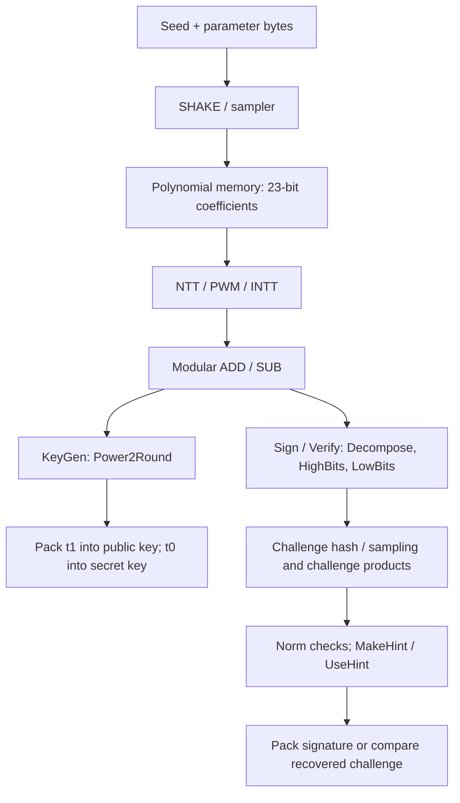

# Dilithium processing blocks

## Stage5N.3 memory-connected signing processes

sign_process_dma is now instantiated in the main-owned bank service. It caches
two92-bit source words and serializes each x4 result through the existing
23-bit write interface. The mathematical blocks/bounds below are unchanged.

| Command | Reads | Results |
|---|---|---|
| Decompose |A,64 checked92-bit words |256 canonical lows in dest +256 zero-extended highs in high;publish together after both64-word ACK/finish sequences |
| CNB |A,64 checked words |No writes;return polynomial OR of bound failures. Norm failure is success with done_reject=1 |
| Mhint |A corrected low + B retained high,64 checked words each |256 canonical0/1 hints in dest;return9-bit polynomial weight |

Stored high23 is checked before narrowing,so64 cannot alias0. Signed lows
are stored as low<0 ? low+8380417 : low. Invalid reads/data free tentative
outputs after writes drain and clear arithmetic tracking before another command.
Source/result leases last through held completion. Main Sign scheduling,
vector-wide CNB reduction,omega checking,retry and final packing remain future.
See SPECIFICATION.md for command/error fields and MEMORY_MAP.md for the diagram.
The Stage5N.2 sections below record the earlier standalone arithmetic milestone.

## Stage5N.2 implemented signing arithmetic

The mathematical rules follow [FIPS204 section7.4,Algorithms36 and39](https://nvlpubs.nist.gov/nistpubs/FIPS/NIST.FIPS.204.pdf).
Five working files now exist under src/controller/process/:decompose.sv,
decompose_x4.sv,cnb.sv,mhint.sv and sign_process.sv. They pass the focused
sign_process gate. Shared-bank DMA is connected as of Stage5N.3;main Sign
scheduling remains future work. This section records the Stage5N.2 milestone.

| Block | Inputs / outputs | Implemented behavior |
|---|---|---|
| decompose_x4 |4x23-bit residues,param2 ->4xhigh6,4xsigned-low19 |Four parallel decompose helpers;positive tie,q-1 wrap;noncanonical/invalid-level error |
| cnb |4x23-bit residues,param2,kind2 ->4 failure bits |Centered magnitude strictly below bound;kind0 z,1 corrected LowBits,2 ct0;equal bound rejects |
| mhint |4x23-bit corrected-low residues,4xhigh6,param2 ->4 hints,count3 |Optimized signing low/high convention;high0 negative tie exception;invalid high/range/level error |
| sign_process |Tagged ready/valid x4 groups ->held results |One elastic stage;64 ordered groups/polynomial;CNB sticky prefix failure and Mhint prefix weight9 |

CNB bounds at levels2/3/5 are respectively:

| kind | level2 | level3 | level5 |
|---|---:|---:|---:|
|0 z:gamma1-beta|130994|524092|524168|
|1 LowBits:gamma2-beta|95154|261692|261768|
|2 ct0:gamma2|95232|261888|261888|

For Mhint,convert the canonical low residue to centered a0. With retained
high a1,the result is1 when a0>gamma2,a0< -gamma2,or a0= -gamma2 with a1!=0.
This port takes the corrected signing low value and retained w1 high;it must
not be wired as generic MakeHint(z,r). Python independently checks whether
HighBits((a1*2*gamma2+a0) mod q) differs from a1;unchanged C make_hint agrees.
This convention avoids adding another set of decomposition lanes in Mhint.
The future signing schedule supplies a0=LowBits(w)-c*s2+c*t0 and
a1=HighBits(w),after the relevant CNB checks. These roles must be preserved
when routing memory operands;two arbitrary residues are not interchangeable.

The returned low19 lanes are signed two's-complement values. The future DMA
must convert negatives back to canonical23-bit residues before bank storage.
CNB/Mhint inputs remain canonical23-bit bank values. High lanes are6 bits for
all levels;allowed maxima are43/15/15. Unused high inputs are ignored for
Decompose/CNB;unused kind is ignored for Decompose/Mhint.

Norm reject is algorithmic data,not a protocol error. Prefix reject covers
one256-coefficient polynomial;the controller must OR across the whole vector.
Hint weight likewise covers one polynomial,0..256;the controller must sum
across k polynomials and apply omega. Full-vector limits,retry control,UseHint,
signing byte formats and complete signatures remain later work.

Stage5N.1 relocates the unchanged Bitpkg instance from keygen_encode into
dilithium_services under the main controller. The encoder now supplies a
pack_request_t and consumes a pack_response_t through the same shared-service
boundary used by KeyGen. ADD/SUB/P2R remain inside the existing banked process
DMA. This changes resource ownership,not arithmetic/format rules or measured
PPA. Decompose x4,CNB,Mhint and signing-format work remain the next bounded
steps;they are not implemented by this refactor.

## Requested LightHD process organization

The user clarified the required block labels:CNB,Decompose x4,Mhint,Bitpkg
and P2R. All their RTL belongs under src/controller/process/. Working
implementations and planned filenames are distinguished below;the latter are
not empty modules or verification-completion claims.

| LightHD label / role | File | Current status |
|---|---|---|
| P2R / Power2Round |power2round.sv|Implemented D=13 block;connected to autonomous KeyGen with ROUND_OUTPUTS=1;rounded arrays retained |
| Decompose x4 |decompose_x4.sv|Implemented/verified four-lane arithmetic under sign_process;bank DMA connection pending |
| CNB / norm-bound checks |cnb.sv|Implemented/verified all three bounds and per-polynomial prefix failure;vector reduction pending |
| Mhint / MakeHint |mhint.sv|Implemented/verified optimized low/high convention and per-polynomial prefix count;vector limit/control pending |
| Bitpkg / bit packing |bitpkg.sv|Connected bank reads/full PK/SK sequencing in Stage5L;signing formats and unpacking remain planned |
| UseHint |usehint.sv|Planned Verify reconstruction,including wrap boundaries |
| Shared modular arithmetic |poly_process.sv|Implemented elastic ADD/SUB/P2R;new Power2Round submodule preserves its one-stage handshake |
| Memory/process routing |poly_process_dma.sv|Implemented packed-bank reads,tagged scalar process and acknowledged writeback |
| Seed/nonce formatting |keygen_hash_message.sv|Implemented;relocated here from controller root |

Stage5J adds autonomous t=A*s1+s2 computation,not rounding/key serialization.
The extracted power2round module computes the same formulas previously inside
poly_process;invalid-input/framing gating and all output tags remain in the
elastic parent. C reference selftest checks all8380417 canonical rounding
inputs;the RTL suite exercises targeted boundaries and malformed framing.
Decompose/CNB/MakeHint/UseHint must use the final FIPS204 rules,while retaining
the requested LightHD hardware organization and level2/3/5 labels.

## 1. Purpose, scope and status

This is the shared description of the arithmetic, formatting and checking around
Keccak, sampling and NTT. It will grow with the main controller. Target **final
FIPS 204**, using our names **level2/3/5** for **ML-DSA-44/65/87**. A planned
interface below is a mathematical requirement, not an implemented RTL port list.

| Block | Current implementation | Connected to the current main subsystem? |
|---|---|---|
| Modular ADD/SUB | `poly_process.sv` plus `poly_process_dma.sv`;isolated and banked source/Python/C PASS | Yes,in PROCESS_SERVICE=1 banked connection(Stage5G) |
| Power2Round | Same arithmetic/DMA;two-region acknowledged result publication PASS | Yes,in PROCESS_SERVICE=1 banked connection(Stage5G) |
| Matrix-row multiply/accumulate | row_accumulate.sv commands the existing PWM,destructive ADD and inverse NTT | Yes,keccak_sampler_row(Stage5H);returns A*s1 before s2 addition |
| KeyGen seed/A/secret message formatter | `src/controller/process/keygen_hash_message.sv`;real-Keccak/hashlib PASS | Yes,autonomous KeyGen drives seed/sample commands |
| Raw SHAKE routing and seed collection | Optional shared service in keccak_sampler plus keygen_seed_collect;seed-driven rows PASS | Yes,RAW_SERVICE=1 banked row test;legacy Quartus Stage4 top still disables raw service |
| Selected LightHD memory | Four1024x92-bit banks plus memory.sv packing/ownership;sampling/NTT/process/rows PASS | Yes,autonomous full KeyGen with retained-field encoding |
| Decompose, HighBits, LowBits | Four parallel lanes implemented in sign_process | Not yet;focused RTL/reference gate PASS |
| MakeHint, UseHint | Mhint implemented;UseHint planned for Verify | Not yet |
| Norm checking and hint counting | CNB/prefix failure and polynomial hint count implemented;vector control pending | Not yet |
| Key/signature packers and unpackers | KeyGen polynomial packets and full PK/SK sequence implemented;signature packing/unpacking planned | Yes for KeyGen,FULL_KEYGEN=1 |
| Shift, challenge products, comparisons and retry control | Required operations; final scheduling/implementation planned | No |

The full KeyGen controller wraps keccak_sampler_row,which retains real sampling,
banked NTT/Pre,ADD/SUB/Power2Round and acknowledged memory access. The encoder
reuses Bitpkg and the shared raw SHAKE service. KeyGen is implemented with
FULL_KEYGEN=1;Sign/Verify remain unsupported. The legacy default/Quartus top
remains keccak_sampler_ntt. Existing C functions are reference software,not
proof of RTL support.

## 2. Common quantities and representations

Every polynomial has **256 coefficients**. Ordinary stored coefficients are
canonical residues **0..q-1**, **23 bits**, with **q=8,380,417**. Negative values
are stored modulo q:for example -3 becomes q-3. Centered signed values are used
for bounds/rounding; convert deliberately rather than treating a23-bit residue
as a signed two's-complement number. NTT-domain/coefficient-domain ownership is
recorded separately in memory. Engine boundaries are not Montgomery encoded.

| Quantity | level2 / 44 | level3 / 65 | level5 / 87 |
|---|---:|---:|---:|
| Parameter port |0|1|2|
| Matrix rows k |4|6|8|
| Matrix columns l |4|5|7|
| Secret bound eta |2|4|2|
| Challenge weight tau |39|49|60|
| beta=tau*eta |78|196|120|
| gamma1 |131072|524288|524288|
| gamma2 |95232|261888|261888|
| Maximum hint weight omega |80|55|75|
| Challenge-seed bytes |32|48|64|

All sets use D=13,initial seed32 bytes,rho32,rho-prime64,key seed32 and tr64.

## 3. How the blocks fit into the operations



This shows dependencies, not a finished hardware pipeline. In KeyGen,
`t = INTT(sum_j(A_hat[i,j] * NTT(s1[j]))) + s2[i]` for each row i.
Addition is needed both for accumulating transform-domain products and for
adding s2 after INTT. Both operands of an ADD/SUB must have matching domain,
parameters and coefficient index;the future controller must enforce this.

## 4. Modular addition and subtraction — implemented

**Purpose:**combine polynomial coefficients without leaving the finite field.

| Item | Contract |
|---|---|
| Opcode |0 ADD;1 SUB in poly_process |
| Inputs |a,b,each23-bit canonical residue |
| Output |23-bit canonical `(a+b) mod q` or `(a-b) mod q` |
| Example |`(q-2)+5 mod q = 3`; `2-5 mod q = q-3` |
| Uses |KeyGen matrix-product accumulation and s2 addition;later Sign/Verify corrections |

This unit is coefficient arithmetic. It does not multiply polynomials or
allocate memory. One accepted beat processes one coefficient.

The Stage5G DMA now loads A/B words from the shared banks,caches two92-bit
words and feeds matching coefficient indices. ADD/SUB require identical domain
and parameter metadata and preserve that domain in the result. Destination must
be distinct from sources. Sources remain leased through completion retirement.
One scalar result per accepted arithmetic beat is packed into the existing
context0 writer;publication requires256 values and64 write acknowledgements.
Stage5H additionally allows explicit in-place ADD/SUB with destination A;the
old A is consumed and B is retained. The row workload exercises in-place ADD.
Both old source words are cached before overwrite;the store rejects reads of
already/partially rewritten words. The ordinary flag0 path still preserves
both inputs. Power2Round continues to require distinct destinations.

## 5. Power2Round — implemented

**Purpose:**split each KeyGen t coefficient into the public high part t1 and
secret low part t0,so the public key can store fewer bits per coefficient.

For canonical a,return high,low satisfying:

```text
a = high * 8192 + low
-4096 < low <= 4096
high = floor((a + 4095) / 8192)
```

| Item | Implemented contract |
|---|---|
| Opcode |2 in poly_process |
| Input |a23 bits; b ignored |
| High output |10 bits;0..1023 |
| Low output |Signed14 bits;-4095..4096 |
| Packing value |Unsigned13 bits;`4096-low`,0..8191 |
| Tie |a=4096 gives high0,low4096;4097 gives high1,low-4095 |

Example:a=20000 becomes high2,low3616,so `2*8192+3616=20000`.

Stage5G's banked implementation requires coefficient-domain input. It allocates
two distinct caller-selected64-word regions and uses the two existing packers.
The low destination stores canonical low modulo q(e.g.-3 as q-3),so it can feed
the existing NTT. The high destination stores zero-extended10-bit high. Both
have coefficient-domain metadata;source mode/parameter remain provenance,not
a declaration that the output is still a sampled secret. The scheduler owns
their t0/t1 roles. Final key byte packing uses10-bit t1 and13-bit4096-low later;
these92-bit natural-order words are not encoded public/secret-key bytes.
Both destinations become externally visible together after both64-word commits;
neither may release while the completion is held. Reset between commits exposes
neither output. No extra polynomial RAM or encoded-key buffer is added.
The high parts become t1 in the public key. Low parts become t0 in the secret
key. The13-bit packing value is a per-coefficient encoding input,not a complete
serialized polynomial. Signed13 bits cannot represent +4096,so the low output
intentionally uses14 bits.

### Shared implemented ADD/SUB/Power2Round transport

- One elastic register stage:an accepted input can produce output after that
  edge;when unstalled the unit accepts one coefficient each cycle.
- Each beat carries ID16,index8,last and opcode2;last must equal index255.
- Output holds all data/metadata while valid and not ready. Reset cancels it.
- Opcode3,noncanonical relevant operands or inconsistent last produce an error
  beat with zero arithmetic outputs and preserved metadata. The controller must
  invalidate the owning operation;this unit does not verify cross-beat order.
- Gates:10349 accepted,10346 exact outputs including13 expected errors,3 reset
  aborts;12 corrupted captures rejected. The separate C oracle exhaustively
  checks8380417 canonical inputs;RTL rounding tests are targeted,not exhaustive.

## 6. Decompose / HighBits / LowBits — implemented arithmetic

**Purpose:**split signing/verification coefficients at spacing `alpha=2*gamma2`.
This spacing differs from Power2Round's8192;the functions are not interchangeable.

For canonical a,first take centered remainder a0 modulo alpha,using the positive
tie. Normally `a1=(a-a0)/alpha`. If `a-a0=q-1`,set a1=0 and decrease a0 by1.
This special wrap handles q not being a multiple of alpha.

| Property | level2 | level3/5 |
|---|---:|---:|
| alpha |190464|523776|
| High-part range |0..43|0..15|
| Sufficient high bits |6|4|
| Low-part range including wrap | -95232..95232 | -261888..261888 |
| Sufficient signed low bits |18|19|

Except for the wrap case,the lower bound is strict:`-gamma2 < a0 <= gamma2`.
For example a=q-1 produces high0,low-1. HighBits returns a1;LowBits returns a0.
One shared decomposition datapath can supply both;separate cores are not required
by the algorithm. The Stage5N.2 x4 ports and elastic transport are specified above.

## 7. MakeHint implemented;UseHint planned

**MakeHint(z,r)** returns one bit:

```text
hint = (HighBits(r) != HighBits((r+z) mod q))
```

It records whether a small correction changes the high part. The optimized C
`make_hint(a0,a1)` uses a different input convention derived from the signing
schedule;do not connect that convention to a generic(z,r) interface blindly.

**UseHint(h,r)** decomposes r into(high,low),with m=44 for level2 or16 for
level3/5. If h=0,return high. If h=1 and low>0,return `(high+1) mod m`;
otherwise return `(high-1) mod m`. Output width is6 or4 bits. Verification uses
hints to reconstruct the high parts hashed by the signer.

Tests must include both correction directions,low0,ties,high0 and high m-1
wraps,and the q-1 decomposition exception. Hint weights are counted across
all k polynomials;no more than omega one-bits may be encoded.

## 8. Norm checks implemented;challenge products and retries pending

**Norm checker:**convert residues to centered signed values and check each
absolute value is **strictly below** the supplied bound. Equality fails.
Reduce a polynomial/vector to one failure flag while preserving operation ID.

| Signing quantity | Required bound |
|---|---|
| z |`norm(z) < gamma1-beta` |
| Low part of w-c*s2 |`norm(...) < gamma2-beta` |
| c*t0 correction |`norm(...) < gamma2` |
| Hint vector |Number of ones <= omega |

Verify also checks the z bound and rejects malformed signature encoding. A
signing rejection means discard the entire tentative result,advance the mask
nonce as specified,and retry;never publish a partial signature. Retry scheduling
and transport are main-controller work,not a new sampler mode.

Challenge products c*s1,c*s2,c*t0 can use existing NTT/PWM/INTT. A dedicated
sparse multiplier is an optional architecture choice,not implemented here.
Verification also needs `t1 * 2^D`:valid10-bit t1 lies in0..1023,so shifting by13
gives0..8380416=q-1 and fits the23-bit canonical datapath. Final challenge comparison consumes every
challenge-seed byte;hardware timing/security properties require separate review.

## 9. Packing and unpacking — planned

Stage5K implements the polynomial packing portion below for t1,t0 and s1/s2,
with64-bit output words and final packet status. Stage5L connects complete key
field sequencing and actual public-key hashing. Unpacking and Sign/Verify
formats remain planned. See SPECIFICATION.md for
the exact Bitpkg command/word protocol and REFERENCE_VERIFICATION.md for tests.

Packers serialize fields in final-standard order with low-bit-first field
packing. Unpackers reverse it and reject malformed encodings,especially hint
indices/counts/padding. Canonical23-bit memory storage is not the external format.

| Polynomial field | Encoded bits/coefficient | Bytes for256 coefficients |
|---|---:|---:|
| t1 |10|320|
| t0 via4096-low |13|416|
| s1/s2 via eta-s |3 for eta2;4 for eta4|96 /128|
| z via gamma1-z |18 for level2;20 for level3/5|576 /640|
| w1 |6 for level2;4 for level3/5|192 /128|

| Object | Field order |
|---|---|
| Public key |rho,then k packed t1 polynomials |
| Secret key |rho,K,tr,l packed s1,k packed s2,k packed t0 |
| Signature |Challenge seed,l packed z polynomials,sparse hint encoding |

Hint encoding uses omega index bytes plus k cumulative-count bytes;unused index
bytes must be zero. Indices within a polynomial must be strictly increasing.
Public/secret/signature byte lengths respectively are1312/2560/2420 for level2,
1952/4032/3309 for level3,and2592/4896/4627 for level5.

The selected next external interface is tagged64-bit key streaming with
backpressure,using retained rounded arrays and no additional encoded-key RAM.
A packer must retain ownership until both
t1 and t0 destinations accept their output before the controller releases t.

## 10. Hash messages and seed collection

The implemented KeyGen formatter builds these byte strings:

| Purpose | Message | Hash/output |
|---|---|---|
| Initial expansion |xi32 + byte(k) + byte(l)|SHAKE256,128 bytes |
| Matrix entry i,j |rho32 + byte(j) + byte(i)|SHAKE128,continuous sampling |
| Secret nonce n |rho-prime64 + little-endian16-bit n|SHAKE256,continuous sampling |

The128 expansion bytes split into rho32,rho-prime64,K32. The implemented
keygen_seed_collect waits for all eight128-bit beats and the shared service's
completion,then retains all three fields with ID16/parameter2/error until
accepted. Parameter3 returns an error with zero seed fields and issues no hash.
Message submission completion alone is insufficient. Reset coordinates with the
service. The focused test feeds these actual RTL-collected seeds through the
formatter and real sampler:seven polynomials/1792 coefficients match Python.
KeyGen also needs tr=SHAKE256(pk,64);the raw service supports that finite length,
and Stage5L now supplies its actual encoded-PK input and collects tr.
Sign/Verify need mu/message/context formatting,mask seeds and challenge hashes;
these additional message builders and randomness controls are not implemented.

## 11. Verification and references

See [REFERENCE_VERIFICATION.md](REFERENCE_VERIFICATION.md) for the single Python
prepare/capture/compare flow and [MEMORY_MAP.md](MEMORY_MAP.md) for storage/ports.
Each new block needs independent arithmetic/byte comparison,boundary and
malformed-input tests,stalls and reset/recovery before connection. Full-system
UVM/functional/code coverage and PPA follow correct full-operation outputs.

Primary rules:[FIPS204](https://nvlpubs.nist.gov/nistpubs/FIPS/NIST.FIPS.204.pdf),
Table1,Algorithms6-8,packing Algorithms16-28,and rounding/hint Algorithms35-40.
Local reference:dilithium-sw-model/ref/{params.h,rounding.c,packing.c,sign.c}.
Local software is an independent development oracle;full official-vector
conformance has not yet been established for our accelerator.
