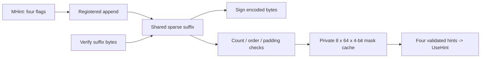

# Current Process blocks

The shared Process path implements four-coefficient arithmetic for KeyGen,
Sign and Verify. It operates on canonical residues modulo q = 8,380,417,
with level-dependent centered/norm interpretation. Controllers own vector
order and lifetimes; Process owns arithmetic, packing and local framing.

## Blocks and responsibilities

| File under src/controller/ | Function | Main users |
|---|---|---|
| `process/poly_process.sv` | Four-lane elastic arithmetic pipeline; operation/tag/error follows each group | All operations |
| `process/power2round.sv` | Split t into t1 and centered t0 using d=13 | KeyGen |
| `process/cnb.sv` | Check coefficient norms against the selected bound | Sign; Verify z |
| `process/mhint.sv` | Form hint flags and count set flags | Sign |
| `process/bitpkg.sv` | Pack coefficient fields into 64-bit encoded words | Keys, signatures, w1 |
| `process/bitunpkg.sv` | Unpack fields and check canonical encodings | Sign/Verify input |
| `process/hint_codec.sv` | Shared canonical sparse-hint encoder and decoder | Sign/Verify |
| `process/secret_regroup.sv` | Regroup compact secret input for shared storage | Key loading |
| `process/sign_hash_message.sv` | Format the signing/verification message hashes | Sign/Verify |
| `datapath/process_dma.sv` | Bank reads, arithmetic operands, low writes, packed output/store and hint transport | All operations |

`hintpkg.sv` and `hintunpkg.sv` also provide standalone hint interfaces. The
integrated datapath uses the shared codec; separate filenames do not establish
multiple instantiated production codecs. Decompose and UseHint arithmetic are
implemented in `poly_process.sv`, not a missing independent RTL file.

## Arithmetic operations

| Operation | What it does |
|---|---|
| ADD / SUB | Modular polynomial addition/subtraction, four coefficients per group |
| P2R | Produce t1 and t0 with t = t1*8192 + t0 modulo q |
| Decompose | Split w into high w1 and centered low w0 for the selected gamma2 |
| CNB | Flag forbidden coefficient magnitudes; polynomial reduction combines lane results |
| MHint | Generate the adjustment flags needed to reconstruct high bits in Verify |
| UseHint | Adjust high bits using the decoded hint and low-part sign |
| PACK pass-through | Feed coefficients through shared formatting without changing their values |

Decompose uses bounded shift/add and correction logic. The elastic pipeline
keeps op, tag and error aligned with four lanes. Input and output handshakes,
not an assumed fixed external latency under stalls, define accepted groups.

## DMA and packing

A full polynomial is 64 bank words. Process DMA selects full or compact
operands, drives the arithmetic pipeline and tracks independent sink credits.
An output consumed by a low-result RAM write must not be duplicated or lost
when the high-part packer stalls, and vice versa. Reduction state collects
reject/hint flags over the polynomial. Packed output can stream to the host
or be stored as low-64-bit words for later hashing.

BitPkg uses format-dependent field widths for eta secrets, t0, t1, z and w1.
Its integrated formatting queue/reservoir holds data during backpressure and
drains the final partial word. BitUnpkg checks field encodings and preserves
index/last/error semantics. Command readiness and final completion include
pending buffered output; accepting a descriptor is not proof the payload retired.

## Shared hints

The codec retains one suffix store with 640 index bits and 64 cumulative-count
bits. Sign encoding registers append positions, accepts four flags per group
when ready, checks omega and drains the last append before publication.
Verify validates monotonic cumulative counts, strict index order per row and
zero padding before releasing decoded masks.

The integrated decoder clears used cache rows during validation and inserts
canonical indices with registered row credits. It emits cached four-bit masks
instead of searching index windows during output. Payload need not be bulk-reset:
every used row is cleared before publication, and invalid suffixes cannot
publish tentative masks. Standalone safe defaults remain available.

## Message formatting

External mode builds tr followed by the pure-message prefix, context and message.
Internal mode builds tr followed directly by supplied Mprime and requires a
zero separate context length. The command latches the mode; changing it while
busy does not reinterpret buffered bytes. Finite SHAKE work, queued input and
accepted output must all drain before hash completion is consumed.

Study [PROCESS_FLOW.md](PROCESS_FLOW.md) for operation ordering and
[MEMORY_MAP.md](MEMORY_MAP.md) for where these results are stored. Full output
comparison tests final behavior; unit checks additionally validate boundaries,
malformed fields, stalls, resets and error publication.
