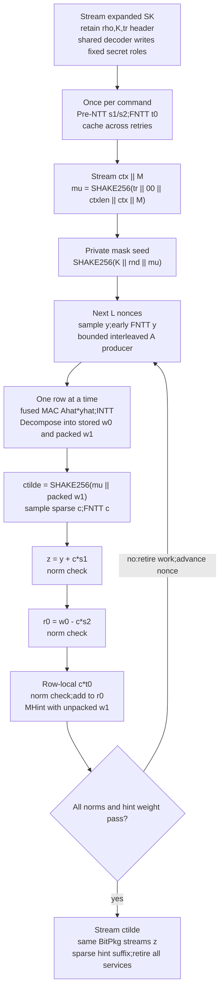
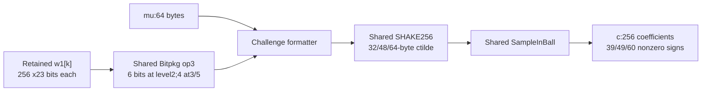
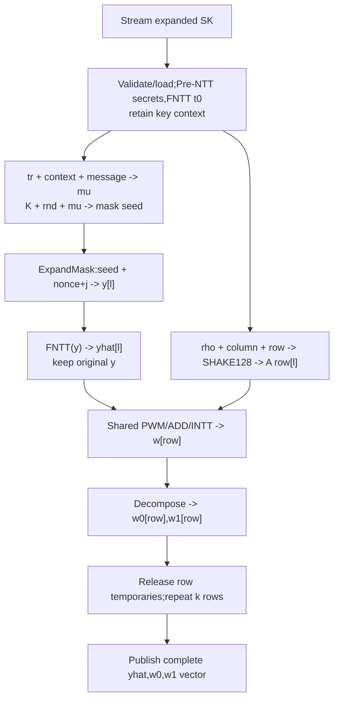

# Dilithium processing flow

## Stage7C selected compact Sign flow

The production main now selects `dilithium`. Its `sign.sv`
uses the approved64-bit frames and the direct-bank shared datapath. Fresh
production210,protocol88 and main UVM33 pass across all three operations:

The norm checks may reject early; the remaining attempt work is then skipped.
No signature is published for a rejected attempt. The sparse hint formatter
is cancelled on retry, but the transformed secrets remain in their fixed
banks. The controller reports completion only after the output suffix and
physical services retire. Reset invalidates all control state; a new command
reloads every required secret before use. Final FIPS hashes and field lengths
are required format adaptations to the paper, not claimed performance gains.

## Stage7C compact Verify flow

1. Stream PK and SIG into the shared decoder/writer. Fork PK words into the
   same SHAKE engine to obtain tr64. Retain rho/ctilde headers, check z norms
   with shared CNB, and validate sparse hints before writing them.
2. Stream ctx||M. The existing final-FIPS formatter computes mu absorption.
   Sample c from ctilde and transform it, then transform z and shifted t1.
3. Overlap bounded A-ring production with transforms and row computation.
   Reuse one accumulator for Ahat*zhat, subtract chat*t1hat in NTT domain,
   then perform one inverse for the row.
4. Shared UseHint reads the row coefficients and that row's hint bits.
   The same BitPkg stores the resulting w1 in its disjoint packed span.
5. After all sampling/rows retire, hash mu||packed w1 and compare the full
   required ctilde length. Publish valid/invalid only after physical retirement.

No per-helper pool adoption or copied operand-handle lists are used. A
noncanonical signature or wrong signature length is normal invalidity;
transport framing still reports stage/detail. The shared main serializes
operation ownership while the engines overlap work within each operation.

## Stage5V.4 host-to-verdict main Verify (preserved production baseline)

1. Accept op2 and snapshot level,ID,signature/context/message lengths. Reject
   invalid command bounds;return normal invalid for wrong signature length.
2. Grant Verify exclusive services. Stream PK and signature through input
   preparation. A bad signature norm/hint encoding is normal invalidity;
   clean loaded regions and stop before consuming the body/arithmetic.
3. Math preparation atomically takes the raw context,accepts ctx||M,computes
   mu,samples c and prepares transformed operands using shared NTT/Pre-NTT.
4. Equation preparation takes that result,computes the public verification
   equation,applies UseHint,then packs/hashes and compares c2 with ctilde.
5. Retire equation and clear any unadopted math/input contexts. All Verify
   regions are gone before the parent publishes held done/code0/accept1 or0.
6. The host acknowledges completion. Only then may the next operation start.
   KeyGen,Sign and Verify share the same engines/pool and cannot overlap owners.

The host sends no00/context-length prefix;the existing formatter adds it.
Each of the three64-bit frames restarts its word index0. Stop offering unused
frames after early invalid/error completion. Errors carry stage1/2/3 and the
child code;fatal raw/physical faults halt until reset. See PIN_CONFIG for
signals and REFERENCE_VERIFICATION for execution/results/study order.

## Stage5V.3 equation and challenge comparison

1. Validate the prepared context and plan free workspace before taking it.
2. For each matrix row,sample L Ahat polynomials from rho||column||row.
3. Shared PWM computes Ahat[j]*zhat[j];in-place ADD accumulates the row.
   Compute chat*t1hat[row] and subtract it in NTT representation.
4. Run one shared inverse NTT into W[row],then release that row's A and
   accumulator/product scratch. Retain the W rows and original context.
5. Read four W coefficients and four hints at a time. UseHint corrects each
   high part;shared Bitpkg emits packed w1 bytes directly to the formatter.
6. Shared SHAKE256 computes c2=H(mu||packed_w1).32/48/64. Compare every c2
   byte with original ctilde. Free every adopted/new region,then hold the
   valid/invalid verdict until acknowledged. Foreign owners remain intact.

Read/packing failures drain the finite operations before cleanup;fatal raw
identity/physical faults wait for reset. Main host op2 connection follows in
5V.4;this component already uses the real preceding preparation stages.

## Stage5V.2b third frame and NTT preparation

1. Snapshot command lengths/ID and raw context headers/handles. Validate
   unique handles,matching identity,complete leases,quiescence and finite
   message-length bounds. Take the upstream context atomically.
2. Stream ctx||M through the existing pure-message formatter and shared
   SHAKE256. Absorb tr64||00||ctxlen_byte||ctx||M and capture tagged mu64.
   A malformed beat causes zero-draining to retire that failed hash;discard
   its digest and release adopted regions before reporting the error.
3. Find a free region and SampleInBall(ctilde) using the shared Keccak/sampler.
   Its256 canonical coefficients are0,1 or q-1;wait for memory finish/retirement.
4. Find one free NTT work region. For each shifted-t1 and z polynomial,FNTT
   source->work,retire the engine,release source,and rotate work to that slot.
5. Transform c through existing Pre-NTT op3. It must match ordinary FNTT(c).
   Release raw c. Keep dense hints in coefficient domain throughout.
6. Publish retained t1hat/zhat/hints/chat,rho,mu,ctilde and held preparation
   status. Clear frees it;take transfers it. Pending read responses block both.

Next5V.3 uses these handles for Az-c*t1hat,inverse NTT,UseHint,packing w1 and
recomputing/comparing ctilde. Preparation alone is not a signature verdict.

## Stage5V.2a PK/signature preparation

1. Snapshot level,ID,signature length and region base. Reject bad length/range,
   nonquiescent services/pending reads,or collisions with existing leases.
2. Admit PK load and matching SHAKE256(PK)->64-byte request on one edge.
   Fork each accepted64-bit host word once to each sink under backpressure.
3. Decode shifted t1 into K tentative regions;capture rho32. Capture four
   tagged128-bit digest beats into tr64;retire the raw core and loader.
4. Accept the signature as a new frame,index0. Decode L canonical z and K dense
   hint polynomials,capture ctilde and commit the whole signature frame.
5. On success publish12/17/23 handles with rho,tr,ctilde and held done0.
   Clear frees them;take transfers them. Pending read responses block both;
   simultaneous clear/take selects clear.
6. On frame error stop host acceptance,drain the finite raw request if needed,
   discard partial/current frame commits,release parent-owned regions,and
   publish error only after cleanup. Service protocol faults require reset.

This ends before the approved third ctx||M frame. Next5V.2b computes mu and
challenge/NTT preparation. No context here is a cryptographic validity result.

## Stage5V.1 Verify front end

1. Snapshot one frame's kind,parameter,ID and declared length.
2. Check and stream rho/ctilde header;decode t1<<13 or centered-to-canonical z.
3. Reject z at or above gamma1-beta in magnitude;already streamed values remain
   tentative and must be discarded by the future memory owner.
4. Collect at most84 suffix bytes;validate cumulative counts,strict per-row
   ordering and zero padding. Expand accepted sparse hints to dense0/1 values.
5. Publish held completion;code0 commits the decoded frame only. Reset clears
   the reservoir,suffix,header,counters and pending output.

Full Verify still needs the shared-memory/hash/arithmetic flow before a main
valid/invalid result can be returned. The approved main stream has three
frames,PK/signature/ctx||M;this component handles the first two separately.

Stage5N.4h.7 applies the flow below to90 official pure/public Sign cases.
For deterministic signing rnd=zero32;randomized cases use the prompt's rnd.
The host supplies original SK and ctx||M;the expected signature is only used
after simulation by Python. Official prehash/internal-API groups are excluded
with explicit audit reasons. See REFERENCE_VERIFICATION.md for results.

## Stage5N.4h.6 real main Sign flow

1. Accept op1,parameter,ID,lengths and rnd. Receive the expanded SK frame.
2. Decode rho,K,tr,s1,s2,t0 into the existing banks. Use existing Pre-NTT for
   small s1/s2 and forward NTT for t0,rotating one spare region.
3. Accept ctx||message as frame2. Calculate mu=SHAKE256(tr||00||ctx_len||ctx||M)
   and the private mask seed=SHAKE256(K||rnd||mu),64 bytes each.
4. Run the existing y sampling,matrix/NTT,decompose,challenge,products,CNB and
   hint checks. Normal rejection frees attempt payload and increments the
   polynomial nonce while retaining mu/seed/key;the host does not replay M.
5. Adopt the accepted z/hints/ctilde and stream the complete encoded signature.
6. Free all attempt/key regions,then publish held main completion. Code0
   validates the output frame. Recoverable errors clean up before completion;
   fatal faults/reset invalidate the request and all provisional bytes.

The host may stall either input frame or signature output. The gap between SK
and body includes key transformation;input ready tells the host when to proceed.
Main service ownership and debug-read isolation span that whole interval.
Verify remains unsupported;Stage5N.4h.7 above now checks90 official pure Sign cases.

## Stage5N.4h.5 final signature encoding

1. Retire accepted attempt completion while retaining z/hints/ctilde.
2. Validate descriptor/complete sources,wait for quiescence,and take the whole
   context atomically. Preflight failure preserves the old owner.
3. Stream ctilde32/48/64 bytes. Read each z as64 packed92-bit words and feed
   four23-bit coefficients per word into shared Bitpkg op4:576/640 bytes/poly.
4. Scan binary hints in ascending index order,emit indices,pad to omega and
   append cumulative counts. Flush the final4/5/3-byte partial output word.
5. After last-byte acceptance,release all adopted regions before held code0.
   Error/reset invalidates previous output bytes. Retain the prepared key.

The focused harness executes real key preparation and the retry loop first.
The main host/controller Sign dispatch is the next integration connection.

## Stage5N.4h.4 automatic retry

1. Retain the prepared key;stream ctx||M once to the initial mask front end.
2. Run mask -> matrix/decompose -> challenge -> challenge transform ->
   products -> norm/hint checks through the existing shared services.
3. If checks reject,wait for complete payload cleanup,then take mu,seed and
   nextnonce into the parent on one handshake. Do not consume more message.
4. If nextnonce+l exceeds65536,stop with code6. Otherwise sample the next
   y vector directly from the retained seed and continue at the matrix step.
5. If checks accept,retain z,hints and ctilde;hold done/result until the caller
   reads,clears or adopts them. Counters report actual attempts/rejections.
6. Service errors stop retries and clear retained clients in reverse order.
   Fatal faults require global reset;the key survives ordinary cleanup.

Next:encode ctilde,z,h into final signature bytes and connect main Sign.

## Stage5N.4h.3 candidate verdict

1. Take the products context and private retry headers as one owned result.
2. Check all z norms,then r0 norms,then ct0 norms;stop at first rejection.
3. For a norm-clean attempt,ADD r0[row]+ct0[row] in place.
4. Generate the row's hints against retained w1 using shared Mhint.
5. Accumulate row weight with12 bits;above omega discards the whole attempt.
6. After each passing row,release old low/high/ct0 and rotate the hint spare.
7. Accept:retain z,hints,ctilde and retry headers. Reject:release every attempt
   region and retain mu/private seed/next nonce. An actual service error
   publishes an error instead. Global reset is required after fatal faults.

Next:feed a rejected outcome into nonce retry using the retained private seed,
without replaying the message. Then pack ctilde,z,h into signature bytes and
connect the main Sign controller. Those steps are not provided by this helper.

## Stage5N.4h.2 challenge products into the response

1. Adopt raw-y and transformed-challenge contexts together,including retry headers.
2. For every s1:shared PWM + INTT gives cs1;in-place ADD gives z=y+cs1.
3. For every s2:shared PWM + INTT gives cs2;in-place SUB gives r0=w0-cs2.
4. For every t0:shared PWM + INTT gives retained ct0.
5. Release scratch after last reads and chat after all products;retain z,r0,
   w1,ct0,mu,private seed,ctilde and next nonce.

Next come z/r0/ct0 norm checks,hint generation/weight,rejection/retry and
signature packing. An arithmetic-complete result may still be rejected by
those algorithm checks. Main Sign/Verify remain unfinished.

## Stage5N.4h.1 challenge into the NTT domain

After c is complete,the matrix and challenge clients transfer their results
together. Release yhat,compute chat=FNTT(c),validate storage,then release raw c.
w0,w1 and ctilde remain available for the next arithmetic stage. The original
key and y survive. Next connect chat*s1,chat*s2 and chat*t0,then the inverse
transforms and response/norm/hint logic. Full main Sign remains unfinished.

## Stage5N.4g challenge generation

Rows are concatenated in order,without per-row padding. Encoded w1 has
768/768/1024 bytes at levels2/3/5. ctilde is the challenge seed which will
appear in the signature;c is its sparse polynomial expansion for arithmetic.
The focused chain now reaches c from real SK,message,rnd and nonce inputs.
Next are challenge/secret products,z,w0 corrections,hints/norms and retry.
It does not yet emit a complete signature.

## Stage5N.4f one signing attempt through decomposition

The working clients now connect as follows in the focused integration harness:

The outer Sign owner retains both key and original y throughout. Matrix data
is already in NTT representation. Each descriptor waits for child retirement
and acknowledged storage;the whole result remains private through the last
row and cleanup. Independent focused checks establish these intermediates.
Still to connect:pack/hash w1 into challenge,challenge/secret products,z and
hint/norm checks,rejection/retry,signature bytes and the complete main Sign.

## Stage5N.4d prepared key and retained context

1. The outer operation owner drains previous services and grants preparation.
   Snapshot level/ID/base/scratch;reject alias,overflow or occupied plans.
2. Decode/load the full expanded secret key through the real shared service.
   Preserve validated rho,K,tr;keep the parent context invalid/private.
3. Transform s1 and s2 with eligible Pre-NTT,t0 with ordinary forward NTT.
   Write into one spare region. Check result identity and complete allocation.
4. Release the old source only after validated success. Reuse that freed
   source as the next scratch and update the polynomial's retained handle.
5. Publish the complete prepared-key context. Hold done,then retain context
   in READY. The outer Sign owner can now schedule hash/mask/vector clients
   against those handles without handing the key to unrelated host traffic.
6. At final clear,drain pending consumer work/read responses,zero the exposed
   context and release all prepared regions. Normal errors clean all owned
   raw/replacement regions before done;physical faults require global reset.

This is a complete preparation phase,not full signature generation. Next:
connect retained key fields to signing-message hashes and mask generation.

## Stage5N.4c2 key-to-shared-process handoff

1. Present load fields through the existing services record. Existing row/NTT/
   scalar/sign owners,pending public reads and active Keccak/sampler jobs drain
   first. A newly accepted key excludes simultaneous public read/release.
2. Stream the complete expanded key. The production bank arbiter now enforces
   private whole-key writes,acknowledged commits and late-error rollback.
3. Hold successful header/region handles or the error result until done-ready;
   other request classes cannot interrupt this owner. A queued row does not
   block its payload or retirement.
4. Retire load ownership. Existing public reads and compute commands may now
   use validated decoded regions. Tests hand valid s1 to real read-only CNB
   before reading back/releasing the complete key.

Retaining the header and scheduling transforms/hash work in a working main
Sign controller is next;this checkpoint does not generate complete signatures.

## Stage5N.4c1 complete-key loading flow

1. Snapshot level,ID and starting region. Validate that all12/17/23 required
   regions fit and are free. Reject before consuming key bytes if not.
2. Run the existing decoder;accept its private header internally. Pack decoded
   s1,s2,t0 coefficients into consecutive regions using the existing memory.
3. Wait for all64 word acknowledgments before finishing each polynomial.
   Keep earlier finished regions hidden while later key bytes are unvalidated.
4. If decoding fails,discard the active partial allocation,release all earlier
   commits,then return an error with zero header/region outputs.
5. On complete success,publish the header and region mask together. Retain
   leases until held done retires. The later Sign controller retains these
   handles before requesting transforms and hash operations.

Current testing uses real banks in a focused harness. Connecting this flow to
the one production shared-service arbiter is Stage5N.4c2;main Sign is pending.

## Stage5N.4b signing hash flow

1. Snapshot relevant key/hash/length/nonce fields;reject invalid level,context
   or overflowing16-bit total length before launching any descriptor.
2. Submit raw SHAKE256 or mask-sampling descriptor to the existing service.
3. Merge prefix and streamed payload into ordered64-bit absorption words;
   ignore poisoned unused bytes and check payload index/bytes/last.
4. On malformed payload,stop consuming it,zero-fill the remaining declared
   absorption length and mark the complete result invalid.
5. Wait for hash output(s) and raw retirement,or sampled polynomial/status.
   A successful formatter done alone does not release the service owner.
6. Only code0 plus service retirement allows mu/private-seed forwarding or
   other valid result use. Then retire held formatter completion.

Real mu ->private seed/challenge and private seed ->mask chains are checked.
The decoder/memory owner and full Sign scheduler are still to be connected.
Next:decoded-key bank ingestion with whole-key publication/rollback.

## Stage5N.4a decoded signing inputs

1. Accept level and job ID for an expanded secret-key stream.
2. Check indexed8-byte words;retain rho32,K32,tr64 and present a held header.
3. Unpack s1[l],s2[k],t0[k] through a76-bit reservoir;emit canonical23-bit
   coefficients with section/poly/index/last/ID metadata.
4. Reject unused eta encodings and malformed word metadata. Earlier outputs
   remain tentative until complete-key success;reset cancels partial state.
5. Retire held done. A subsequent command can reuse the same ID with new bytes.

This process is independently tested with all75 official KeyGen secret keys,
local boundaries,malformed inputs and five reset checkpoints. It is not yet
connected to signing memory/control. Next build signing hash messages;then
connect ingestion,vector reductions,retry and signature packing.

## Stage5N.3 checked process-memory flow

1. Accept a tagged Decompose/CNB/Mhint request after existing service owners drain.
2. Lease sources immediately;read/validate owner,region,word,level and coefficient domain.
3. Wait for selected result regions to become free;allocate two for Decompose,
   none for CNB,one for Mhint.
4. Read64 ordered x4 groups,rechecking metadata and retained modes. Check all
   stored high23 bits before narrowing for Mhint.
5. Feed sign_process. Store canonical lows/highs/hint bits through the existing
   scalar packers;CNB only accumulates a rejection flag.
6. Wait for64 acknowledged result words per destination and finish handshake(s).
   Publish both Decompose outputs together. Hold completion and leases until accepted.
7. On late error,drain/discard every tentative destination before reporting an
   error;clear partial reductions/tracking. Reset cancels ownership.

This path is integrated into dilithium_services and tested using real sampling
and shared memory. Main Sign does not issue it yet. Next implement signing
key/input decode and hash formatting,then vector checks/retry/signature control.
Earlier milestone paragraphs below describe their historical state.

Stage5N.2 adds the arithmetic for the next signing steps:
Decompose(w) supplies high/low parts;CNB checks z,corrected low and ct0 bounds;
Mhint derives hints from corrected low plus retained high. sign_process checks
64 ordered x4 groups and returns norm/hint prefix reductions. These blocks
are independently verified now;they do not yet receive commands from Sign.
Next connect shared-bank DMA and acknowledged result publication,then signing
inputs/hash/retry/packing control. Complete KeyGen remains the active operation.

## Stage5L implemented complete KeyGen sequence

1. Main FSM accepts operation0,level2/3/5,ID and32-byte xi.
2. Existing RTL expands xi,samples s1/s2,retains/Pre-transforms s1,and
   processes every matrix row through PWM/ADD/inverse,s2 addition and P2R.
3. Full-key mode accepts row results internally;retained t1/t0 stay in the banks.
4. After all matrix sampling finishes,submit the PK hash descriptor to the
   same raw SHAKE service. Stream rho and Bitpkg(t1) to host and hash exactly
   once each,with independent backpressure.
5. Collect64-byte tr and retire that physical hash request.
6. Stream rho,K,tr,Bitpkg(s1),Bitpkg(s2),Bitpkg(t0) as the secret key.
7. Wait for every word and packet completion,then assert held overall done.
   On its acceptance,free retained regions and allow the next operation.

Both complete keys match the unmodified final-format C KeyGen at all levels.
Stage5M also matches all75 official NIST keypairs. Next add the Sign
controller/remaining LightHD process blocks on the existing shared resources.
Full UVM/PPA optimization remains
after supported operation outputs. No Sign/Verify functionality is claimed yet.

## Stage5K rounding before key encoding

With ROUND_OUTPUTS=1,the autonomous scheduler now performs P2R after every
t=A*s1+s2 row. It stores all t1/t0 fields in dedicated existing bank regions,
preserves them across subsequent matrix rows,and makes them readable while
overall completion is held. Existing temporary cleanup still follows each t row.

The working Bitpkg block encodes one polynomial field per command. Its t1,
t0 and secret bit order agrees with the software C packers at all levels.
It is currently independently exercised;the next step is a bank read/field
sequencer for rho,t1,rho,K,tr,s1,s2,t0 in final key order,plus SHAKE256(pk,64)
for tr. Complete public/secret-key byte outputs are not yet claimed.

## Stage5J autonomous polynomial execution

Only a start operation,level,ID and32-byte xi are required:
RTL expands the seed; samples s1 nonces0..l-1 and s2 noncesl..l+k-1;
retains raw secrets; Pre-transforms s1 once; samples each A_hat row;
runs PWM/accumulation/inverse; adds s2[i]; and presents tagged coefficient
rows t_i. The caller reads and accepts each row. RTL frees row temporaries,
retains secrets/transforms until overall completion acceptance,and cleans
them up before accepting another operation.

This phase now runs for levels2/3/5. It ends at t=A*s1+s2. Still required:
Power2Round integration into this KeyGen schedule,t1/t0/secret byte packing,
public-key hash tr and complete public/secret-key output. The P2R arithmetic
is implemented under process/ and already independently tested.

## Stage5I implemented seed-to-row path

1. Submit op0 with xi32 and level. RTL sends xi||k||l to the same dual Keccak,
   accepts eight128-bit output beats and retires the raw request.
2. Retain rho32,rho-prime64,K32. Hold source completion until accepted.
3. Submit op2 with an s1 nonce and explicit bank region. RTL formats the secret
   message and waits for actual sampling plus acknowledged memory publication.
4. Use eligible Pre/ordinary NTT to retain transformed s1. Submit op1 descriptors
   for A[row,column];RTL formats each matrix message from retained rho.
5. Run the existing row scheduler through PWM,accumulation and inverse NTT.
   Seed state and transformed secrets survive ordinary row completion;reset
   invalidates them together with bank metadata.

This complete connected path now passes selector5/seed_row. The bench still
schedules commands;the adapter is not an autonomous KeyGen sequencer.
Next:generate all s1/s2 nonces and matrix rows under controller control,add
s2[i] to each inverse row,then Power2Round and serialize the keys.

## Selected first KeyGen direction — LightHD memory/reuse

Final FIPS204 bytes are selected,with level2/3/5 names. The user chose LightHD's
four-bank organization and reuse strategy. The bank foundation passes its tests;
Stage5E connects sampling,per-context word packing and region ownership;
Stage5F adds source leases,word DMA and NTT result storage;Stage5G adds banked
ADD/SUB/Power2Round with low/high result storage. Stage5H adds staged-row
PWM/accumulation/inverse scheduling. Full KeyGen/Sign phase scheduling remains
next. Figure2 is the peak
Sign memory map,so complete KeyGen addresses/ownership must be derived and
checked rather than assumed to be fully specified by that figure.

1. Expand a test-supplied32-byte seed into rho,rho-prime and K using the selected
   reference's exact input formatting. The optional shared raw-hash service and
   keygen_seed_collect now pass their focused gate. The tested
   keygen_hash_message builder now emits SHAKE256(xi32||K||L),requesting128 bytes.
   Collect bytes0..31 as rho,32..95 as rho-prime,and96..127 as K(key seed).
2. Sample s1 and retain secret data for key encoding/subsequent signing. Schedule
   s2 once alongside the matrix stream as capacity permits. Use eligible
   Pre/NTT for s1 and retain transformed s1 for reuse across matrix rows.
   For each matrix row i and column j,sample A_hat[i,j] using exact
   row/column/secret nonces. The formatter emits rho||column||row for A and
   rho-prime||nonce_le16 for secrets. s1 uses0..L-1;s2 uses L..L+K-1.
   A_hat is already transformed;do not forward-transform it again.
3. Compute PWM and accumulate the row in transform domain using modular ADD.
   Reuse a64-word accumulator region across columns. Consume bounded A staging
   entries as they are generated;do not regenerate s1 for each row as in the
   superseded four-slot proposal. Prove read-before-overwrite on accumulator reuse.
4. Inverse-transform the row sum,obtain the stored/scheduled s2[i],and add it
   modulo q. Preserve each raw secret until key encoding has consumed it;do not
   overwrite its only copy merely because a transformed cache exists.
5. Power2Round each t coefficient into t1 and t0;encode them using the selected
   byte format. Preserve t0 until the chosen key-output/storage destination owns it.
6. Hash the complete encoded public key to obtain tr;encode the secret key
   with the required seed/hash/secret/t0 fields. Byte order and hash length
   must follow the selected version. Compare complete keys with its reference.

The shared coefficient ADD/SUB/Power2Round unit now passes its isolated tests.
The shared raw hash service,seed/nonce builder and seed collector pass focused
tests and now feed the banked row path in Stage5I. Process/memory routing
passes Stage5G/H. Still required:byte serializers/key storage and the actual
main-controller schedule. See MEMORY_MAP.md for the selected dimensions and
published Sign regions. The prior four-slot regeneration/ten-slot proposals
are superseded. Extra encoded-key buffers are not silently allocated.

## Current Stage4 sampled-polynomial arithmetic

1. Submit real sampling jobs and wait for successful slot commit using the
   producer/storage flow below. Keep Matrix A marked transform-domain.
2. Present opcode,source slot(s),expected source ID(s) and a new result ID.
   The helper accepts the command after active sampling and old reads retire.
3. Memory validates state/IDs/domain/Pre eligibility and PWM parameter agreement.
   Invalid requests return a held rejection reply without starting the engine.
4. For a valid request,wait for a free destination,lock sources and reserve it.
   Inputs remain stored. The four-slot pool may need an unrelated slot released
   before proceeding;no implicit overwrite or automatic input release occurs.
5. DMA reads A indices0..255,and B0..255 for PWM,with one outstanding read.
   Engine arithmetic uses normal canonical residues;INTT includes its scaling.
6. Write results0..255 into the reserved slot. Wait for engine done,then commit
   the destination and unlock sources. Offer the tagged completion until accepted.
7. Read/consume the completed result and explicitly release slots after their
   scheduled consumers finish. A new NTT job is not loaded while one is active.

Tested mathematical chain:A_hat (directly sampled) and s -> NTT(s) ->
PWM(A_hat,NTT(s)) -> INTT -> coefficient polynomial. Python independently
checks this against schoolbook(inverse(A_hat),s) in Z_q[x]/(x^256+1).
Pre(s) equals NTT(s),and INTT(NTT(s)) equals s exactly. Reset cancels the
whole subsystem during DMA load,core execution or writeback;new jobs recover
with fresh messages,including reusing the same source/result IDs.

This is still a subsystem flow. Full KeyGen/Sign/Verify scheduling,seed/nonce
assembly and remaining process blocks come in Stage5.

## Preserved Stage3 memory transaction

1. Reserve a free polynomial slot on the same handshake that accepts the job;
   capture job_slot_o and actual job_core_o for the future controller.
2. Run the Stage2 SHAKE/sampling flow below. Tagged coefficient writes must
   match the slot owner,index,last and canonical range.
3. Keep the slot WRITING through all256 writes and source drain. A premature
   read returns an error;the last coefficient alone does not commit the slot.
4. Successful external status acceptance commits COMPLETE. An expected error
   frees the slot;reset invalidates all slots and pending responses.
5. Request coefficients by slot/index. A synchronous response carries data,
   job ID,mode,parameter and domain;hold it stable under backpressure.
6. Release the slot explicitly after its scheduled consumers finish. A pending
   read response blocks release. Pool exhaustion stalls new jobs.

The focused testbench drives public reads/releases. Stage4 additionally supplies
NTT compute descriptors and checks DMA/result/commit behavior.

## Preserved Stage2 producer transaction

1. Present the sampling mode,parameter encoding,ID and absorption-message length.
2. Hold the descriptor until ready/valid accepts it;capture assigned core.
3. Feed exactly the declared message on64-bit beats,earliest byte in bits7:0.
   Keccak handles the final partial word using the declared byte length.
4. Keccak absorbs,pads,permutes and produces a tagged SHAKE stream.
5. The shared two-slot registered-credit queue passes data/byte count/core to the matching
   sampler context. Concurrent jobs keep separate parser/carry state.
6. The sampler emits256 canonical23-bit coefficients,with job ID,core,index and
   last. The Stage3 receiver is polynomial memory;the preserved Stage2 test
   still checks the producer stream directly.
7. On sampler stop,the adapter drains/discards surplus,then stops Keccak after
   releasing its held output. It waits for old source tokens to retire.
8. The external status handshake releases the context for a new job.

Invalid parameter3 produces the existing parameter-error status after safe
upstream retirement. A coordinated reset cancels both jobs;partial polynomials
must be discarded. The focused test checks accepted partial prefixes and then
checks same-ID recovery with different messages.

## Implemented versus planned

| Operation | Current ownership |
|---|---|
| Raw absorbed message generation | Stage4 uses test vectors;isolated keygen_hash_message now formats final KeyGen seed/A/secret messages;not connected to main top |
| Raw hash/seed collection | Optional service in keccak_sampler plus keygen_seed_collect;focused seed-to-real-sampler gate PASS;main Stage4 top disables the raw client |
| SHAKE128/256 | Accepted Keccak RTL |
| A/secret/mask/challenge sampling | Accepted sampler RTL |
| Job binding,two-slot credit bridge,stop/drain | controller/keccak_sampler.sv |
| Polynomial allocation and memory writes/readback | controller/memory.sv and keccak_sampler_memory.sv;Stage3 source PASS |
| NTT/INTT/PWM/Pre-NTT | src/ntt/ imported unchanged;controller/keccak_sampler_ntt.sv DMA/source locks/result commit;Stage4 source PASS |
| Banked NTT routing | controller/keccak_sampler_ntt_banks.sv;sequential92-bit word DMA,source leases,shared packer and acknowledged result publication;Stage5F PASS |
| Modular ADD/SUB and Power2Round | poly_process.sv plus process/poly_process_dma.sv;Stage5G banked path PASS with PROCESS_SERVICE=1 |
| Staged matrix-row execution | row_accumulate.sv plus keccak_sampler_row.sv;Stage5H returns u_i=INTT(sum_j A_hat[i,j]*s1_hat[j]);one reused accumulator/product scratch;PASS |
| Full KeyGen/Sign/Verify schedules,decompose/hints/encoding | Later controller/process stages |

A is already transform-domain data and will go to operand storage/PWM. Small
secrets can later use ordinary NTT or eligible Pre-NTT with one owner for the
first-stage work. Final FIPS204 is the selected format;complete controllers,
memory scheduling and exact-output checks remain before a full-operation claim.
