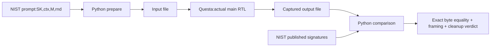

# Dilithium reference verification

## Latest C16 complete qualification

Main token `35e3b644e9e34fad0e38ced055dc13578cc161a5f04e9b118ca48660ba40341b`.
Full210 official commands/744280 published bytes/35independent Verify digests/
9valid36invalid verdicts pass. Protocol88/148704prefix-full bytes and all90
checker corruptions pass. Main33 UVM/negative and the240-source audit pass.
All payload/status/attempt/rejection/nonce records equal C15;latency changes
are measured,not retagged as exact cycles. Physical and new184bit operand/
tag/valid guards pass;actual31893ALMs/worst63MHz,targets open.

Actual production range logic matches frozen C15 RTL across134217728norm/
67108864hint coefficient comparisons,including all23-bit values. Process
unit5843accepted/5840checked/three reset discards and actualRAM DMA64cases/
11008coefficients/464packed words pass. Operand monitoring checks4083refills/
3900consecutive accepts/651stalls/three occupied-buffer resets. All prior
router/codec/NTT160/split48/BRAM/main9 independent gates also pass. Evidence:
`evidence/stage7c16_registered_process_qualified.zip`/SHA.

## Previous Stage7C.10 source qualification

Main token`0868e40c579eef6a5a83d193ae9fcc2588d32172719534f42c000c32051e2271`.
Fresh main210 passes75 KeyGen/90 Sign/45 Verify,744280 exact published bytes,
35 independent equation digests/9 valid36 invalid verdicts. Protocol88 checks
148704 prefix/full bytes with29 errors,3 normal invalids,12 resets and44 same-ID
recoveries/44 busy probes. All90 deliberate checker corruptions reject.
Main UVM33/negative passes. Full non-timing payload/status/attempt records are
exact C9R1;new cycle costs are measured in stage7c10_cycle_audit.log.

Fresh real-bank NTT160 checks40960 coefficients,48 deliberately split A/B
renewals/48 ownership checks,and10240 concurrent-write readbacks (10176 writes
overlap active computation). Its contention trigger follows the real two-port
renewal-valid window after the new completion registers. Direct-memory28,
BRAM23397 requests,hint106/18 checker faults,and mixed9/27700 published bytes
also pass. The bank-port geometry/ADMIT source is unchanged from its focused
qualification. Only the NTT adapter differs from C9R1's98 archived RTL files;
other97,QSF/SDC and engine arithmetic are exact. Full compile/ASM/STA and
retained/four-corner checks pass:34660 placed ALMs,25339 registers,59M10Ks,
8DSP;worst Fmax56.65MHz/setup-10.894ns/hold+0.122ns. All20 control bits
retained and no combinational loops.148MHz target remains open;no Stage8,
board throughput or security signoff follows from this qualified checkpoint.

## Frozen Stage7C.9 R1 source qualification

Main token`5d46a1e1379a3decc1fd0863f330d2beb66087227e0a93792d803c9d1f3755fa`.
Fresh main210 passes75 KeyGen/90 Sign/45 Verify,744280 exact published key/
signature bytes,35 equation digests and9 valid/36 invalid verdicts. Protocol88
passes29 errors,3 normal invalids,12 resets and44 same-ID published recoveries,
checking148704 prefix/full bytes. All90 deliberate checker faults reject.
Main UVM33/negative passes. Full non-timing payload/status/attempt records
remain exact C8;operation cycles are newly measured in THROUGHPUT.md.

The initial ADMIT-only attempt fails mixed Verify and was stopped/preserved
under reference_build/stage7c9_initial_failure.zip. It is not a qualification
or PPA result. R1 also repairs split-port retirement:the NTT adapter remembers
completed reads,and8 router bits retain a physical REPORT/owner until renewal
wins arbitration while exposing each completion to the client once.
Expanded160-case real-bank NTT testing deliberately splits48 A/B renewals;
all48 reservations,40960 coefficients and10240 concurrent-write readbacks
pass.10176 side writes overlap active computation. The same legal contention
fails on frozen C8 RTL at1110ns,proving the newly exposed phase-sensitive race.
Those diagnostic outputs remain separate from passing captures.

The ADMIT gate covers8448 commands (2465 valid/5983 invalid),128 admission
resets,post-acceptance live-input mutation,consecutive disjoint-bank commands
and atomic REPORT renewal. Geometry compares16842752 cases with the original
formula. R1 reuses those two checks only after proving port RTL/ADMIT-bench
identity;the geometry function is unchanged. Fresh direct-memory28,BRAM23397,
hint106/18 checker faults and mixed main9/27700 published bytes also pass.
Only3 of98 archived RTL files change from C8;QSF/SDC and other95 are exact.
Engine arithmetic and public streams are unchanged. Same-device physical
qualification passes at34535 placed ALMs/25404 registers/59M10Ks/8DSP. All18
new admission/deferred-retirement bits are retained. Worst Fmax53.85MHz/
setup-11.812ns/hold+0.121ns;there are no combinational loops. This is slower
than C8 and is NOT performance-accepted. The148MHz target remains open.

## Frozen Stage7C.8 source qualification

Main token`866a964ab5b1746291685ecec73cde002aa9f88edc11014a45726b4e88b3e3b3`.
Fresh main210 passes75 KeyGen/90 Sign/45 Verify,744280 exact published key/
signature bytes,35 independent equation digests and9 valid/36 invalid verdicts.
Protocol88 passes29 errors,3 normal invalids,12 resets and44 published same-ID
recoveries/44 blocked busy probes,checking148704 prefix/full bytes. All90
deliberate checker corruptions reject. Main UVM33/negative also passes.
Full native94312/18793 capture records after source headers and all30 UVM
latency rows are EXACT C7. Checked-CSV source tokens are individually validated,
not rewritten to make the rows compare. See stage7c8_cycle_audit.log.

The only RTL change from C7 is bank-port geometry arithmetic. The new actual
RTL is compared with the frozen C7 admission expression across16842752 cases:
all1024 bases,2048 encoded counts,4 modes,2 directions plus65536 bank/write-mask
trials. This is a two-state command-field equivalence gate;it does not replace
the real memory,protocol or end-to-end tests. Fresh BRAM23397 requests,direct
memory28 commands,NTT160 real-bank operations/40960 coefficients/10240 overlapping
other-client writes,hint106 cases/21510 x4 words/18 checker faults,and mixed
main9/27700 published bytes pass. QSF/SDC and97 other archived RTL files are
byte-identical to C7. Same-device full compile/ASM/STA and retained-hardware/
four-corner analysis pass. Actual placed34333 ALMs/25358 registers/59M10Ks/
8DSP;worst Fmax55.53MHz/setup-11.251ns/hold+0.121ns. The148MHz target still
fails setup. Source qualification is not timing closure or board signoff.

## Frozen Stage7C.7 qualification

Main token`f2ba6af50400edece6ae9dd3522eeb678aba239e4ffe3a3555766427446e2732`
passes210 official commands/744280 exact published key-signature bytes/
35 independent Verify digests/9 valid36 invalid verdicts. Protocol88 checks
148704 prefix/full bytes and all errors/resets/recoveries. Checkers reject90/90
corruptions. All non-timing records in the full capture are exactC6;new cycle
costs are reported in THROUGHPUT.md rather than reusing old latency evidence.

Focused gates pass89 unpacker packets/15556 coefficients/29 invalids/6 reset
recoveries;71 shared-decoder packets/3472 RAM words/29 invalids/6 resets;
135 SK-load commands/105 complete published SKs/21 rejects/9 resets;
105 Verify-input commands/48832 exact bank words/9 resets;and mixed main9/
27700 exact published bytes. The refill algebra passes9216 combinations.
Admission checks ID/count/index/last before buffering;queued valid prefix
words drain before error zero-fill and completion. No engine arithmetic changes.

Main UVM33/negative pass at token
`8424f166c0efb7b95dffc2959c2e3eacbc2a58a8a58bbdeda38d1b969da365c9`.
Functional116/170;enabled code114789/159142. Full compile/retained-register/
four-corner analysis pass on the same FPGA:34302 placed ALMs,25337 registers,
59 M10Ks,8 DSPs. New queue184 payload bits and7 decoded-progress bits are
retained. No combinational loops. Worst Fmax51.78MHz/setup-12.556ns/hold+0.103ns;
setup148MHz remains open. Next is memory-command arbitration/validation.
Evidence:`evidence/stage7c7_decode_handoff_qualified.zip` plus SHA256.


## Frozen Stage7C.6 qualification

Production token`695b8bbef6746043e78e107d11847ec819e5ba59d019f88721a8646beaf8f706`
passes210 official commands,744280 exact published key/signature bytes,
35 independent Verify digests,and9 valid/36 invalid verdicts. Protocol88 and
90/90 checker corruptions pass. Every non-header record in both captures is
exact7C.5,including all operation cycles. Main UVM33/negative pass at token
`a7d34ebc20a9e155889aa044f1e81c82bb25e1b3f29b80b0e09765e2be20b71e`;
all30 latency rows are unchanged. Functional116/170;code114324/158664.

Fresh focused gates pass23397 queued RAM requests (204 serialized collisions,
3 resets),28 direct-memory commands (6208 writes/10661 reads,max8 simultaneous
physical requests),160 real-RAM NTT operations/40960 independent coefficients,
and106 hint commands/21510 exact masks/9 resets. The hint checker rejects18/18
corruptions. All10240 other-client NTT-test writes overlap active compute.

Full compile and retained-hardware/four-corner analysis pass on the same FPGA.
Actual placed ALMs33824,registers25092,M10Ks59,DSP8. No combinational-loop
warning remains. Worst reported Fmax39.37MHz/setup-18.645ns/hold+0.127ns:
setup remains open at6.757ns. The next measured bottleneck is the shared
decoder-to-Verify control path. Evidence is create-only
`evidence/stage7c6_response_hint_complete.zip` plus SHA256. No commit,board,
netlist simulation,performance acceptance or complete-unpublished-replica
claim follows from this checkpoint.


## Stage7C.5 actual production source gate

The production wrapper now instantiates the compact main. Fresh210 official
commands and88 protocol commands pass under token
`ed84c91c3989dc0e297cd69c380870da8a819290816b5272ced90d1d1e7e1081`.
The checkers reject90/90 corruptions. All94312 full-run and18793 protocol
capture records after the source-token header are byte-for-byte identical to
the frozen7C.4 candidate,including every measured cycle count. Only three
RTL files differ:wrapper selection,matching-child-ID completion guard,and
a Sign-loader comparison spelling that avoids a Quartus elaborator crash.
The comparison is exhaustive over16384 binary section/poly/k/l combinations;
no arithmetic width,state or transition clock changes.

Fresh main UVM33 passes30 checked completions/3 resets under token
`59a242a1beab6725a65beee9373295b308744534b31e1d294cfd81f192c6b642`.
Same-token corruption rejects key byte0 with no outcome/functional credit.
All30 UVM latency CSV rows equal the pre-compatibility run. Functional
116/170=68.24%;raw code110771/155011=71.46%. This changed memory coverage model
uses actual physical port ownership;it is not the old64-slot pool model.
Full fitting,assembly and separate retained-hardware/four-corner analysis
complete successfully. Actual placed ALMs34170,DSP8,M10Ks59. A145-node
post-fit backpressure loop remains (152 synthesis nodes),so this baseline
is not timing closure;reported worst setup is-24.598ns.
A two-response-slot memory prototype is being evaluated outside production;
its diagnostics must not be retagged as final production source gates.


## Stage7C.4 complete compact candidate gate

Token`6270b2cad0147c256d8eb84798cef422b8d419201bbcab96243b0eaab78ffe61`
passes210 interleaved official commands:75 KeyGen,90 Sign,45 Verify.
Every one of433600 key bytes and310680 signature bytes matches the published
NIST result. Verify matches9 valid/36 invalid verdicts. For35 inputs that
reach the equation,its actual recomputed challenge also matches independent
Python arithmetic;the invalid verdict alone cannot earn that equation check.
The other10 inputs are structurally invalid and correctly stop before math.

Protocol88 passes29 expected command/framing errors,3 normal wrong-length
invalids,12 resets and44 published-output recoveries. Each recovery changes
operation while reusing the ID. Native asserts all44 busy-command probes
remain blocked while all public command fields are poisoned. It checks
148704 prefix/full key-signature bytes,including output emitted before reset.
Main checkers reject90/90 deliberately corrupted records. The refreshed
secondary gates also pass:main diagnostic9,Verify-input105/48832 bank words,
Hint106/21510 masks and18 hint-checker faults.

The mixed tests exposed a real integration bug:KeyGen's idle raw-ready
condition could inspect another operation's hash response before its first
use. It now permits responses only in KeyGen's own seed/PK hash phases.
This retains identity/error checks;it does not mask foreign responses with
a fabricated empty-pool status. The combined210 and88 campaigns qualify
that fix through the actual shared datapath.

Create-only checkpoint:`evidence/stage7c4_main_qualified.zip` plus SHA256.
This gate instantiates `dilithium`,not the older production binding.
The next7C.5 handoff must qualify the actual `dilithium_fpga` binding and
adapt main UVM to real fixed-bank port ownership. Historical pool/legacy
probes and their old coverage are not credited to the replacement. New
whole-main synthesis/PPA and main-UVM coverage remain pending.

## Stage7C.3 compact Sign qualification

Final source token:
`b5c7cf95c4c0cce20bac03c4615e96c1116b023d4373ae18893c3b8bbedb3a22`.
All90 signatures/310680 published bytes,69 protocol commands and62/62 checker
corruptions pass. Every attempt hash and rejection is independently justified.
The fresh shared-datapath KeyGen rollup passes75 keypairs/433600 bytes,
protocol20/50656 bytes and25 checker faults under its scoped token
`2348b298abbc9c680cc023a767d41673ab8cad5ce19c44eaddfa65f4e6d137ea`.
The71-packet decoder cleanup gate also re-passes. Public `run.do` batch launch
checks pass for diagnostic Sign, protocol Sign and protocol KeyGen. GUI wave
configuration is present; this launcher check did not visually inspect the GUI.
Final create-only checkpoint:`evidence/stage7c3_sign_qualified.zip` plus SHA256.

For a fast study run, in Questa from the repository root:

```tcl
set DILITHIUM_STAGE 7
set DILITHIUM_TEST lighthd_sign_diagnostic
do sim/dilithium/run.do
```

Then run `python sim/dilithium/dilithium_vectors.py lighthd_sign_diagnostic_compare`.
The full official selector is `sign`, followed by `lighthd_sign_compare`;
the protocol selector is `lighthd_sign_protocol`, followed by
`lighthd_sign_protocol_compare`. After both full and protocol captures, run
`lighthd_sign_selftest`. The launcher prepares input fixtures automatically,
leaves the finished design loaded for waves, and prints the separate comparison
command. Study `sign_input.sv`, `sign.sv`, the shared datapath,
Process DMA/BitPkg and hint formatter in that order. The per-phase cycle ledger
and limitations are in THROUGHPUT.md. Compact Verify/main remain pending.

The following paragraph describes the preserved initial checkpoint:

The initial complete compact Sign controller passes all90 official cases:
310680 published signature bytes, every attempt's challenge hash, nonce
progression and mathematically justified rejection reason. Its actual shared
datapath uses the fixed banks, cached secret transforms and one retry loop.
The bench receives SK/context/message/randomness inputs, never expected
signature bytes. Python reconstructs an independent arithmetic trace and
first proves its accepted signature equals the pinned official NIST result.
The final output comparison still uses those published signature bytes.

Initial token:
`f0ab7bf11d3e944b637cc0f65040bdbbe2362e5086bcaf2f00751a5b736cd36f`.
Create-only archive:`evidence/stage7c3_sign_official_initial.zip`;
SHA256`97434a67e26a9936b1272a586ead0d69706d92e09a64b26fc5e88c6a0f4a9f9f`.
This is a source-operation checkpoint, not replacement-main PPA or UVM coverage.

The69-command protocol campaign covers3 invalid commands,21 malformed SK/body
frames,12 targeted resets and33 same-ID valid recoveries. All recovery signatures
and any emitted pre-reset prefix are compared to official bytes. Each valid
recovery also probes a second start while busy. The partial-load reset requires
32..255 committed coefficients while the decoder is actually loading, so stale
state from a previous command cannot satisfy that phase. Completion requires
the real shared services to be idle. Native and independent protocol gates pass;
the final refreshed90-case/checker-fault qualification above also passes.

The same single `sim/dilithium/dilithium_vectors.py` owns `lighthd_sign_prepare`,
`lighthd_sign_compare`, `lighthd_sign_diagnostic_compare`,
`lighthd_sign_protocol_compare` and `lighthd_sign_selftest`. No second permanent
Python flow is needed. The selftest deliberately corrupts capture identity,
signature bytes/order/padding, attempts/rejections/nonces, reset records and
completion metadata to prove the comparators reject incorrect results.

## Stage7C.2 paired-A and early-matrix qualification

Token`1648e985aacec89c00b32feabbf3e70cae6362b758bc6501c0c2580d7b67c742`
passes the same75 official complete keypairs,protocol20 and checker25 after
the producer starts A/s2 before the final secret transforms finish and fills
both Keccak contexts with A jobs when s2 is exhausted. The array remains one
nine-slot ring. All433600 published key bytes and50656 protocol/prefix bytes
match. Native counts observe88533 secret-phase overlap cycles,368768 overall
sampling/NTT overlap cycles,and a maximum of4 occupied A slots across75 runs.
The native log is authoritative for these counters;they are not new main-UVM
coverage bins. Each phase-ledger row sums to total minus the command-accept
clock. No old capture was relabeled. The earlier two checkpoints remain intact.

Create-only evidence:stage7c2_keygen_paired_schedule.zip and SHA256. Full Sign
and Verify replacements and the final main-top PPA/UVM gates remain pending.

## Stage7C.2 compact KeyGen functional qualification

Fresh token`4c30524acaec63454452d4e44911c6c277bbca00bbbe5c8bb4b5796621e0cdbe`
passes75 complete official keypairs/433600 bytes,20 protocol commands and
25 deliberately corrupted comparator records. Protocol20 includes3 invalid
commands with no work launched,8 resets at sampling/Pre-NTT/MAC/INTT/Process/
PK-hash/PK-output/SK-output phases,8 same-ID published-key recoveries,and one
busy-command probe with a correct complete keypair. All50656 bytes emitted
in complete recoveries and tentative prefixes match their published keys.

Create-only checkpoint:evidence/stage7c2_keygen_qualified.zip plus SHA256.
This preserves the source BEFORE the next paired-A scheduling refinement.
Its nine-slot ring is bounded,but the current producer uses only one A job
per batch after s2 finishes;fixing that remains part of the reconstruction.
No Sign/Verify replacement or whole-main PPA/main-UVM credit is implied.

## Stage7C.2 initial compact KeyGen official gate

The new `controller/keygen.sv` and sole `datapath.sv` complete
all75 pinned official NIST KeyGen commands:25 at each level. The independent
file comparator matches every one of433600 published PK/SK bytes. The RTL
bench reads seeds only;published expected keys remain exclusively in Python's
comparison step. This gate exercises the actual new sampler/Keccak,physical
four-bank fabric,Pre-NTT/MAC/INTT,Process/BitPkg and full key serialization.

Source token:
`1ef5ea62a260e3acc7709ddb744ee19d54236c99b41d42940510c85eb37417fe`.
Initial checkpoint:evidence/stage7c2_keygen_official_initial.zip plus SHA256.
The archive is create-only and includes the exact source,seed fixtures,capture,
native log,comparison log and pinned NIST provenance. New source edits require
fresh fixtures/captures;old output files are never relabeled with a new token.

The same single Python provides `lighthd_keygen_prepare` and
`lighthd_keygen_compare`. The focused bench is `tb_keygen.sv`;its
DIAGNOSTIC=1 mode runs only cases0/25/50 and writes a separately named file.
DIAGNOSTIC=0 is required for the75-case gate. Additional command/reset and
checker-corruption qualification is still pending;this is not a complete
replacement-main UVM/PPA result. Compact Sign/Verify remain to be implemented.

## Stage7B.9 production top

The normal uvm_prepare/run_uvm.do flow now instantiates dilithium_fpga and
checks its actual production pins. No additional mode or Python file is
needed. The unchanged core enables full KeyGen,Sign and Verify;old debug
exports are internal. The focused run.do selectors still instantiate the
original core/components for their detailed verification. Preparation refreshes
their source fingerprints normally. Current production main33 passes30 checked
completions/3 reset aborts with zero UVM errors/fatals. The current-token negative
specifically rejects the first corrupted key byte with zero checked outcomes
and0/170 functional credit. All30 timestamps and every latency CSV field equal
7B.7. Independent C/Python preparation and final fixture freshness pass.
This requalifies the production boundary with the main33 campaign;it does not
claim a fresh RTL rerun of all210 Stage6 official commands. Historical raw-core
results below keep their original scope. Full production fitting/assembly
and retained-register analysis now pass;setup at6.757ns fails. Physical
metrics and the next measured bottleneck are in THROUGHPUT.md.

## Stage7B.7 decoder regression

The same Python/DO flow now compares the aligned decoder with an exact
verification-only copy from7B.6. Both receive identical live inputs. The
existing independent C/Python checker remains responsible for decoded values,
framing,errors and reset records;the old RTL copy checks preservation of
observable timing. It is excluded from production synthesis and main coverage.

From the repository root,prepare with
`python sim/dilithium/dilithium_vectors.py prepare`.
In the Questa Transcript,use `set DILITHIUM_STAGE 5`,
`set DILITHIUM_TEST verify_decode`,then `do sim/dilithium/run.do`.
Compare with `python sim/dilithium/dilithium_vectors.py compare --stage 5 --unit verify_decode`
and check the checker with the same command using `selftest` instead of `compare`.
Fresh383 cases/705010 values and37 checker corruptions pass. Full-main UVM
uses the normal uvm_prepare/run_uvm.do flow below and is still running.
The earlier memory candidate's source checks pass,but its fit fails routing;
evidence is frozen in evidence/stage7b6_metadata_route_failure.zip +SHA256.

## Stage7 main UVM and area regression

Prepare with `python sim/dilithium/dilithium_vectors.py uvm_prepare`, then run
`do dilithium/run_uvm.do` from sim/ in the Questa Transcript. The scoreboard
compares the separately consolidated published outputs and credits functional
coverage only after checked retirement/cleanup. COVERAGE.md owns the full
flow and initial results. The whole-main Quartus project is
quartus/dilithium/dilithium_full.qpf; the former QPF is a subsystem project.

Stage7A's 33 scenarios pass (30 completions/3 resets). Its same-token
corrupted-key gate specifically rejects byte0 with zero functional credit.
Its first full fit fails capacity and supplies no accepted PPA. Evidence:
evidence/stage7a_uvm_full_baseline.zip +SHA256, verified with39 prior archives.
Stage7B retains the same outputs/interfaces while reducing guard logic.
`tb/tb_dilithium/tb_handle_set.sv` compares the new function against the
original bitmap-insertion algorithm over45841 cases. It is a focused
equivalence check, not a source of main-UVM functional/code coverage.
Fresh full-main UVM/Quartus results for this candidate are pending.

The current-source sign_accept regression also passes all59 commands:
18 accepted results,5 genuine algorithmic rejections,21 expected errors and
15 reset/fault aborts. Python checks70944 combined/hint writes and157888
packed reads. This focused gate exercises malformed descriptors and cleanup
through the real helper/service chain; it supplies no main-UVM coverage credit.

## Stage6 current-source full-operation qualification

Run all three published suites against `dilithium` with `FULL_KEYGEN=1`,
`ENABLE_SIGN=1` and `ENABLE_VERIFY=1`. The benches print these actual elaborated
parameters as `MAIN_CONFIG` in the Questa Transcript. The 75-case KeyGen
selector now enables both other operations; the separate local `full_keygen`
compatibility selector retains its deliberately disabled-feature configuration.
All three campaigns use the same current RTL and source fingerprint.

```powershell
# Repository root: generate input files and consolidated published expectations.
python sim/dilithium/dilithium_vectors.py prepare
```

```tcl
# Questa GUI Transcript, cwd sim/. Run each selector separately.
set DILITHIUM_STAGE 5
set DILITHIUM_TEST nist_keygen
do dilithium/run.do
# Then repeat with DILITHIUM_TEST nist_sign, then nist_verify.
```

```powershell
# Repository root; substitute nist_sign or nist_verify for the other suites.
python sim/dilithium/dilithium_vectors.py compare --stage 5 --unit nist_keygen
python sim/dilithium/dilithium_vectors.py selftest --stage 5 --unit nist_keygen
```

`DILITHIUM_STAGE 5` remains the launcher's controller-test selector; Stage6 is
the qualification milestone. No additional DO or Python program is needed.
Each selector reads `sim/dilithium/stage5_nist_<operation>_inputs.txt`, writes
`stage5_nist_<operation>_outputs.txt`, and has its own `_expected.txt`,
`_compare.log` and `_checker_selftest.log`. KeyGen compares complete public
and secret keys; Sign compares every encoded signature byte; Verify compares
the published boolean verdict, alongside independent intermediate-value checks.
Expected files do not feed the RTL. Verify's separate expected file contains
case index, parameter code, original NIST tcId and published testPassed.

The supported pure external API covers 75 KeyGen, 90 Sign (45 deterministic,
45 supplied-randomness) and 45 Verify cases. The audits retain all original
360 Sign and 180 Verify cases: 270 Sign and 135 Verify cases require prehash,
external-mu or internal-message interfaces outside the current host contract.
These excluded cases are not counted as passes. Level names 2/3/5 select final
FIPS 204 ML-DSA-44/65/87 byte formats. Prior provenance sections below identify
the pinned NIST ACVP source and hashes.

This milestone makes no new area, Fmax, throughput, coverage, netlist, FPGA or
security claim. Stage5V.4's fault/reset/mixed-operation evidence stays distinct
from this fresh official-only qualification.

### Fresh Stage6 results

Source token: `0d69fb8112a49d70fd4080a017e94538c64bf9ca0f3a59e372dc40e471b4a03a`.
All three logs print MAIN_CONFIG with all three parameters equal to 1.

| Suite | Published result | Exact checks | Checker validation |
|---|---|---|---|
|KeyGen|75/75 keypairs, 25 per level|433600 key bytes / 54200 words; 18300 PK hash words, 4800 tr bytes, 112000 field-read metadata records|41/41 corruptions rejected|
|Sign|90/90 signatures, 15 deterministic + 15 supplied-randomness per level|310680 signature bytes / 38880 words; 87433 host input words; 75469 allocations and finishes / 58802 releases|152/152 corruptions rejected|
|Verify|45/45 verdicts, 15 per level; 9 valid / 36 invalid|1328384 exact scalar writes / 26880 packed reads; 5199 allocations and finishes / 3995 releases|158/158 corruptions rejected|

All 210 official commands complete with code0 and no reset/fault aborts. For
Verify, code0 includes the 36 correctly rejected invalid signatures. Ten stop
at structural validation; the remaining 26 invalid inputs reach the equation
and fail the challenge hash. These are expected invalid verdicts, not errors.
Normal commands reuse the same services and memory without global reset.

KeyGen and Sign expectations are the published bytes, not newly generated
Python outputs. Verify's expected boolean is also published; the independent
Python mathematics additionally checks the actual intermediates, with the
unchanged production C functions cross-checking the reference calculations.
The input file supplies only the original inputs and host control fields.

Sign's peak occupancy is 33/45/61 regions, and Verify's is 22/30/40 at levels
2/3/5. These are logical regions in the unchanged 64-region/four-bank pool,
not FPGA block counts. All 74 RTL files, 21 production C/H files and the
6.757ns SDC are identical to Stage5V.4. Changes are confined to qualification
test selection, the Verify fixtures/checker and documentation. The local
full_keygen campaign's disabled-feature behavior remains available.

All three capture/comparison/checker gates and final source freshness pass.
The 38 earlier evidence archives were checked against their SHA sidecars and
remain unchanged. Fresh sources, fixtures, raw outputs, logs, pinned NIST
inputs, mode audits and result/manifest metadata are frozen together in
`evidence/stage6_full_operation_qualification.zip` and its `.sha256` sidecar.
The ZIP is created without overwriting an existing checkpoint, then its CRC,
every member hash and every workspace-backed member byte are verified.
Stage7 full-system UVM and whole-main synthesis/PPA remain next; this stage
does not reuse historical standalone metrics as whole-accelerator results.

## Stage5V.4 complete:main Verify

`src/controller/verify.sv` sequences the three already verified helpers:
input preparation,math preparation,and equation/comparison. Main op2 now
dispatches it through the same physical services tree as KeyGen and Sign.
No additional polynomial/key/signature/message RAM or arithmetic engine is
introduced. The existing Sign port group remains intact;Verify has one
separate64-bit input group,active only during its operation.

```powershell
# Repository root
python sim/dilithium/dilithium_vectors.py prepare
```

```tcl
# Questa GUI Transcript,cwd sim/
set DILITHIUM_STAGE 5
set DILITHIUM_TEST full_verify
do dilithium/run.do
```

```powershell
python sim/dilithium/dilithium_vectors.py compare --stage 5 --unit full_verify
python sim/dilithium/dilithium_vectors.py selftest --stage 5 --unit full_verify
```

Supply start_op2,param0/1/2 (level2/3/5 =ML-DSA-44/65/87),ID,message length,
context length and signature length. Stream **PK**,then **signature**,then
**ctx||M** on verify_input_*. Each frame restarts its16-bit word index at0,
has1..8 valid bytes and marks its final word. Empty ctx||M needs no data beat.
PK length is fixed by level;signature length is2420/3309/4627. The shared
hash interface requires66+context+message<=65535 and context<=255 bytes.
The controller inserts00 and the context-length byte;the host omits them.

Held completion code0 means an executed signature check,with verify_accept_o
giving valid1/invalid0. Wrong signature length,noncanonical hints and z-norm
failures are normal invalid results,not internal errors. A malformed signature
may finish early:stop offering the remaining frame/body,acknowledge completion,
then begin a new command. Payload framing and services failures are errors.
All Verify regions are freed before completion;debug reads and Sign inputs
cannot access the services while Verify owns them. Further starts wait for
completion acknowledgement and retirement of every operation owner.

Files:controller/verify.sv,new main dispatch in controller/dilithium.sv,
tb/tb_dilithium/tb_full_verify.sv,the same Python/DO and Quartus source list.
Python prepares stage5_full_verify_inputs.txt;Questa writes
stage5_full_verify_outputs.txt. The fixture contains original PK/SIG/body
and control fields,with no expected verdict or polynomial arrays fed to RTL.
Test-only C uses unchanged production crypto_sign_verify;Python independently
checks decoding,modular/NTT operations,UseHint,packing and SHAKE values.

The118 scenarios include all45 selected official pure external Verify cases
(9 valid,36 invalid),15 mutations/boundaries,nine wrong-length commands,
19 command/framing/child-metadata errors,14 resets/faults with14 recoveries,
and one actual KeyGen/Sign each. The135 prehash/external-mu/internal-message
API cases remain explicitly unsupported in the existing180-case audit.
Fresh Sign45 and KeyGen-only16 compatibility gates follow the primary gate.
Their original op2-unsupported probe now uses op3 in the Sign campaign;
the KeyGen-only feature campaign explicitly disables Sign and Verify.
Diagnostic captures/reset-probe corrections are excluded from final credit.

Study order:main dispatch/owner mux in dilithium.sv,then verify.sv's INPUT,
MATH,EQUATION and cleanup states,the three existing helpers,and finally
full_verify_cases/frame/expected plus verify_full_verify in the one Python.
See the universal PROCESS_FLOW,PROCESS_BLOCKS,MEMORY_MAP and PIN_CONFIG docs.
No new PPA/full-system UVM/netlist/FPGA/security signoff is claimed here.

Final source token:
`40eb550853678a7d9af083eaeec93801e596ff2c8deceefbbc00e46806453356`.

| Fresh gate | Result |
|---|---|
|Main Verify campaign|118 commands,104 completions,14 resets/faults;23 valid Verify,60 invalid Verify,19 expected errors,two complete mixed operations|
|Published official results|45/45 pure Verify verdicts match:9 valid,36 invalid;10 structural rejects stop before arithmetic,26 other invalids reach the equation|
|Exact Verify values|2624604 scalar writes,51466 packed reads,all decoded/sampled/NTT/PWM/ADD/SUB/UseHint/packed/hash values checked|
|Ownership/protocol|10576 allocation/rewrite events,10569 finishes,7977 releases across the full mixed campaign;all normal Verify completions leave an empty pool|
|Checker validation|170/170 deleted,duplicate,mutated,stale or trailing captures reject,including false-positive/false-negative verdicts and computed domain/operand faults|
|Independent whole Verify oracle|C/Python60 distinct inputs agree:9 valid,51 invalid;original45 published verdicts agree|
|Main Sign compatibility|45 scenarios:21 complete signatures/63204 exact bytes,one real KeyGen,14 expected errors,nine resets/faults;Verify stays enabled|
|KeyGen-only feature compatibility|16 scenarios:8 complete keypairs,3 expected rejects,5 resets;5433 exact key words,2058 PK hash words,656 tr bytes,11179 field reads;Sign/Verify explicitly disabled|
|Prior source preservation|72 of73 prior RTL files unchanged;only main dilithium.sv changed,verify.sv added (74 total);all21 production C/H and6.757ns SDC unchanged|

The primary campaign also checks3872 encoded KeyGen bytes and2420 Sign
signature bytes between Verify requests,without resetting normal operations.
Verify private peaks are22/30/40 regions. Whole-primary peaks are33/30/40
because its mixed level2 operations use more;Sign compatibility reaches
33/45/61. These are logical pool regions,not FPGA memory-block counts or ALMs.
The four-bank64-region pool is unchanged. Counter definitions and arithmetic
are in THROUGHPUT.md. No new fitted Fmax/area/throughput is claimed.

Frozen evidence:evidence/stage5v4_full_verify.zip and SHA256. It contains final
source,fixtures,captures,comparisons,C logs,checker proof,manifest and internal
RESULTS.json. Earlier diagnostics and missed reset-probe work are excluded;
no capture was retagged. All prior evidence archives remain intact. This gate
does not re-run all75 official KeyGen/90 official Sign vectors on current
source;their earlier published-output proofs remain historical. NextStage6
qualifies the current complete operation suite,then Stage7 adds full-system
UVM and synthesis/optimization. Changes remain uncommitted.

## Stage5V.3 complete:Verify equation component

This control client consumes the **actual** 5V.2a/5V.2b preparation chain.
It computes `w = inverseNTT(Ahat * zhat - chat * (t1<<13)hat)`,applies
UseHint to each w coefficient and its received hint,then compares
`SHAKE256(mu || packed_w1)` with the received ctilde. One shared sampler,
NTT,process DMA,Bitpkg,SHAKE and four-bank pool perform the work. Main
`dilithium.sv` op2 is not connected by this component milestone.

```powershell
# Repository root:one Python,independent C/Python checks and original inputs
python sim/dilithium/dilithium_vectors.py prepare
```

```tcl
# Questa GUI Transcript,cwd sim/
set DILITHIUM_STAGE 5
set DILITHIUM_TEST verify_equation
do dilithium/run.do
```

```powershell
python sim/dilithium/dilithium_vectors.py compare --stage 5 --unit verify_equation
python sim/dilithium/dilithium_vectors.py selftest --stage 5 --unit verify_equation
```

| File | Responsibility |
|---|---|
|src/controller/helpers/verify_equation.sv|Adopt context,expand A,PWM/ADD/SUB/inverse schedule,read W/h,UseHint/pack/hash,compare and cleanup|
|src/controller/process/use_hint.sv|Decompose and apply the full-width0/1 hint;validate coefficient,param and hint|
|tb/tb_dilithium/verify_setup.sv|Test-only real PK/SIG/body preparation chain;one physical services tree|
|tb/tb_dilithium/tb_verify_equation.sv|Drive original inputs,backpressure,errors/resets;capture handshakes and ownership|
|tb/tb_dilithium/verify_reference.c op5/op6|Test adapter to unchanged production C equation and UseHint|
|sim/dilithium/dilithium_vectors.py|Original fixtures,independent mathematical expectations,RTL comparison and negative checker tests|
|sim/dilithium/stage5_verify_equation_inputs.txt|Generated original PK/SIG/body and test controls;UseHint unit inputs/expected flags separately|
|sim/dilithium/stage5_verify_equation_outputs.txt|Actual unit results,equation writes,reads,packed bytes,hash traffic,verdict and lease events|

The first35 component cases are the structurally valid official pure sigVer
inputs:9 valid,26 cryptographically invalid. Ten additional official cases
are structurally malformed and are covered by the prior decoder/preparation
gates. The component adds message/ctilde/synthetic-signature mutations,
protocol injections and ten reset/fault phases with recoveries. These are
derived component expectations from official operation inputs,not published
NTT,UseHint or intermediate-polynomial NIST KATs. Full main-top official
Verify testing follows the op2 connection.

Study:verify_equation_material first (mathematics),then verify_setup and the
primary bench (real stimulus),verify_equation (scheduling/lifetimes),use_hint
and existing decompose (coefficient correction),and verify_verify_equation
(independent comparison). Only final fresh capture/compare/checker logs count
as results;diagnostic old-token runs do not establish acceptance.

Fresh results under source token
`03631da8c81b893af1261188d22469daa9e5f4e575050d121cdec2a5f8df2d0d`:

| Gate | Result |
|---|---|
|Primary RTL +independent comparison|87 commands:19 valid,35 cryptographically invalid,23 expected protocol errors,10 reset/fault aborts;80 actual adoptions|
|Official equation cases|35/35 verdicts agree:9 valid,26 invalid;the10 malformed official inputs remain covered by prior gates|
|Exact arithmetic/memory|2104627 scalar writes,49903 packed reads,8226 allocation/rewrite events,8221 full finishes,7208 releases|
|Shared services|2473 matrix sample jobs,3308 NTT commands (2880 PWM+428 inverse),2446 in-place ADD/SUB commands|
|UseHint and packing/hash|966 RTL unit cases (918 valid,48 invalid);92177 packer inputs,6433 output words,8057 raw input words,205 digest beats|
|Independent C/Python|44 distinct inputs/519168 matrix,W,UseHint coefficients and exact packed bytes/digests;918 valid unit cases agree with C|
|Checker validation|172/172 missing,duplicate,mutated,stale or trailing captures reject,including verdict/digest/domain/operand mutations|
|Earlier math-preparation regression|Fresh134 commands:65 transformed contexts,57 expected errors,12 resets/faults;236834 writes/84099 reads/848 NTTs including68 Pre-NTTs,unchanged|
|Source preservation|All71 prior RTL,21 production C/H and6.757ns SDC byte-identical;two new modules make73 RTL files|

The primary final run took9m00s on this machine,the preparation regression
1m54s;these are simulator wall times with deliberate stalls,not hardware
latency. Counters exclude upstream setup traffic. Private peaks are22/30/40
regions at levels2/3/5,excluding the preserved foreign owner. The pool remains
64 regions/four banks;no new coefficient RAM is added.

Frozen evidence:evidence/stage5v3_verify_equation.zip and its SHA256 sidecar.
It includes the final source,fixtures,captures,logs,manifest and RESULTS.json.
Initial diagnostics and the corrected ignored-domain-port negative test are
excluded from final credit. No captures were retagged. Earlier Sign/KeyGen
RTL captures remain frozen in5V.2a/5N.4h.7;their71 shared/prior RTL files are
unchanged here. No new PPA,full-system UVM,netlist,FPGA or security signoff.
**Next5V.4:wire verify.sv/main op2 to the approved three-frame host interface,
then test full main-top official Verify verdicts.** No commit or branch change.

## Stage5V.2b complete:Verify message,challenge and NTT preparation

Flow:the real5V.2a owner receives PK and signature and holds raw t1/z/h plus
rho/tr/ctilde. The new math owner atomically takes that context,receives ctx||M,
computes mu,samples c from ctilde,and prepares t1hat/zhat/chat. Hints remain
raw. All engines and memory are the same physical shared services. This is
preparation;the Verify equation and final validity result follow in5V.3/5V.4.

```powershell
# Repository root:generate original-input fixtures and validate C/Python math
python sim/dilithium/dilithium_vectors.py prepare
```

```tcl
# Questa GUI Transcript,cwd sim/
set DILITHIUM_STAGE 5
set DILITHIUM_TEST verify_math
do dilithium/run.do
```

```powershell
# Repository root:compare RTL capture,then test the checker with corruptions
python sim/dilithium/dilithium_vectors.py compare --stage 5 --unit verify_math
python sim/dilithium/dilithium_vectors.py selftest --stage 5 --unit verify_math
```

Files:

| File | What it does |
|---|---|
|src/controller/helpers/verify_math_prepare.sv|New control owner:context take,message hash,challenge sampling,rotating NTT scratch,cleanup and result handoff|
|tb/tb_dilithium/tb_verify_math.sv|New focused bench connects real upstream prep and one services tree;drives gaps/backpressure/faults and captures actual events|
|tb/tb_dilithium/verify_reference.c op4|Test-only adapter calls unchanged C SHAKE256,poly_challenge,poly_shiftl and poly_ntt|
|sim/dilithium/dilithium_vectors.py|Same one Python prepares fixtures,validates C/Python,compares RTL and validates its checker|
|sim/dilithium/run.do|Same one launcher,new verify_math selector and GUI waves|
|sim/dilithium/stage5_verify_math_inputs.txt|Generated original PK/SIG/body bytes,command/test controls and expected status controls;no expected hash/coefficient arrays feed RTL|
|sim/dilithium/stage5_verify_math_outputs.txt|Questa-generated accepted inputs,mu/challenge/NTT events,scalar writes,reads,ownership,headers and completions|
|quartus/dilithium/dilithium.qsf|Adds the new RTL source;existing synthesis top/SDC remain unchanged|

Expected mu is independently computed with Python hashlib over
tr64||00||ctxlen_byte||ctx||M. Python sampling and mathematical FNTT produce
challenge and transformed polynomials;unchanged production C independently
confirms56 distinct inputs/191232 challenge-and-NTT coefficients. These are
derived component expectations,not separately published NIST component KATs.
Original PK/SIG/ctx/M come from the same pinned official sigVer corpus. The
35 structurally valid cases include9 valid and26 invalid official signatures.
The10 structurally invalid cases remain covered by the earlier decoder/load
gates. Directed message/fault/reset cases use original valid PK/SIG material.

Study order:

1. verify_math_cases/material/artifact in the single Python:original data,
   boundary/fault choices and independent expected math.
2. tb_verify_math setup/send_payload:the actual previous owner,atomic take,
   third frame,one physical services mux and captured handshake records.
3. verify_math_prepare state machine:CHECK/TAKE,MU,C sample,NTT rotation,
   FREE_SOURCE,REPORT/READY and error cleanup.
4. sign_hash_message op0:the existing pure-message formatter applies to both
   Sign and Verify. Then sampler mode3 and NTT op0/op3 in existing services.
5. verify_verify_math:exact values,tag/domain/lease ledger,formatted absorption,
   source-release ordering,packed readback and corruption rejection.
6. MEMORY_MAP.md for geometry,lifetimes and the updated block diagram.

Current work preserves every one of the70 prior RTL files and all21 production
C/H files byte-for-byte;one new RTL module makes71. The6.757ns SDC is unchanged.
The earlier Sign/KeyGen compatibility results remain in the immutable5V.2a
archive. The new gate and the earlier5V.2a loading gate are rerun under one
fresh fingerprint here;no old capture is retagged. Diagnostic runs and checker
development are excluded from final credit. No new PPA/full-UVM/netlist claim.

Final results:

| Gate | Fresh result |
|---|---|
|Math preparation|134 commands:65 successful transformed contexts,57 expected errors,12 reset/fault aborts;112 actual upstream adoptions|
|Exact values and ownership|236834 scalar writes,84099 external packed reads;930 new allocations,925 full finishes,3157 releases including original/foreign leases|
|Shared engines|848 NTT commands=780 FNTTs+68 challenge Pre-NTTs;18612 exact mu input words,437 tagged digest beats|
|Checker validation|112/112 missing,duplicate,mutated,stale or trailing captures reject|
|C/Python|56 distinct inputs/mu hashes,191232 challenge-and-NTT coefficients match;unchanged production C|
|Earlier5V.2a revalidation|133 requests,49 raw contexts,73 expected errors,11 resets/faults;360545 writes/61827 reads;fresh capture/compare pass|

The65 successes include35 original official inputs (9 valid/26 crypto-invalid),
18 message-boundary cases and12 recovery requests. These counts establish
correct preparation,not a final cryptographic verdict. The57 failures and
read/write counting arithmetic are detailed in THROUGHPUT.md. Private memory
peaks14/19/25 regions;result leases13/18/24 regions. All normal paths preserve
the sampled foreign polynomial and release it only through its explicit owner.

Final fingerprint:
`46bb7af1709019014aba17c5162be6ab4b04b9d2e44e8b1d4b26bae3b181a719`.
Two checker-development details were resolved before final prepare:sample
allocation uses mode-derived stored domain when alloc_compute=0,so the ignored
raw domain port is not its metadata;sampler completion and physical finish
can handshake on the same edge. Allocation captures now include alloc_compute
and the checker validates that same-edge finish. The corruption test also
skips the header's V tag when selecting a runtime NTT V record. No RTL bug
fix or old-source rewrite was required. Old-header diagnostics receive no credit.

Immutable evidence:[ZIP](evidence/stage5v2b_verify_math.zip) and
[SHA256](evidence/stage5v2b_verify_math.sha256),with source,original pinned NIST
files,prepared fixtures,fresh captures/comparison/checker/C logs,universal docs,
RESULTS and a per-member hash manifest. The5V.2a ZIP remains byte-identical.
Next5V.3 consumes this context for the Verify equation,UseHint,w1 packing and
recomputed challenge comparison;main op2 is connected in5V.4.

## Stage5V.2a complete:Verify input preparation,flow and execution

The new helper loads decoded PK/signature polynomials into the real existing
four banks and computes tr=SHAKE256(full encoded PK).64 using shared Keccak.
The host sends PK and signature as two frames;the approved third ctx||M frame
is for the next5V.2b checkpoint. Main RTL Verify/op2 is still unsupported.
Structurally acceptable signatures can still be cryptographically invalid.

```powershell
# Repository root:prepare inputs and independent C/Python checks
python sim/dilithium/dilithium_vectors.py prepare
```

```tcl
# Questa GUI Transcript,cwd sim/
set DILITHIUM_STAGE 5
set DILITHIUM_TEST verify_prepare
do dilithium/run.do
```

```powershell
# Repository root:compare the captured RTL events,then validate the checker
python sim/dilithium/dilithium_vectors.py compare --stage 5 --unit verify_prepare
python sim/dilithium/dilithium_vectors.py selftest --stage 5 --unit verify_prepare
```

The same Python creates stage5_verify_prepare_inputs.txt from all45 pinned
official Verify PK/signature pairs plus directed faults/resets. This file holds
original frame bytes and test controls,not expected coefficient arrays or tr.
The focused tb_verify_prepare.sv drives real services and writes
stage5_verify_prepare_outputs.txt. Python separately checks each handshake,
canonical coefficient,packed word,header,digest and memory-owner transition.
The test-only verify_reference.c adapter calls unchanged C SHAKE256 for45
distinct full PKs,alongside the previous unpack/norm/official software Verify
checks. No new downloadable NIST component vectors are claimed:the full PK/SIG
inputs come from official sigVer;component expectations are independently
derived. Original official verdicts are not used as preparation status codes.

Study order:

1. verify_prepare_cases /verify_prepare_frame /verify_prepare_artifact in the
   single Python:which original bytes/faults are sent and their provenance.
2. tb/tb_dilithium/tb_verify_prepare.sv:send_frame,independent sink stalls,
   event capture,foreign sentinel,read/clear/take and reset/fault probes.
3. src/controller/helpers/verify_input_prepare.sv:PK fork and paired start,
   complete-frame ownership,finite error drain,context publication/handoff.
4. src/controller/process/verify_frame_load.sv and verify_decode.sv:canonical
   decoding,metadata checks,scalar writes,commit and rollback.
5. dilithium_service_pkg.sv and keccak_sampler_ntt_banks.sv:Verify/SK load
   selection and the existing allocator/packer/raw Keccak services.
6. verify_verify_prepare in Python:exact values,hashes,physical memory ledger,
   footer and missing/duplicate/stale/mutated-record rejection.

Keep the original Stage5V.1 archive below. Fresh source changes invalidate
older capture tokens;rerun prepare,simulation,compare and selftest together.
No altered token or diagnostic freshness bypass counts as final evidence.

Fresh5V.2a results:133 commands=49 retained contexts+73 expected errors+11
reset/fault aborts. Exact checking covers60646 accepted host words,360545
scalar coefficient writes,61827 packed reads,27921 raw input words and453
digest beats. All87 checker corruptions reject. C/Python agree on45 distinct
full-public-key hashes. The35 structurally accepted official inputs include
all9 valid signatures and26 cryptographically invalid signatures;their later
Verify equation/challenge check is essential. Ten official malformed/norm
cases reject at preparation,as intended. Detailed count arithmetic is in
THROUGHPUT.md;allocation geometry/lifetimes and diagram are in MEMORY_MAP.md.

Final source fingerprint:
`3991be05559b5a564a050afe7361d1906313ffe000988db091d7575cd3b38e64`.
Compared with the frozen5V.1 archive,only the shared service package and bank
backend change;two RTL modules are added (70 total). All21 production C/H
files,existing engine RTL and6.757ns SDC remain byte-identical. The initial
old-header diagnostic run was explicitly excluded;the final capture,
comparison and87-fault selftest all ran fresh after prepare.

Fresh shared-service compatibility:

| Gate | Fresh exact results |
|---|---|
|Existing SK load service|138 commands,133 completions,38 expected errors,5 resets;449992 scalar writes and105728 packed reads;75 official KeyGen SKs loaded;95/95 checker corruptions reject|
|Existing load arbitration|138 acceptance edges,eight prior-owner blocking phases per level;three real raw hashes/pending reads;133 foreign polynomials and95 key-to-CNB handoffs preserved|
|Full KeyGen|8 complete keypairs,3 rejects,5 resets;5433 key words,2058 PK hash words,656 tr bytes,11179 field reads;37/37 checker faults rejected|
|Actual main Sign|45 commands:21 exact signatures/63204 bytes,one mixed KeyGen,14 errors,nine resets/faults;13356 input words,9113 signature words,484 key words;11253 allocations,11251 finishes,8778 releases;peak regions33/45/61|

The main Sign compatibility run repeats its full45-scenario capture/compare;
the unchanged196-corruption Sign checker remains validated in the earlier
Stage5N.4h.7 archive,not newly rerun here. Official90-case RTL Sign results
also remain historical evidence;no official full RTL Verify verdict is claimed.

Immutable checkpoint:[ZIP](evidence/stage5v2a_verify_prepare.zip) and
[SHA256](evidence/stage5v2a_verify_prepare.sha256). It contains current source,
original pinned NIST inputs,prepared fixtures,fresh captures/comparison and
checker logs,universal docs and a per-member hash manifest. No diagnostic
capture receives final credit. Prior archives are preserved. Next5V.2b adds
ctx||M hashing,mu,challenge and NTT preparation using the retained handles.

## Stage5V.1 Verify decoder and official verdict audit complete

Original NIST inputs/verdicts are retained in NIST/ML-DSA-sigVer-FIPS204 at
commit2972def23bf9f3680c2c531561ed9bdd0f1086ad,with URL/byte/SHA provenance.
[Pinned NIST sigVer source](https://github.com/usnistgov/ACVP-Server/tree/2972def23bf9f3680c2c531561ed9bdd0f1086ad/gen-val/json-files/ML-DSA-sigVer-FIPS204).
The one Python audits all180 cases and selects45 pure public-API cases,
15 per level,whose published verdicts are9 valid/36 invalid. The other135
cases use unsupported prehash/internal APIs and are preserved without credit.

This checkpoint tests **decoding**,not main RTL Verify. Python uses direct
integer bit slicing and canonical sparse-hint rules;the C test adapter calls
unchanged unpack_pk/unpack_sig,polyvecl_chknorm and full crypto_sign_verify.
The latter checks all45 official verdicts in software. The RTL decoder must
reject malformed encodings/norms,while correctly decoding structurally valid
but cryptographically invalid signatures for the future arithmetic controller.

```powershell
# Repository root
python sim/dilithium/dilithium_vectors.py prepare
```

```tcl
# Questa GUI Transcript,cwd sim/
set DILITHIUM_STAGE 5
set DILITHIUM_TEST verify_decode
do dilithium/run.do
```

```powershell
python sim/dilithium/dilithium_vectors.py compare --stage 5 --unit verify_decode
python sim/dilithium/dilithium_vectors.py selftest --stage 5 --unit verify_decode
```

Files:verify_decode.sv (RTL),tb_verify_decode.sv (focused TB),verify_reference.c
(test-only C adapter),and the same dilithium_vectors.py/run.do. Preparation
writes stage5_verify_decode_inputs.txt and stage5_nist_verify_audit.csv;
Questa writes stage5_verify_decode_outputs.txt. Python separately compares
accepted command/input/header/coefficient/status records;malformed/reset jobs
must expose only the independently calculated tentative prefix. The C log is
stage5_verify_c_reference.log. Fresh capture and comparison pass383 commands:
374 completions (275 structural successes/99 expected errors) and9 reset
aborts. Errors=14 command/length+37 norm/hint+48 transport.117458 accepted
input words and705010 exact decoded values match. Corpus frames=90 from
45 Verify tests,90 Sign signatures,75 KeyGen PKs;128 additional directed cases.
Python/C agree on303 distinct frames/664576 full-unpack values. Full C Verify
matches9valid/36invalid official cases.10 official invalid signatures fail
decoding/norm;26 have valid structure and need the later arithmetic rejection.
Decoder checker rejects37/37 corruptions. Fresh full-KeyGen compatibility
also passes8 complete keypairs,3 rejects,5 resets:5433 exact key words,2058 PK
hash words,656 tr bytes,11179 read words,and37/37 checker corruptions rejected.
Both fresh captures use source token
`f4636b613b2aa57ed0c16e1e9aa87d6de54631543fcfcd13f430c709a17fc655`.
An initial numeric-literal whitespace parse error was fixed,then prepare and
the entire capture/comparison were rerun fresh;diagnostic old-header captures
receive no final credit and no capture was retagged. The main three-frame
interface is approved in DILITHIUM_PLAN.md;main op2 remains unsupported for now.
Immutable evidence:[stage5v1_verify_decode.zip](evidence/stage5v1_verify_decode.zip)
and create-only SHA256 sidecar retain source,original NIST files/provenance,
input/audit files,fresh captures/comparisons/checker/software logs and a SHA
manifest. Prior archives remain unchanged. Next5V.2:load decoded t1/z/h into
the existing bank pool,hash the public key to tr,and establish the preparation/
cleanup lease before Verify arithmetic and main dispatch. No new PPA/full-UVM/
netlist/FPGA/security signoff is implied by this component gate.

## Stage5N.4h.7 official NIST signing flow

Source: [NIST ACVP-Server sigGen corpus at the pinned revision](https://github.com/usnistgov/ACVP-Server/tree/2972def23bf9f3680c2c531561ed9bdd0f1086ad/gen-val/json-files/ML-DSA-sigGen-FIPS204).
The original prompt/expected JSON bytes and retrieval URLs, SHA256 and lengths
are retained in `NIST/ML-DSA-sigGen-FIPS204/`. Commit:
`2972def23bf9f3680c2c531561ed9bdd0f1086ad`, the same revision as KeyGen.
The one Python validates their hardcoded hashes, joins `(tgId,tcId)` and audits
all360 cases before preparing any selected inputs. Originals are not rewritten.

| Corpus mode | Cases | Current main interface |
|---|---:|---|
|External/public API,pure,deterministic|45,15 per level|Selected;explicit rnd is32 zero bytes |
|External/public API,pure,randomized|45,15 per level|Selected;original prompt rnd |
|External/public API,prehash|90|Unsupported;not counted as passes |
|Internal API,externalMu=true|90|Unsupported;not counted as passes |
|Internal API,externalMu=false|90|Unsupported;its message is already formatted for the internal API |

ACVP's **external signature interface** means its public Sign API;it does not
mean external-mu. Our hardware derives mu from tr||00||ctxlen||ctx||message.
Internal-API message cases cannot simply be relabeled as pure public messages,
because that would add the prefix twice/change the signed input. No message,
context,rnd or signature is truncated/replaced to make a case fit.
Selected messages range1..8192 bytes,contexts0..255;all fit the current finite
descriptor. Final ML-DSA-44/65/87 are displayed as levels2/3/5.

### Run it yourself

```powershell
# Repository root:one script,prepares input files and checks software references
python sim/dilithium/dilithium_vectors.py prepare
```

```tcl
# Questa GUI Transcript,working directory sim/
set DILITHIUM_STAGE 5
set DILITHIUM_TEST nist_sign
do dilithium/run.do
```

```powershell
# After capture,compare actual main outputs with the official signature bytes
python sim/dilithium/dilithium_vectors.py compare --stage 5 --unit nist_sign
python sim/dilithium/dilithium_vectors.py selftest --stage 5 --unit nist_sign
```

| File | How made / purpose |
|---|---|
|NIST/ML-DSA-sigGen-FIPS204/prompt.json|Unmodified NIST SK/context/message/rnd inputs |
|NIST/ML-DSA-sigGen-FIPS204/expectedResults.json|Unmodified published signatures;actual comparison oracle |
|NIST/ML-DSA-sigGen-FIPS204/provenance.json|Download source,revision,byte lengths and hashes |
|sim/dilithium/stage5_nist_sign_audit.csv|Python lists every original case and its selection/unsupported reason |
|sim/dilithium/stage5_nist_sign_inputs.txt|Python selects90 cases and emits existing main command+two-frame stimuli;no expected signature |
|sim/dilithium/stage5_nist_sign_expected.txt|Python copies official signatures with i/tgId/tcId/parameter/determinism mapping;not read by RTL |
|tb/tb_dilithium/tb_full_sign.sv|Same actual main-top testbench,NIST_VECTORS1;streams SK then ctx||M,captures output and physical ownership events |
|sim/dilithium/stage5_nist_sign_outputs.txt|Questa-generated accepted input/signature words,completion and memory ledger |
|sim/dilithium/stage5_nist_sign_c_reference.log|Additional unchanged C Sign vs official signatures;no PK is supplied by this corpus,so this mode does not claim C Verify |
|sim/dilithium/stage5_nist_sign_compare.log|Independent file checker verdict:original inputs,official bytes,framing,tags,nonces and complete cleanup |
|sim/dilithium/stage5_nist_sign_checker_selftest.log|Rejects deliberately corrupted captures rather than trusting the checker untested |

Study order:the original JSON's one selected test -> nist_sign_corpus() and
full_sign_input_artifact() -> tb_full_sign.send_frame() -> actual sign.sv ->
captured S/D/B records -> verify_full_sign(nist=True). C is a second check;
the hardware's expected bytes are loaded directly from NIST JSON,not generated
by C. The testbench never reads an expected-output file. Existing `full_sign`
still runs the45 local error/reset/mixed-KeyGen scenarios separately.

### Simple explanation for a review



1. Match the original input and answer by tgId/tcId;give its hardware command
   the original tcId as operation ID. The source token binds the whole corpus
   and current source/testbench/scripts to this capture.
2. Record only accepted output handshakes. For each64-bit output word,byte0 is
   its low8 bits;append only the declared valid bytes,in index order.
3. Compare that assembled byte string with the original NIST signature.
   A different byte,missing/extra word,wrong tag/index/last or nonzero unused
   tail byte fails. A code0 completion and fully released memory are required.
4. Deliberately corrupt capture records and rerun the checker. Their rejection
   checks that the comparison machinery detects wrong evidence.

In one line: `captured_signature_bytes == original_NIST_signature_bytes`.
The C preflight checks our input interpretation separately;it does not replace
the RTL output capture or provide the official expected signature.

Byte-order example:official bytes `01 23 45 67 89 ab cd ef` appear as one
captured64-bit hexadecimal word `efcdab8967452301`. Python takes the low byte
first,so it reconstructs the original byte sequence before comparison. This
is serialization,not a change to NIST's signature. The capture's case index
maps to its original tgId/tcId in the expected file and audit CSV;official
tcIds are not a continuous1..90 sequence.

### Fresh measured results

Official capture reaches `STAGE5N4H7_NIST_SIGN_CAPTURE_PASS`:90 commands,
90 successful completions,no errors/aborts. Direct official comparison reaches
`STAGE5N4H7_NIST_SIGN_COMPARE_PASS`:90/90 signatures,310680 exact bytes,
30 cases per level (15 deterministic+15 randomized). The independent C
preflight also matches all90 published signatures;it does not supply the
hardware oracle and does not claim Verify without an original PK.

| Actual capture metric | Result |
|---|---:|
|Accepted original SK/body input words|87433 |
|Signature output words|38880;30x303+30x414+30x579 |
|Signature bytes|310680;30x2420+30x3309+30x4627 |
|Attempts /normal rejections|433 /343;1..23 attempts per request |
|Physical allocations|75469=58802 new+16667 rewrites |
|Physical finishes|75469,all successful256-coefficient commits |
|Physical releases|58802;equals all new region lifetimes,no reset/discard |
|Peak occupied regions|33/45/61 for levels2/3/5 |
|Boundary before every successful main done|Zero reserved/complete regions |

Observed batch simulator duration:47m54s on this machine,including deliberate
host/output/completion stalls and90 operations;not hardware execution time or
a sustainable-throughput measurement. RTL and the6.757ns SDC remain identical
to4h.6. `STAGE5N4H7_NIST_SIGN_CHECKER_SELFTEST_PASS` rejects152/152 corruptions:
representative first/last record fields,missing/duplicate records,stale token,
truncated capture and trailing data. Fresh local full_sign capture/comparison
also pass:45 commands=21 Sign/63204 exact bytes+1 actual KeyGen/3872 bytes+
14 expected errors+9 reset/fault aborts. All prior physical/stream counts are
unchanged. `STAGE5N4H6_FULL_SIGN_CHECKER_SELFTEST_PASS` rejects196/196 corruptions.
Both gates use the same final source token:
`00b60421e4f5f8901c80c8df29182984c482d8bc0c3c3e4901663537d44b08ca`.
The local mode retains C Sign+Verify for its12 unique oracle fixtures;the
official mode's90 expected signatures come directly from NIST.

Immutable snapshot:[stage5n4h7_nist_sign.zip](evidence/stage5n4h7_nist_sign.zip)
and create-only SHA256 sidecar. It contains original NIST files/provenance,
source/reference/build inputs,universal docs,prepared inputs/expected files,
the audit CSV,fresh captures,logs,comparisons,checker results and a SHA manifest.
Old evidence remains unchanged. **Next:main Verify**,including its host framing,
signature/public-key decoding,shared-service ownership and official vector flow.
No new PPA/full-UVM/netlist/FPGA/security claim follows from these vectors.

## Stage5N.4h.6 full Sign through the actual main top

The user approved one64-bit input stream with two sequential frames:expanded
SK,then ctx||M. Each starts its index at0 and has its own last flag. Lengths,
parameter,operation ID and rnd are command metadata. `dilithium.sv` now sends
op1 to the real `sign.sv`;the test instantiates the actual main top with the
default enabled Sign and FULL_KEYGEN1. It does not preload polynomial RAM.

### Execute and compare

```powershell
# Repository root
python sim/dilithium/dilithium_vectors.py prepare
```

```tcl
# Questa GUI Transcript,working directory sim/
set DILITHIUM_STAGE 5
set DILITHIUM_TEST full_sign
do dilithium/run.do
```

```powershell
python sim/dilithium/dilithium_vectors.py compare --stage 5 --unit full_sign
python sim/dilithium/dilithium_vectors.py selftest --stage 5 --unit full_sign
```

| File | Role |
|---|---|
|src/controller/sign.sv|Key-load/transform ->attempt/retry ->encoder ->whole cleanup ->main completion |
|src/controller/dilithium.sv|Main dispatch,command snapshots,exclusive ownership and debug-read isolation |
|tb/tb_dilithium/tb_full_sign.sv|Actual main top;two input frames,signature capture,mixed KeyGen,errors,resets and physical memory ledger |
|tb/tb_dilithium/full_sign_reference.c|Calls unchanged production full Sign and Verify from original SK/PK/context/message/rnd |
|sim/dilithium/dilithium_vectors.py|full_sign_cases/reference/frame,verify_full_sign,prepare/compare/selftest |
|sim/dilithium/stage5_full_sign_inputs.txt|Command and original SK/context/message/rnd,test controls;no expected output supplied to RTL |
|sim/dilithium/stage5_full_sign_expected.txt|Whole signatures produced by the independent C reference;used by freshness checking,never loaded into DUT |
|sim/dilithium/stage5_full_sign_outputs.txt|Actual accepted commands/input words,signature/key output words,nonce starts,physical memory events,errors/resets |
|sim/dilithium/stage5_full_sign_c_reference.log|Software oracle build/verification result |
|sim/dilithium/stage5_full_sign_compare.log|Exact output byte/framing,counter,input and physical-ownership verdict |
|sim/dilithium/stage5_full_sign_checker_selftest.log|Deliberate capture corruption rejection |

The C adapter accepts only original inputs and explicit rnd. It signs and then
verifies with the matching public key;it does not accept Python/RTL arithmetic
intermediates.12 distinct software fixtures cover41424 signature bytes;the
three ctx7/M169 fixtures also match the existing independent Python mathematical
attempt/encoding model. Other messages use the unchanged C oracle. The45
hardware scenarios repeat those fixtures for error/reset/recovery checks.

The SK/PK inputs are three official NIST KeyGen pairs. Contexts/messages/rnd
and expected signatures are local reference-derived fixtures,**not official
NIST signature-output vectors**. Exact matching to a C signature accepted by
C Verify establishes that the same returned bytes verify for that fixture.
Official full-operation NIST signing is the next independent-vector gate.

### Main-top scenarios

The45-command campaign consists of21 successful Sign requests,one actual
KeyGen request,14 expected errors and9 reset/fault aborts. Successful signing
compares63204 bytes:the12 distinct fixtures contribute41424 and nine level2
recovery requests contribute9x2420=21780. The mixed level2 KeyGen compares its
1312-byte PK and2560-byte SK. All three signature tail lengths4/5/3 are checked.

Fresh main comparison and196/196 checker corruptions PASS. Captured work:
13356 input words,9113 signature words including abort prefixes,484 key words,
76 attempt starts. Every physical allocation/finish/release is reconstructed:
11253 allocations (8901 new,2352 rewrites),11251 finishes (11246 success,
5 error discards),8778 releases.118 region lifetimes end at global reset,
including2 open writes. Thus8901 new allocations=8778 releases+5 failed
finishes+118 reset lifetimes. Peak33/45/61 regions;none remain at normal Sign done.

Affected compatibility gates freshly PASS at the same source token:

- Encoded KeyGen:8 complete keypairs,3 expected rejects,5 reset aborts;
  5433 exact key words,2058 PK hash input words,656 tr bytes,11179 field reads;
  37/37 checker corruptions reject.
- Rounded/debug-read KeyGen:7 complete operations,3 rejects,4 aborts;34 rows,
  190224 exact scalar writes,12800 packed reads;36/36 checker corruptions reject.
  Independent schoolbook row0 agrees at all three levels.

- Normal messages:ctx7/M169,ctx0/M0,ctx255/M1,and ctx0/M1 at all levels.
  Partial input high bytes are poisoned and must be ignored. Command fields
  are poisoned after acceptance;busy commands are offered and refused.
- Preflight:bad parameter,context256,finite length overflow,unsupported main
  Verify/reserved operation. No input or physical allocation may occur.
- SK errors:high word-index alias1026,zero byte count,premature/missing last,
  and unused eta encoding. Body errors:wrong index,zero bytes,premature/missing
  last. The whole owned context must be freed before error completion.
- Resets:partial SK,key transformation,initial message hash,genuine retry,
  stalled z output,stalled final word,held main done and pending hint read.
  A forced memory fault during active hint encoding must HALT until reset.
- Ownership:one physical services tree;mutually exclusive main owners;external
  debug reads offered throughout Sign but never acknowledged/exposed. KeyGen's
  post-done cleanup blocks a proposed next command before Sign can start.

Capture records:C command,I input frame,S signature,K encoded key,N attempt
start,A allocation/rewrite,M finish,F release,D main completion,Z reset/fatal,
REFUSE busy request,GATE KeyGen cleanup refusal,B empty boundary,END counts.
The checker reconstructs every physical region lifetime and matches all
accepted frame/output bytes. Per-engine intermediate coefficient typing/data
remains covered by preceding component gates;allocation modes here are range
checked and params/tags/lifetimes are checked,not another full arithmetic model.

An initial fatal probe used retained encoder hint-state from an earlier job
and fired during a different read. It was restricted to active Sign encoding
and READ_RESP. The full gate is freshly prepared/captured after that correction;
diagnostic prefixes receive no final credit and old captures are never retagged.
Main error propagation for normal framing failures and forced fatal reset is
tested here;encoder/protocol-mismatch propagation combinations remain gaps for
the later full UVM plan. Passing this finite campaign is not full coverage.

### Study order

1. `full_sign_input_artifact` and `full_sign_frame`:what bytes the host offers,
   where the frame index restarts,and how malformed beats are constructed.
2. `sign.sv`:KEY,ATTEMPT,ENCODE,then DROP/WAIT cleanup states. Follow the single
   services request mux and the retained key lifetime.
3. `dilithium.sv`:start snapshots,op dispatch,owner signals and masked debug
   response. Follow a KeyGen completion into its cleanup before the next start.
4. `full_sign_reference.c`:original inputs ->production Sign ->production Verify.
5. `verify_full_sign`:actual outputs ->byte comparison and physical region ledger;
   then selftest deliberately corrupts capture fields/records.

No production C/H,standalone engine RTL or6.757ns SDC changes. The old main
top changes and new Sign control file make67 RTL files,with65 prior files
byte-identical. No new synthesis/PPA/full-UVM/netlist/FPGA/security signoff.
The Quartus source list is updated;its selected legacy synthesis top is unchanged.
Source token:`76ed6917df74705e5c7c248401a4c5129e42f94d54d2da58efde1a07ddfb2d8c`.
Frozen evidence:`evidence/stage5n4h6_full_sign.zip` and create-only SHA256
sidecar,including sources,fixtures,actual captures,reports,docs and a manifest.
Next:official NIST Sign comparison,then main Verify. No commit or branch change.

## Stage5N.4h.5 complete signature encoding

The focused harness connects real prepared-key loading,mask sampling,matrix/
NTT arithmetic,challenge,products,norm/hint checks and rejection retry to
`sign_signature_encode`. The output is a complete final-format signature.
**This is still a focused harness:the main host Sign/Verify dispatch is open.**

### Run it yourself

```powershell
# Repository root;the one integration Python prepares all inputs and checks C.
python sim/dilithium/dilithium_vectors.py prepare
```

```tcl
# Questa GUI Transcript,working directory sim/
set DILITHIUM_STAGE 5
set DILITHIUM_TEST sign_encode
do dilithium/run.do
```

```powershell
python sim/dilithium/dilithium_vectors.py compare --stage 5 --unit sign_encode
python sim/dilithium/dilithium_vectors.py selftest --stage 5 --unit sign_encode
```

| File | Purpose |
|---|---|
|src/controller/helpers/sign_signature_encode.sv|Accepted-context take,reads,signature stream,hint scan and cleanup |
|src/controller/process/bitpkg.sv|Existing packer plus op4 z:18/20-bit gamma1-z |
|src/controller/helpers/dilithium_service_pkg.sv|Shared pack command op widened to3 bits |
|tb/tb_dilithium/tb_sign_signature_encode.sv|Real attempt loop and one physical services tree;stalls/errors/resets |
|tb/tb_dilithium/sign_retry_reference.c|Test-only adapter;ENCODE_SIGNATURE calls unchanged pack_sig and full signing |
|sim/dilithium/dilithium_vectors.py|sign_encode_cases,signature_bytes,check_sign_encode_c,verify_sign_encode,selftest |
|sim/dilithium/stage5_sign_encode_inputs.txt|Original SK,ctx/message,rnd,starting nonce and scenario controls |
|sim/dilithium/stage5_sign_encode_outputs.txt|Actual upstream result,take,reads,signature words,releases and terminal records |
|sim/dilithium/stage5_sign_encode_c_reference.log|Independent C/Python complete signature agreement |
|sim/dilithium/stage5_sign_encode_compare.log|Fresh strict RTL byte/metadata/ownership comparison |
|sim/dilithium/stage5_sign_encode_checker_selftest.log|Deliberate capture corruption rejection |

`prepare` writes inputs;Questa writes actual outputs;`compare` independently
constructs expected bytes and checks the capture. Python never supplies expected
signature bytes to RTL. The C adapter takes original SK/message/rnd and a nonce;
it independently runs retries and calls production `pack_sig`. For nonce-zero
fixtures,it also compares with unchanged `crypto_sign_signature_internal`.
The six software fixtures agree on22030 whole signature bytes;three have the
additional full-signing check. Repeated fault/recovery scenarios use these
fixtures,not24 distinct cryptographic messages.

The keys are three published NIST KeyGen SKs. Message/context/rnd are local
fixtures;**these expected signatures are locally reference-derived,not official
NIST signature-output vectors**. Whole-operation NIST signing remains later.

### Results and limits

-24 commands:7 successful complete signatures,9 expected errors,8 reset/fault
  aborts. Seven successes compare25339 bytes:2x2420 +2x3309 +3x4627.
-21 atomic takes,6810 exact output words including error/abort prefixes,
  8880 exact encoder packed reads,149 encoder-owned-region releases and11 actual
  key preparations. Upstream intermediate writes/releases are not counted here;
  preceding component gates cover those,while whole signatures check the path.
-163/163 checker corruptions reject:fields,missing/duplicate records,stale
  capture,truncation and trailing events. This validates the checker against
  those mutations;it is not a proof of complete verification.
-Packer compatibility gate:188 commands=108 successes+62 expected errors+
  18 reset aborts;34467 accepted coefficients,5690 exact64-bit words. All previous
  t1/t0/eta/w1 cases remain;z adds endpoints,invalid neighbors,noncanonical q,
  all three formats,framing errors,stalls and same-ID recovery.15/15 checker faults.
-Fresh full KeyGen compatibility:8 complete C-reference keypairs,3 expected
  rejects,5 reset aborts;5433 exact key words,2058 public-key hash input words,
  656 tr bytes,11179 field read words.37/37 checker corruptions reject.

Preflight bad map/digest/valid flag leaves the source owner intact. Invalid z,
nonbinary hints,omega overflow and hint metadata/error observations invalidate
the provisional frame and free only the adopted regions. A bad Z read with a
live pack command or a physical fault HALTs until reset. Reset cases cover
digest,Z feed,hint scan,held final partial word,held done and pending read.
All three final byte counts4/5/3 and output/done stalls are checked. Every
encoder output ID is source ID+256,so source read tags and new frame tags must
be handled independently. A HOLD record proves that a full hint output word
was stalled with a bad read response pending. The encoder waits for that word
to retire before consuming a response which can terminate the provisional frame.

Diagnostic runs found a reset probe watching readiness before its stall gate
and a negative-test generator treating a hexadecimal map as decimal. Review
also found that a hint-read error could discard a held full output word. RTL
now blocks hint-response consumption until that word retires;the directed HOLD
witness checks this case. Final source/output IDs are deliberately distinct.
All changes are bound to the final source fingerprint and fresh capture/
compare/selftest. Isolated checker diagnostics bypassed freshness only
in a temporary Python process and receive no final credit. No capture is retagged.

Only three prior RTL files change:Bitpkg,the service package and KeyGen encoder
op width. The other62 prior RTL,production C/H and6.757ns SDC are unchanged.
The new helper makes66 RTL. No new synthesis/PPA/full-UVM/netlist/FPGA/security
signoff. Preserve older immutable archives. New frozen evidence:
`evidence/stage5n4h5_sign_encode.zip` and its create-only SHA256 sidecar.
Source token:`509806b1621e1427f831d216959bbdb293406280a61bdde4fbad6cd1bb56c686`.

### Study order

1. `signature_bytes`:ctilde,packed z,ordered hint indices,padding,counts.
2. Bitpkg op4:canonical residue -> centered z -> gamma1-z -> bits/bytes.
3. Encoder CHECK/TAKE and CLEAN:who owns the source regions at every edge.
4. DIGEST/ZCMD/read/feed/drain,then HSCAN/HPAD/HCOUNT/FLUSH:where each byte
   comes from,and why the final word needs a byte count.
5. `verify_sign_encode`:actual packed reads and output bytes versus the model;
   `check_sign_encode_c`:agreement with production C from the original inputs.

Next:connect a real main Sign client and host dispatch to this verified path,
then full-operation NIST signing and main Verify. Keep functionality/bytes first.

## Stage5N.4h.4 automatic rejection retry with seed reuse

Start with a prepared key and stream ctx||M once. The new sign_attempt_loop
calls mask,matrix,challenge,transform,products and checks in order. On normal
rejection it takes mu/private-seed/nextnonce after all attempt payloads are
freed,and starts mask sampling directly from that seed. It repeats until
acceptance or nonce exhaustion. Actual service errors stop and clean up.
This is an attempt controller,not yet full signature encoding/main Sign.

```powershell
# Repository root;single integration Python
python sim/dilithium/dilithium_vectors.py prepare
```

```tcl
# Questa GUI Transcript,working directory sim/
set DILITHIUM_STAGE 5
set DILITHIUM_TEST sign_retry
do dilithium/run.do
```

```powershell
python sim/dilithium/dilithium_vectors.py compare --stage 5 --unit sign_retry
python sim/dilithium/dilithium_vectors.py selftest --stage 5 --unit sign_retry
```

| File | Purpose |
|---|---|
|src/controller/helpers/sign_attempt_loop.sv|Six-child schedule,normal rejection/header handoff,retry nonce guard,error cleanup and accepted result retention |
|src/controller/helpers/sign_mask_prepare.sv|New seed-only retry command selects the existing ExpandMask formatter directly;old callers tie it off |
|tb/tb_dilithium/tb_sign_attempt_loop.sv|Real key preparation/one services tree,streamed inputs,stalls/errors/resets and physical ownership capture |
|tb/tb_dilithium/sign_retry_reference.c|Independent full C attempt schedule from SK/message/rnd;no Python intermediate input |
|sim/dilithium/dilithium_vectors.py|sign_retry_chain/cases/artifact,check_sign_retry_c,verify_sign_retry,compare/selftest |
|sim/dilithium/stage5_sign_retry_inputs.txt|SK/message/rnd/starting nonce and test controls |
|sim/dilithium/stage5_sign_retry_outputs.txt|Actual child results,hash/sampler data,memory events,header handoffs,final reads and resets |
|sim/dilithium/stage5_sign_retry_c_reference.log|Python/full unchanged-C reference agreement |
|sim/dilithium/stage5_sign_retry_compare.log|Strict byte/value,nonce,schedule,verdict and ownership verdict |
|sim/dilithium/stage5_sign_retry_checker_selftest.log|Corrupted-capture rejection results |

### Study these parts in order

1. `sign_retry_chain`:for each flat nonce,calculate the candidate and its
   norm/hint verdict. Reject -> add l;accept -> stop. Check the16-bit limit
   before generating a vector.
2. `sign_mask_prepare` retry inputs:copy mu/seed,select phase3,and sample
   SHAKE256(seed||LE16(nonce+j)) for each y polynomial. The initial mu and
   private-seed derivations are bypassed;ExpandMask itself still uses SHAKE.
3. `sign_attempt_loop`:START/WAIT_CHILD/RETIRE advance through six clients.
   RETRY_TAKE transfers rejected headers before reusing memory. CLEAN walks
   clients in reverse dependency order. REPORT/READY retain an accepted result.
4. `verify_sign_retry`:check actual requests,bytes,coefficients,child results,
   private headers,nonce transitions and the physical allocation ledger.
   Final z/hints/ctilde are compared with the independent model.
5. The C adapter independently repeats the algorithm using production C
   functions. It takes the original inputs;it does not receive expected
   masks,products or hints from Python.

| Level / start | Real progression |
|---|---|
|2 /0|r0 reject0 ->accept4,next8 |
|3 /5|reject5/10/15/20/25/30 ->accept35,next40 |
|3 /455|56-hint reject455 ->reject460/465/470/475 ->accept480,next485 |
|5 /0|reject0/7/14/21 ->accept28,next35 |
|2 /65532|Last legal vector rejects;stop at65536,never launch nonce0 |
|3 /65531|Last legal vector rejects;stop at65536 |
|5 /65529|Last legal vector accepts;nextnonce65536 is reported without wrapping |

The13 starting fixtures cover26 full software attempts and24064 accepted
z/hint coefficient values. Some starts converge on the same accepted candidate.
The expected intermediates remain local FIPS-derived data from three official
KeyGen SK inputs,not official NIST signature-output vectors. The47 hardware
scenarios repeat these fixtures for fault/reset/recovery checks.

Capture:G token;K key;C parent command;S/D child start/result;M complete mask
headers;L rejected-header take;O/I/H/Q actual hash request/input/digest/done;
J/W/X/T mask request/input/coefficients/status;A/COM/F physical allocation/
commit/release;BAD actual injected protocol observation;R/E accepted result/
parent completion;V reads;BARRIER pending read;TAKE outbound result;B final
reserved map;Z reset/fatal;END counters. Only y writes are independently
checked scalar-by-scalar here;final z/hints are checked by complete readback.
Other intermediate arithmetic was covered by the preceding component gates.

Diagnostic capture initially omitted row-internal scratch releases and assumed
row temporary IDs equaled the parent ID. The monitor now records the physical
release port,and the checker uses the existing row-MAC ID formulas. The full
capture must be regenerated after those changes;old captures are never retagged.

Fresh final gates PASS:

- 47 commands:19 accepted parent results,12 expected service errors,
  5 nonce-exhaustion stops and11 reset/fault aborts.
- 87 actual attempts,45 real rejection/header transfers,157 actual raw
  hashes,418 mask jobs,105667 exact y coefficients and56256 packed reads.
- Every hash absorption/digest byte,mask seed/nonce input and observed y
  coefficient matches;every final z/hint/digest and key/sentinel read matches.
- The physical ledger checks13147 allocations,13140 commits and9972 releases,
  including row-internal scratch operations and16-bit temporary IDs.
- Independent full C/Python13 starts/26 attempts/24064 accepted coefficients
  PASS;152/152 corrupted captures reject.
- Fresh normal-mode mask regression78 commands/27 successes/36 expected
  errors/15 aborts,49094 writes/83136 reads and85/85 checker faults PASS.

Only prior sign_mask_prepare RTL changes;the other63 prior RTL files and
6.757ns SDC are byte-identical to Stage5N.4h.3. Three prior TB instantiations
only tie the added retry inputs low. The new parent makes65 current RTL files.
The final source token is
`06c54ff503a5e6e90186ee329daec1a35d97e81f728788db5aa8c4fd1d1728bc`.
The complete capture and all primary/default-mode comparison/checker gates
were freshly rerun at this token after the diagnostic monitor/checker fixes.

Frozen evidence:`evidence/stage5n4h4_sign_retry.zip` and its create-only SHA256
sidecar. Contains current source/fixtures,fresh retry+mask captures/logs,
reference results,universal docs and a hashed manifest. Old evidence is
unchanged. Next:signature bytes/packing,then main Sign host dispatch and Verify.

## Stage5N.4h.3 CNB,hints and candidate acceptance

This gate connects the actual products result to existing norm/hint/ADD
services. Inputs are generated by real upstream RTL,then every z,r0,w1,ct0
word is read and independently checked before ownership transfers. No
expected intermediate is loaded into the hardware. Output is a candidate
verdict and retained headers,not yet a complete encoded signature.

```powershell
# Repository root;one Python file prepares all integration fixtures
python sim/dilithium/dilithium_vectors.py prepare
```

```tcl
# Questa GUI Transcript,working directory sim/
set DILITHIUM_STAGE 5
set DILITHIUM_TEST sign_accept
do dilithium/run.do
```

```powershell
# Repository root;independent comparison and checker sensitivity
python sim/dilithium/dilithium_vectors.py compare --stage 5 --unit sign_accept
python sim/dilithium/dilithium_vectors.py selftest --stage 5 --unit sign_accept
```

| File | Purpose |
|---|---|
|src/controller/helpers/sign_attempt_check.sv|Whole-context adoption,CNB/ADD/Mhint sequencing,wide weight reduction,rejection/error distinction,result retention and cleanup |
|tb/tb_dilithium/sign_check_setup.sv|Real upstream products preparation using one physical services tree |
|tb/tb_dilithium/tb_sign_attempt_check.sv|Stalls,real bad-ID requests,observed result faults,resets,held publications,exact writes/reads and ownership records |
|tb/tb_dilithium/sign_accept_reference.c|Adapter around unchanged production C poly_chknorm/poly_make_hint |
|sim/dilithium/dilithium_vectors.py|sign_accept_material/cases/artifact,check_sign_accept_c,verify_sign_accept,compare/selftest |
|sim/dilithium/stage5_sign_accept_inputs.txt|SK/message/rnd/nonce and scenario controls;no expected intermediates |
|sim/dilithium/stage5_sign_accept_outputs.txt|Actual input/result reads,service commands/verdicts,writes,releases,headers and resets |
|sim/dilithium/stage5_sign_accept_c_reference.log|Python/C mathematical agreement |
|sim/dilithium/stage5_sign_accept_compare.log|Exact arithmetic,verdict,metadata,lifetime and retry-header verdict |
|sim/dilithium/stage5_sign_accept_checker_selftest.log|Deliberately corrupted captures must reject |

### Simple explanation and study order

1. `sign_accept_material`:center residues;any absolute value >=bound rejects.
   Otherwise add r0+ct0 moduloq;hint=1 where the mathematical high part differs
   from original w1. Sum hints;above omega rejects.
2. `cnb.sv` and `mhint.sv`:the existing arithmetic implements those checks.
   `sign_process.sv` accumulates one256-coefficient polynomial;its DMA reads
   actual banks and holds source leases until the child result retires.
3. `sign_attempt_check.sv`:CHECK/PLAN/TAKE secures ownership,NORM checks all
   vectors,ADD/HINT makes each row,FREE rotates its scratch,REPORT/READY holds
   the outcome. CLEAN discards every rejected/error payload.
4. The testbench records accepted requests and real bank writes/reads.
   `verify_sign_accept` reconstructs the schedule and memory ledger,compares
   every observed value/metadata field,and checks release and header lifetime.
   `selftest` proves selected corruptions cannot silently pass that checker.

The signer's normal rejection has code0,reject1 and a reason. It keeps
mu/private seed/nextnonce after freeing the attempt,so retry need not replay
the message. A service error has nonzero code and publishes no algorithmic
result. A fatal fault has no completion and needs global reset.

Eight distinct local FIPS-derived fixtures use three official KeyGen SK inputs:

| Level | Nonce | Candidate outcome |
|---|---|---|
|2|4|Accept,61 hints |
|2|0|Reject r0 norm |
|3|0|Accept,44 hints |
|3|5|Reject z norm |
|3|455|Norms pass;56 hints exceeds omega55 |
|5|28|Accept,68 hints |
|5|0|Reject z norm |
|5|7|Reject r0 norm |

These are **not official NIST signature-output vectors**. The independent C
check covers25794 norm flags,weights,combined-low and hint values. This gate
does not establish full nonce retry,signature encoding,main Sign/Verify,
UVM/code coverage,PPA or security signoff. Honest fixtures do not reach ct0
norm rejection or exact whole-vector omega equality;those limits stay visible.

Capture records:G source token;K/M/U/H/S upstream publications;Y products
context;N/C reservation map/command;T whole take;O/Q CNB/Mhint request/result;
P/R ADD request/result;X scalar writes;F releases;D/E retained outcome/done;
V packed reads;BARRIER pending consumer response;A result/header take;L
external release ACK;B final reservations;Z reset/fault;END counted totals.

Development diagnostics:the first launch stopped at elaboration because a
reset probe omitted the subsystem hierarchy level. That testbench path was
fixed. After the diagnostic run,the checker was strengthened to match each
release state as well as its region,and simultaneous clear/take priority was
made explicit in the testbench. Inputs and the complete final capture must
be regenerated after those changes;an older capture is never retagged.

Fresh final primary gates PASS:

- 59 commands=18 accepted candidates+5 genuine algorithmic rejections+
  21 expected errors+15 reset/fault aborts;44 normal completions.
- 53 whole products takes,70944 exact combined-low/hint writes,157888
  packed92-bit reads;18 actual key and53 full upstream preparations.
- Python/C8 fixtures/25794 norm,weight,combined/hint values PASS.
- 118/118 corrupted captures reject. No intermediate preload or forced
  algorithmic result is used;all five normal rejections come from real inputs.
- Clear priority,held outcomes,private headers,pending reads,ownership reuse,
  normal rollback,global-reset aborts and retained-key preservation pass.

All63 prior RTL files and6.757ns SDC are byte-identical to the preceding
immutable products checkpoint. One new control helper makes64 current RTL.
Final source token:
`b8717adda3ecae125922d467c29f5d458d04b2a4caf3be8e22fe42e5327a04c4`.
The final capture was fully regenerated after diagnostic testbench/checker
changes,then compared and fault-tested at this token;no retagging.

Fresh compatibility:the preceding sign_products63-case capture/comparison
again passes with24 arithmetic completions,21 expected errors,18 aborts,
425955 exact writes and99584 packed reads. It uses the unchanged prior RTL
and testbench at the same new source token. Its fresh84/84 checker
corruptions also reject;the capture,comparison and checker gates all pass.

Frozen evidence:`evidence/stage5n4h3_sign_accept.zip` plus its create-only
SHA256 sidecar. The archive contains exact source,fixtures,fresh primary and
products captures/logs,reference adapters/results,universal docs and a hashed
manifest. It excludes stale earlier captures. Old archives remain immutable.

Next:rejection/nonce retry with retained private-seed reuse,then signature
encoding/main Sign. Main Verify and full signature-vector testing remain open.

## Stage5N.4h.2 challenge products,response and low correction

The focused harness prepares real key,y,w0,w1 and chat using the preceding
clients. New sign_response_products takes mask/vector contexts atomically,
uses shared PWM/INTT for cs1,cs2,ct0,and uses the existing in-place ADD/SUB
service for z=y+cs1 and r0=w0-cs2. w1 is unchanged. The private retry headers
are retained with the whole result. No expected intermediate is injected.

```powershell
# Repository root
python sim/dilithium/dilithium_vectors.py prepare
```

```tcl
# Questa GUI Transcript,working directory sim/
set DILITHIUM_STAGE 5
set DILITHIUM_TEST sign_products
do dilithium/run.do
```

```powershell
python sim/dilithium/dilithium_vectors.py compare --stage 5 --unit sign_products
python sim/dilithium/dilithium_vectors.py selftest --stage 5 --unit sign_products
```

| File | Role |
|---|---|
|src/controller/helpers/sign_response_products.sv|Atomic adoption,workspace plan,PWM/INTT/in-place arithmetic schedule,result validation,retained context and cleanup |
|src/controller/helpers/sign_mask_prepare.sv|New take interface transfers raw-y and private headers before destructive reuse |
|tb/tb_dilithium/sign_products_setup.sv|Real upstream clients through FNTT(c),one physical services tree |
|tb/tb_dilithium/tb_sign_response_products.sv|Independent stalls/errors/resets,exact intermediate/final observations,old-owner and private-header checks |
|tb/tb_dilithium/sign_products_reference.c|Test adapter around unchanged C unpack,NTT,Montgomery multiplication,inverse,add/sub |
|sim/dilithium/dilithium_vectors.py|sign_products_material/cases/artifact,check_sign_products_c,verify_sign_products and compare/selftest |
|sim/dilithium/stage5_sign_products_inputs.txt|Source SK/message/rnd/nonce and test controls |
|sim/dilithium/stage5_sign_products_outputs.txt|Actual accepted service requests/results,scalar writes,packed reads and ownership events |
|sim/dilithium/stage5_sign_products_c_reference.log|Independent sparse schoolbook/C agreement on six fixtures/44032 product,response and correction coefficients |
|sim/dilithium/stage5_sign_products_compare.log|Arithmetic,headers,ordering,retirement,rollback and preservation verdict |
|sim/dilithium/stage5_sign_products_checker_selftest.log|Corrupted-capture rejection verdict |

Study sign_products_material first:ordinary sparse negacyclic convolution
explains why c*s is the output of PWM followed by INTT. It does not reuse
RTL butterfly scheduling. Then follow helper CHECK/PLAN/TAKE,each group's
PWM/INV/PROCESS states,FREE/ADVANCE and final DROP_CHAT/REPORT/READY.
The packet ledger checks child success and storage before dependent work.

Capture records:G source token;K/M/U/H actual key/mask/matrix/challenge
publications;S retained transformed source;N reservation map/handles;C command;
T atomic take/workspace;O/Q PWM or inverse request/result;P/R in-place request/
result;X scalar writes;F releases;D/E whole publication/completion;V readback;
BARRIER pending consumer response;A next-owner/header take;L external release
ACK;B final reserved map;Z reset/fault abort;END totals.

Expected intermediates are local FIPS-derived values,not official signature
outputs. Inputs use three existing official KeyGen secret keys. Six fixtures
cover levels2/3/5 at nonce0/nonce=l. Arithmetic success may subsequently fail
z/r0/ct0 norms or hint weight. Those decisions,rejection/retry,signature packing
and main Sign/Verify remain unfinished;this is not a completed signing test.

For study,the independent software oracle predicts these out-of-bound
coefficient counts. This table is not yet an integrated RTL CNB verdict:

| Level / nonce | z | r0 | ct0 |
|---|---|---|---|
|2 /0|0|1|0 |
|2 /4|0|0|0 |
|3 /0|0|0|0 |
|3 /5|2|2|0 |
|5 /0|1|0|0 |
|5 /7|0|1|0 |

Equality with the centered bound rejects. The current product gate must
still match the arithmetic in rejecting attempts;it cannot label them valid
signatures. Later CNB/hint testing needs additional level5 nonces that reach
the hint path. Zero entries here do not establish a valid hint weight.

Fresh product gates PASS:

-63 commands =24 completed arithmetic schedules +21 expected errors +18
  reset/fault aborts;45 normal completions.21 actual key preparations and57
  mask/matrix/challenge/transform preparations supply the tested sources.
-57 atomic takes;425955 exact intermediate scalar writes and99584 exact
  packed92-bit reads. Every PWM,INTT,in-place update and retained vector is
  checked;THROUGHPUT.md gives the counting arithmetic and storage intervals.
-Independent Python/C agree on6 fixtures/44032 cs1/cs2/ct0/z/r0 coefficients.
-84/84 corrupted captures reject,covering values,tags,headers,ownership,
  descriptors,retirement,missing events and duplicate credit records.
-Fresh compatibility sign_transform:51 commands =24 successes +12 expected
  errors +15 reset/fault aborts;7875 exact writes/85760 packed reads;
  64/64 checker corruptions reject. The new mask take input stays low.

The first diagnostic check had an incorrect held-done ordinal expectation:
the helper resets ordinal to0 at group completion. Only that checker
expectation changed;the final prepare/capture/compare/fault gates were then
freshly rerun. No diagnostic capture was retagged as final evidence.

Final source token:
`f91cf9ef1f257ec5d9b2a0894b5ef05c5cbba4fbd2d462403360bd05ea01db5b`.
Only sign_mask_prepare.sv changes among62 prior RTL;other61 and6.757ns SDC
match frozen4h.1 bytes. One new control helper brings current RTL to63 files.
Physical arithmetic,bank and packer RTL remain unchanged. No new synthesis,
PPA,full-system coverage,netlist,board/security claim or commit.
Evidence:evidence/stage5n4h2_sign_products.zip plus create-only SHA256 sidecar.
Next4h.3 integrates norm reductions,hints and hint weight;then rejection/
nonce retry,signature packing and working main Sign. Main Verify is still open.

## Stage5N.4h.1 ownership transfer and NTT(c)

The focused harness prepares real retained key,y,w0,w1 and c through the
earlier clients. sign_challenge_transform adopts matrix/challenge outputs
on one edge,releases dead yhat,computes ordinary FNTT(c) and releases raw c
only after validated storage. Existing banks/engines hold every polynomial.

```powershell
# Repository root
python sim/dilithium/dilithium_vectors.py prepare
```

```tcl
# Questa GUI Transcript,working directory sim/
set DILITHIUM_STAGE 5
set DILITHIUM_TEST sign_transform
do dilithium/run.do
```

```powershell
python sim/dilithium/dilithium_vectors.py compare --stage 5 --unit sign_transform
python sim/dilithium/dilithium_vectors.py selftest --stage 5 --unit sign_transform
```

| File | Role |
|---|---|
|src/controller/helpers/sign_challenge_transform.sv|Context validation,atomic adoption,dead-yhat release,FNTT scheduling,validated publication,rollback/clear/transfer |
|src/controller/helpers/sign_matrix_prepare.sv|New READY-only take interface;prior clear behavior retained |
|src/controller/helpers/sign_challenge_prepare.sv|Matching READY-only take;whole c/ctilde ownership relinquishment |
|tb/tb_dilithium/tb_sign_challenge_transform.sv|Real chain,independent handshake stalls,capacity blockers,errors/resets,exact write/read and ownership checks |
|tb/tb_dilithium/sign_challenge_transform_reference.c|Adapter around unchanged C poly_challenge/poly_ntt |
|sim/dilithium/dilithium_vectors.py|sign_transform_cases/artifact,check_sign_transform_c,verify_sign_transform,compare/selftest |
|sim/dilithium/stage5_sign_transform_inputs.txt|Generated source inputs and command/fault/reset controls |
|sim/dilithium/stage5_sign_transform_outputs.txt|Actual DUT capture |
|sim/dilithium/stage5_sign_transform_c_reference.log|Six fixtures/1536 c and1536 chat coefficients versus unchanged C |
|sim/dilithium/stage5_sign_transform_compare.log|Independent arithmetic,ownership,retirement and preservation verdict |
|sim/dilithium/stage5_sign_transform_checker_selftest.log|Corrupted-capture rejection verdict |

Study the memory diagram first,then helper CHECK/TAKE/DROP_HATS,NTT
request/result retirement,DROP_C and cleanup. In the capture:G is source
token;K/M/U/H are actual source publications;N is initial map/handles;C is
command;T is atomic source transfer;O/Q are NTT request/result;X is actual
scalar write;F is release with owner phase;D/E are publication/completion;
V is exact readback;BARRIER holds a consumer response;A transfers results
to the next owner;L acknowledges external-owner release;B is final reserved
map;Z is reset/fault abort;END counts the checked work.

The six independent fixtures use nonce0/nonce=l at all levels. Source SK
inputs come from three existing official KeyGen cases;intermediate expected
values are local FIPS-derived,not official signature outputs. No complete
Sign,rejection/retry or signature-byte comparison is claimed by this gate.

Final fresh gates PASS:

-51 commands =24 successful executions +12 expected errors +15 reset/fault
  aborts;36 normal completions. Eight successes per level reuse six distinct
  level/nonce fixtures. Sources use18 real key preparations,24 mask vectors
  and51 full matrix/challenge preparations.
-42 atomic source transfers,39 forward requests/33 results,7875 exact chat
  scalar writes and85760 exact packed reads. THROUGHPUT.md provides arithmetic
  and separates error/reset prefixes from successful work.
-64/64 corrupted-capture tests reject. Every event class has missing-record
  tests;ownership,request/result,publication/completion and footer records
  also have duplicate tests.
-Independent Python/C:6 fixtures,1536 c and1536 chat coefficients agree.
-Fresh compatibility gate sign_challenge:81 commands =24 successes +39
  expected errors +18 reset/fault aborts;8640 c writes/171264 packed reads;
  77/77 checker corruptions reject. Both old take inputs are held low.

Final source token:
`4661ce647abb7ed7b2cdbe1d6630f9dd161df7d1e33750a6a6784f8d22c621d3`.
Only sign_matrix_prepare.sv and sign_challenge_prepare.sv change among61
prior RTL;the other59 and6.757ns SDC match frozen4g bytes. The new helper
brings current RTL to62 files. Physical engines,banks and shared packer are
unchanged. Evidence:evidence/stage5n4h1_sign_transform.zip and create-only
SHA256 sidecar,with fresh captures/gates,source inputs,models,docs and manifest.

Stage5N.4h remains in progress. Next4h.2 connects chat to s1/s2/t0 products
and inverse transforms,response/correction arithmetic and later norm/hint
checks. Key/raw-y ownership and private-seed reuse must remain explicit for
retry. Main Sign/Verify,full signature bytes,PPA and full-system UVM remain
unfinished. No commit,branch,constraint or netlist action.

## Stage5N.4g w1 packing,challenge hash and SampleInBall

The focused harness connects real sign_key_prepare -> sign_mask_prepare ->
sign_matrix_prepare -> sign_challenge_prepare around ONE dilithium_services.
Inputs are expanded SK,message,rnd and nonce. Actual w1 is packed and hashed;
actual ctilde is sent to the sampler. No reference polynomial,digest or RAM
image is injected. This reaches the challenge of one attempt,not full Sign.

```powershell
# Repository root
python sim/dilithium/dilithium_vectors.py prepare
```

```tcl
# Questa GUI Transcript,working directory sim/
set DILITHIUM_STAGE 5
set DILITHIUM_TEST sign_challenge
do dilithium/run.do
```

```powershell
python sim/dilithium/dilithium_vectors.py compare --stage 5 --unit sign_challenge
python sim/dilithium/dilithium_vectors.py selftest --stage 5 --unit sign_challenge
```

| File | Role |
|---|---|
|src/controller/helpers/sign_challenge_prepare.sv|Validate source lease,read w1,schedule pack/hash/sample,drain errors,retain/clear c |
|src/controller/process/bitpkg.sv|Existing shared packer;op3 adds unsigned6/4-bit w1 encoding |
|src/controller/process/sign_hash_message.sv|Existing op2 formatter for mu64 || encoded_w1 |
|tb/tb_dilithium/sign_attempt_setup.sv|Real key/mask/matrix preparation and one physical services tree |
|tb/tb_dilithium/tb_sign_challenge_prepare.sv|Stalls,fault/reset adapters,actual writes and exact retained-source/result readback |
|tb/tb_dilithium/sign_challenge_reference.c|Adapter around unchanged C w1 packing,SHAKE256 and poly_challenge |
|sim/dilithium/dilithium_vectors.py|sign_challenge_material/cases/artifact,check_sign_challenge_c,verify_sign_challenge and compare/selftest |
|sim/dilithium/stage5_sign_challenge_inputs.txt|Generated source inputs and test controls |
|sim/dilithium/stage5_sign_challenge_outputs.txt|Actual Questa capture;compare only after simulation finishes |
|sim/dilithium/stage5_sign_challenge_c_reference.log|Independent Python/C fixture agreement |
|sim/dilithium/stage5_sign_challenge_compare.log|Exact expected-value,ownership,retirement and preservation verdict |
|sim/dilithium/stage5_sign_challenge_checker_selftest.log|Corrupted-capture rejection verdict |

Study in this order:

1. PROCESS_FLOW.md:why ctilde and sparse c are different outputs.
2. Python sign_challenge_material:plain little-endian packing,hash and sparse oracle.
3. bitpkg op3:range check,value width and the existing bit reservoir.
4. sign_challenge_prepare FSM:CHECK/FIND,pack/read/feed,HASH_WAIT,sample,
   REPORT/READY/CLEAN;DRAIN for normal errors,HALT for global reset.
5. TB event monitor and Python verify_sign_challenge:follow one successful
   command's B/L/I/O/P/H/W/R/Q/J/A/X/S/D/E/V/F records in order.
6. Run compare and selftest;the capture marker alone is not the value verdict.

Capture records:G source token;K/M/U real key/mask/matrix publications;N initial
reserved map;C command;B pack command;L observed source read;I accepted pack
input;O accepted packed output;T pack result;P formatter body;H raw descriptor;
W absorbed word;R raw digest;Q raw retirement;J sampler descriptor;A seed
word;X physical scalar write;S sampler status;D whole challenge publication;
E held completion;V result/source/blocker read;F release;BARRIER pending read
which blocks clear;ST seven stall counts;Z reset/fault abort;END totals.

The independent expected intermediates are locally FIPS-derived. Three SK
inputs are from the existing official NIST KeyGen corpus;there are no official
sigGen outputs in this gate. Python/C check six distinct level/nonce fixtures:
5120 packed w1 bytes,288 ctilde bytes and1536 challenge coefficients. Those
fixtures are reused for success,error and recovery executions.

Normal-error cases exercise source ID/mode faults,real pack value/frame
rejections,pack output/done tags,raw output ID/byte-count/done tags,sampler
status ID/code,duplicate high handles and real exhausted memory. Invalid
packing finishes or rejects its current packet;the formatter zero-fills the
remaining body and the client drains/discards the diagnostic hash. Bad hashes
never start SampleInBall. A completed c with bad observed status is released.

Reset/fault cases interrupt partial input,held pack output,partial raw digest,
partial c write,held parent done and parent HALT. Recovery prepares real
sources again. Global reset invalidates all owners;an aborted attempt receives
no successful credit. Pending consumer responses block normal clear.

The first diagnostic run exposed an overstrict ready check;the client now
waits for packer command readiness. A second run exposed a TB reset boundary
that could accept a beat after its checkpoint record;reset is now asserted
before the next edge. Final acceptance requires a fresh source-token capture,
independent comparison,negative checker and shared-packer/KeyGen regressions.

Final fresh Stage5N.4g gates PASS:

-81 commands =24 successful executions +39 expected errors +18 reset/fault
  aborts;63 normal completions. Eight successes per level reuse six distinct
  level/nonce fixtures,including recovery.21 real key preparations and27
  source mask/matrix vectors are performed,not bypassed.
-90895 accepted pack inputs,6317 exact packed output words,3216 physical
  digest bytes,8640 exact c scalar writes and171264 exact packed reads.
  THROUGHPUT.md separates successful,error,reset and source-preservation work.
-77/77 corrupted-capture tests reject. The checker validates byte values,
  provenance,retirement,read preservation,cleanup and reset credit separately.
-Shared Bitpkg regression:136 commands =84 successes +40 expected errors
  +12 reset aborts;25479 accepted coefficients,2996 exact64-bit words;
  15/15 checker faults reject. All t1/t0/eta/w1 formats are checked.
-Fresh local full-KeyGen regression:8 complete exact keypairs,3 expected
  rejects,5 reset aborts;5433 key words,2058 public-key hash input words,
  656 tr bytes and11179 field reads match independent C expectations;
  37/37 checker corruptions reject.

Final source token:
`244ba6450bfa78dc10e6514fd8cf7677a0e6a729746f9db110d449e33bdca7b3`.
Only src/controller/process/bitpkg.sv changes among the60 prior RTL;the other
59 and6.757ns SDC match frozen4f bytes. New helper brings current RTL to61
files. Evidence:evidence/stage5n4g_sign_challenge.zip and matching create-only
.sha256 sidecar;includes fresh captures/gates,inputs,sources,docs,manifest.
No new PPA/full-system coverage/netlist/board/security claim or commit.
Next4h defines ownership transfers then connects secret products,z/hints/
norms/retry. Main Sign/Verify and full official signature comparison are open.

## Stage5N.4f yhat,A*y and decomposition

The focused harness connects real sign_key_prepare -> sign_mask_prepare ->
sign_matrix_prepare to ONE actual dilithium_services. No expected polynomial
or digest is injected into RTL;no RAM is preloaded. Original y and the
prepared key remain retained while every matrix row is sampled,computed,
inverse-transformed and decomposed into w0/w1. Main Sign is not enabled yet.

```powershell
# Repository root
python sim/dilithium/dilithium_vectors.py prepare
```

```tcl
# Questa GUI Transcript,working directory sim/
set DILITHIUM_STAGE 5
set DILITHIUM_TEST sign_matrix
do dilithium/run.do
```

```powershell
python sim/dilithium/dilithium_vectors.py compare --stage 5 --unit sign_matrix
python sim/dilithium/dilithium_vectors.py selftest --stage 5 --unit sign_matrix
```

| File | Role |
|---|---|
|src/controller/helpers/sign_matrix_prepare.sv|Free-address plan,FNTT(y),A-row sampler/row MAC/decomposition schedule,result validation,rollback,retained READY/clear |
|tb/tb_dilithium/tb_sign_matrix_prepare.sv|Three real clients and one services tree,declared stall/result-fault adapters,real capacity blockers,exact bank readback and reset recovery |
|tb/tb_dilithium/sign_matrix_reference.c|Test adapter around unchanged C uniform_gamma1,matrix expansion,NTT/PWM/INTT/decompose;canonical printed values |
|sim/dilithium/dilithium_vectors.py|sign_matrix_material/cases/artifact,check_sign_matrix_c,verify_sign_matrix and compare/selftest selector |
|sim/dilithium/stage5_sign_matrix_inputs.txt|Python-generated command/reset/fault fields,three published SK inputs,rnd and message payload |
|sim/dilithium/stage5_sign_matrix_outputs.txt|Questa-produced actual DUT capture |
|sim/dilithium/stage5_sign_matrix_c_reference.log|Six complete intermediate-vector fixtures,96256 coefficient comparisons |
|sim/dilithium/stage5_sign_matrix_compare.log|Independent expected-value/ownership/retirement/readback verdict |
|sim/dilithium/stage5_sign_matrix_checker_selftest.log|Corrupted-capture negative gate |

Study the helper in execution order:CHECK/PLAN chooses disjoint free regions;
NTT_START/WAIT preserves original y;A_START/WAIT constructs exact rho/column/
row messages;ROW_START/WAIT uses existing PWM/ADD/INTT;DECOMP_START/WAIT/
RETIRE validates both outputs;FREE_ROW reuses row workspace;REPORT/READY/
CLEAN retain or release the new vector. SPECIFICATION.md gives codes/ports,
MEMORY_MAP.md gives dimensions/lifetimes,PROCESS_BLOCKS.md explains each step.

Capture records:H source;K prepared key publication;M real mask publication;
I initial reservation map;C command;G chosen workspace;N/O forward request/
result;J/W/S A descriptor/absorption/status;R/Q row request/result;D/B
decomposition request/result;X physical scalar writes;F memory finish ACK;
L releases;P whole-vector publication;E parent result;V exact packed reads;
T stalls/peak allocations;A reset/fault abort;Z totals. Row-internal PWM,
accumulator ADD and inverse writes are checked too,not only final reads.

The oracle uses independent direct root evaluation/inverse formulas,plain
modular products and mathematical decomposition. It agrees with unchanged C
on both nonce0 and nonce=l at every level:6 complete fixtures,96256 values
across y,yhat,A,w,w0,w1. C's Montgomery PWM/inverse factors cancel in w;
RTL row intermediates use ordinary modular residues. Expectations are local
FIPS-derived intermediates,not published official sigGen vectors. Only three
secret-key input fixtures come from the existing pinned NIST KeyGen corpus.

The gate includes all k rows at levels2/3/5,ID65535 wrap,nonzero nonce,
actual sampled capacity blockers,real wrong-source-ID NTT/row/decomposition
rejections,observed NTT/A/row/decomposition result-tag faults after earlier
work,and exact preservation of the key,y,sentinel and blockers. Reset points
cover partial FNTT output,partial A sample,partial row PWM,between low/high
decomposition finish ACKs,held successful result,and an injected parent fault
followed by GLOBAL reset/reload/recovery. A few outstanding physical writes
after that injected parent fault are checked as aborted work,never success.

Final fresh gates PASS:

-66 commands =24 successful executions +24 expected errors +18 reset/fault
  aborts.48 normal completions. Successful executions reuse six distinct
  level/nonce combinations,including recovery runs.
-1060230 exact scalar writes cover FNTT,A sampling,PWM,in-place ADD,INTT,
  both decomposition outputs and aborted prefixes.4137 physical finish ACKs.
-102336 exact packed reads =8192 yhat +9216 w0 +9216 w1 +53248 prepared-key
  +16384 original-y +3072 sentinel +3008 capacity-blocker words. Final output
  reads26624 x4=106496 coefficients across24 whole-vector executions.
-303 forward requests,1192 A jobs,210 row commands and198 decompositions;
  corresponding retirements300/1189/204/195. Interruptions get no success
  credit.21 actual key preparations and27 actual mask-vector generations
  reuse three published SK input fixtures.
-Normal success peak allocated regions34/46/62,including one unrelated
  sentinel. Deliberately filled capacity tests raise the all-case level2
  peak to46. Address-plan budgets and actual allocations are distinct counts;
  see MEMORY_MAP.md/THROUGHPUT.md for arithmetic and full release accounting.
-Seven stall totals[260,1389,175,166,3760,1772,973] cover forward/A/row/
  decomposition commands,input,child completions and releases.
-66/66 mutated/missing/duplicate capture cases reject. Fresh local full-
  KeyGen also passes8 complete C-reference keypairs,3 rejects,5 resets,
  5433 exact key words,2058 hash-input words,656 tr bytes,11179 field reads
  and37/37 checker faults. These are the two fresh RTL gates at this token;
  earlier unrelated captures retain their own historical provenance.

Source token:
e08c7d68837cb2a9a702ebe761af37a6ed53429299bf49947ded7d95f7a99025.
Create-only archive:evidence/stage5n4f_sign_matrix.zip +.sha256,containing
MANIFEST.csv,RESULT.txt,source/fixtures,fresh C-reference logs and both fresh
RTL/comparison/negative gates. CRC,member hashes/sizes and current disk bytes
are checked. The first read-only diagnostic capture was not retagged or reused
as final checkpoint evidence. All59 prior RTL files and6.757ns SDC remain
byte-identical to4e;only one new control helper is added. No synthesis/PPA,
netlist/full-UVM,board/security or full-signature claim.

## Stage5N.4e retained key to signing hashes and mask vector

The new control-only helpers/sign_mask_prepare.sv is connected in a focused
owner harness to real sign_key_prepare and one actual dilithium_services.
K/tr come from a validated,transformed,retained key. Actual RTL mu feeds the
private-seed hash;actual RTL seed feeds every sampler nonce. No expected
digest or polynomial is injected into the RTL. Main Sign remains unfinished.

```powershell
# Repository root
python sim/dilithium/dilithium_vectors.py prepare
```

```tcl
# Questa GUI Transcript,working directory sim/
set DILITHIUM_STAGE 5
set DILITHIUM_TEST sign_mask
do dilithium/run.do
```

```powershell
python sim/dilithium/dilithium_vectors.py compare --stage 5 --unit sign_mask
python sim/dilithium/dilithium_vectors.py selftest --stage 5 --unit sign_mask
```

| File | Role |
|---|---|
|src/controller/helpers/sign_mask_prepare.sv|Hash/seed/vector schedule,private result collection,retirement barriers,rollback and retained clear |
|tb/tb_dilithium/tb_sign_mask_prepare.sv|Both real clients,one services instance,declared handshake stalls/result-fault adapters,real mask/key/sentinel reads |
|sim/dilithium/dilithium_vectors.py|sign_mask_cases/artifact,check_sign_mask_c,verify_sign_mask,compare/selftest selector |
|tb/tb_dilithium/sign_hash_reference.c|Existing component adapter around unchanged C SHAKE256 and poly_uniform_gamma1;no new C model |
|sim/dilithium/stage5_sign_mask_inputs.txt|Python-generated commands,rnd,payloads and three published SK input fixtures |
|sim/dilithium/stage5_sign_mask_outputs.txt|Questa-generated capture;never a Python-generated DUT output |
|sim/dilithium/stage5_sign_mask_c_reference.log|Independent Python/C component agreement |
|sim/dilithium/stage5_sign_mask_compare.log|Strict expected-message/digest/coefficient/metadata comparison |
|sim/dilithium/stage5_sign_mask_checker_selftest.log|85 deliberately corrupted captures rejected |

Read the helper in execution order:CHECK -> START/WAIT_RESULT for op0 mu ->
op1 private seed -> op3 for each nonce -> REPORT/READY -> CLEAN. The sampler
status handshake accepts memory finish on the same edge;complete is checked
after that retirement,not before the acknowledgment changes bank metadata.
The initial controller's premature check was found and corrected;only the
fresh passing source/capture belongs to the final checkpoint.

Capture records:H source token;K newly prepared key header/map;C command;
D descriptor/assigned core;W exact absorption word;R raw digest beat;
S raw/sampler retirement;X scalar bank write;P whole successful publication;
E held parent result;V privileged mask/key/sentinel packed read;L mask release;
A reset/fault abort;T handshake-stall witnesses;F totals. The independent
checker enforces descriptor order,full absorption/retirement before dependent
descriptors,exact tags/lengths/bytes,all sampled writes,publication and cleanup.

Final primary gate PASS:

-78 commands =27 successes +36 expected errors +15 reset/fault aborts;
  63 normal completions. Levels2/3/5 each contribute26 commands.
-18 actual key preparations reuse three published NIST KeyGen SK inputs;
  each context is reused across commands and reloaded after global reset.
  This gate does not rerun all75 SKs;the prior4d gate does.
-4464 exact absorption words;6800 physical digest bytes in425 x16-byte beats.
  Deliberate observed-byte-count faults are checked separately from physical
  128-bit data transfer;discarded/error diagnostic digests are not successes.
-49094 scalar mask writes =191 complete polynomials x256 +198 partial
  coefficients. Six partial vectors have32/34 writes in their interrupted
  second polynomial. Every observed value is checked;aborts get no success.
-83136 exact92-bit reads =9216 mask +69888 prepared-key +4032 sentinel words.
  Mask reads check36864 coefficients from27 complete vectors. Key/sentinel
  reads prove noninterference after every non-reset success/error.
-308 accepted descriptors =60 mu +51 seed +197 mask. Retirements are
  57/48/191 respectively;12 requests are interrupted by reset/fault.
-169 mask-region releases;none releases a key/sentinel region. Per-level
  mask counts4/5/7,upper valid nonce65536-l,overflow,bounds,alias,occupied
  plan,255-byte context,empty message and deterministic rnd are exercised.
-Malformed payload drains without seed forwarding. Wrong observed raw ID,
  raw byte count,raw-done ID,mask status ID and mask status code stop dependent
  work and discard any accumulated masks. These are explicit result adapters,
  not claims that the unchanged engines spontaneously produced bad results.
-Five abort phases per level:mu output,seed output,partial second mask,
  held successful done,and injected physical-fault response during a partial
  vector. Global reset/reload/recovery follows each. Held done/READY results
  remain stable;new command fields are poisoned after acceptance.
-Descriptor/input/output/status/release stall totals:
  [224,3908,228,616,106].85/85 checker corruptions reject.

Python hashlib plus independent sampler arithmetic agrees with unchanged C
on462 intended component messages/45606 bytes/336 mask polynomials. These
intermediate expectations are local FIPS-derived vectors. Only the three SK
inputs originate in the existing pinned official NIST KeyGen corpus;this is
not an official sigGen vector or complete signature claim.

Fresh local full-KeyGen regression also passes:8 complete independent-C
keypairs,3 expected rejects,5 reset aborts;5433 exact key words,2058 public-key
hash input words,656 tr bytes and11179 field-read words.37/37 checker faults
reject. These are the two fresh RTL gates at this token;older unrelated
captures retain their previous checkpoint provenance and are not relabeled.

All58 prior RTL files and6.757ns SDC remain byte-identical to4d;only one new
control helper is added. No PPA/netlist/full-UVM/board/security result is
created. Source token:
53e7a2e7883166e9b384e8b8dbbe8f6fe9d5b01037e8c045c800832f67edd78b.
Create-only evidence:evidence/stage5n4e_sign_masks.zip,with MANIFEST.csv and
RESULT.txt,and external .sha256 sidecar. It contains source,fixtures,fresh
C-reference logs and both fresh capture/comparison/negative-checker gates;
archive CRC,member size/SHA and current-source byte agreement are checked.

Remaining:forward-transform y,matrix/vector products,decomposition/challenge,
secret products,z/hint/norm reductions,rejection/retry,signature encoding and
working main Sign;then Verify/full official-output tests. This client handles
one attempt only;retry seed reuse/nonce progression belongs to that controller.

## Stage5N.4d retained signing-key preparation

The working sign_key_prepare helper drives the real shared loader and NTT
engine,using one rotating scratch region and retaining rho/K/tr plus prepared
handles. It is exercised at the future main operation-owner boundary with
one actual dilithium_services instance. Main Sign/Verify remain unsupported;
this is not a complete signature or official sigGen result.

```powershell
# Repository root;the same single Python file
python sim/dilithium/dilithium_vectors.py prepare
```

```tcl
# Questa GUI Transcript,working directory sim/
set DILITHIUM_STAGE 5
set DILITHIUM_TEST sign_prepare
do dilithium/run.do
```

```powershell
python sim/dilithium/dilithium_vectors.py compare --stage 5 --unit sign_prepare
python sim/dilithium/dilithium_vectors.py selftest --stage 5 --unit sign_prepare
```

| File(s) | Contents / creator |
|---|---|
|src/controller/helpers/sign_key_prepare.sv|Control-only loader/transform/context/clear client |
|tb/tb_dilithium/tb_sign_key_prepare.sv|Actual services/banks,operation-owner/privileged-consumer mux,declared stall/fault adapters;no RAM preload or forced RTL |
|tb/tb_dilithium/sign_prepare_reference.c|Test-only adapter around unchanged software unpack_sk/poly_ntt |
|sim/dilithium/stage5_sign_prepare_inputs.txt|Single Python prepare:level/ID/base/scratch/sentinel,framing/reset/result-fault selectors and exact SK bytes |
|sim/dilithium/stage5_sign_prepare_outputs.txt|S source header,C command,W key input,L/B load command/result,N/O transform command/result,R owner release,G allocation,X scalar write,U finish,Z loader rollback,P/Q physical packed request/ACK,H first valid context,D parent done,V privileged/sentinel read,I pending consumer read,E clear,A reset,T witnesses,F totals |
|sim/dilithium/stage5_sign_prepare_c_reference.log|Python direct polynomial evaluation versus unchanged C unpack_sk/poly_ntt |
|sim/dilithium/stage5_sign_prepare.log / _console.log|Questa capture;GUI waves show retained context,owned mask,scratch,ordinal and owner/service records |
|sim/dilithium/stage5_sign_prepare_compare.log / _checker_selftest.log|Separate exact comparison and deliberately corrupted-capture gates |

The75 official key inputs are the existing pinned NIST KeyGen secret keys.
Expected intermediate coefficients are locally derived,not NIST-published
standalone Pre-NTT/preparation vectors. Python evaluates each polynomial at
the odd roots of unity independently of the butterfly schedule. The unchanged
C unpack_sk/poly_ntt cross-check covers164 source fixtures/709632 transformed
coefficients,including full source data for malformed/reset tests. No new
external corpus or second Python script is added.

The component workload is165 commands:95 successful keys,62 expected errors
and8 resets/fault-aborted keys. It checks1013992 scalar writes,115776 packed
reads and1816 accepted transform requests(1200 Pre-NTT,616 ordinary forward).
The final gate results/source token are recorded below. Prototype/diagnostic
replay did not substitute for the final fresh prepare/simulation/comparison.

Coverage of this functional gate includes:

- All75 published SKs at levels2/3/5 and local coefficient patterns. Correct
  NTT-domain values,polynomial order,ID/level/mode/domain/small metadata and
  retained rho/K/tr are checked;input commands are poisoned after acceptance
  to prove snapshot retention and blocked replacement commands.
- Raw region bounds,aliasing scratch,occupied raw/scratch regions,unused eta
  encodings and malformed byte/index/last framing. Rejections preserve an
  unrelated real SHAKE/sampler-generated sentinel.
- Pre only for eligible s1/s2;ordinary forward for t0. Each destination is
  free,each write/packed ACK is tracked per allocation generation,and source
  release follows validated result identity and complete memory commit.
  Peak live key storage is at most N+1 regions.
- Real NTT source-ID rejection at the first/last polynomial,observed result
  ID/region corruption after partial progress,and load result ID/mask
  corruption. Normal errors drain child retirement and release every owned
  raw/replacement/new completed result before returning invalid context.
- Five resets at partial key header,first NTT load,partial NTT writeback,
  first completed transform/source release,and held prepared-key done.
  Three further declared service-fault cases halt ownership until global
  reset. These fatal cases intentionally do not claim normal rollback done.
- Successful done holds,then context remains stable in READY while a new
  command is held. Every prepared polynomial is read by the privileged Sign
  consumer before clear. A pending read blocks clear;after draining,clear
  zeroes exposed context and releases the entire prepared key. The unrelated
  sentinel survives;global reset instead invalidates all shared allocations.

Periodic backpressure need not stall every individual key. The first key
deterministically witnesses all child channels;retained context,clear barrier,
done hold and outer owner protection are required per relevant key. The caller
must retain the outer services lease between child jobs and while context is
READY,block unrelated host requests,and stop new privileged requests on clear.
The helper does not itself implement main Sign's host arbiter or signature
controller. No formal/security/secure-erasure/UVM/PPA/netlist signoff is claimed.

Study sign_key_prepare's LOAD/OP/FREE_SOURCE/READY/CLEAN states,then the test's
owner mux and explicit adapters,then sign_prepare_math/verify_sign_prepare in
the single Python script. Next:retained-key signing hashes and mask generation.

### Final Stage5N.4d results and evidence

| Fresh current-source gate | Result | Checker corruptions rejected |
|---|---|---|
|sign_prepare|165 keys,157 completions(95 success,62 errors),8 resets/fault aborts;1013992 exact scalar writes,115776 exact packed reads;1816 requests(1200 Pre,616 forward);75/75 official SKs prepared |55/55 |
|sign_load_service|138 keys,133 completions,5 resets;449992 writes,105728 key words,133 sampled sentinels,95 CNB handoffs |95/95 |
|full_keygen|8 complete C-reference keypairs,3 rejects,5 resets;5433 key words,2058 hash words,656 tr bytes,11179 field reads |37/37 |

Physical NTT results:1805 successful retirements,6 real source-ID rejections,
5 reset/fault-interrupted requests. Six physically completed results have
bad observed tags and are discarded;1799 pass parent checks/source release.
Checked transform writes462111 =1805 x256 +31 reset-prefix values;decoded
raw writes551881 complete the1013992 total. Packed reads115776 =105728
prepared-key words +157 x64 sentinel words.95 pending clear-barrier reads
are additional,separately logged responses.96 valid context publications
include one held-done reset;only95 commands count as completed success.
The monitor observes maximum13/18/24 live key regions(levels2/3/5),with no
additional bank/poly RAM. Detailed accounting is also in THROUGHPUT.md.

All57 prior RTL files and6.757ns SDC are byte-identical to Stage5N.4c2.
The other Stage5N.4c2 regression gates remain preserved there;they are not
claimed freshly rerun here. Likewise,the75-case complete KeyGen RTL result
remains Stage5N.3 evidence. Fresh prepare still cross-checks all75 complete
software keypairs against official bytes,plus the independent C component
oracles. This milestone's new75-key RTL result is key preparation,not signing.

Global source token:
a72c6cc1cabf9338fd0ac684f6393e7c44ff05e4cc5aa571d57c6305f1926647.
All3 final captures/comparisons/checker logs use that snapshot. Frozen
create-only archive:evidence/stage5n4d_key_prepare.zip with SHA256 sidecar;
manifest records every source/input/capture/log size and hash. Prior immutable
archives are preserved. No synthesis/netlist/full-UVM/PPA/main-Sign completion
or secure erasure is claimed by this source functional checkpoint.

## Stage5N.4c2 key loader in the actual shared service

New sign_load_service selection uses the same fixture and single launcher/
Python script as the standalone loader. The test instantiates production
dilithium_services,including its existing Keccak pair,sampler,NTT,process
clients and one four-bank memory tree. No hierarchical RAM preload or forced
RTL signals are used. Main Sign/Verify remain unsupported;this is the key-load
and ownership milestone,not complete signatures or official NIST sigGen.

```powershell
# Repository root
python sim/dilithium/dilithium_vectors.py prepare
```

```tcl
# Questa GUI Transcript,working directory sim/
set DILITHIUM_STAGE 5
set DILITHIUM_TEST sign_load_service
do dilithium/run.do
```

```powershell
python sim/dilithium/dilithium_vectors.py compare --stage 5 --unit sign_load_service
python sim/dilithium/dilithium_vectors.py selftest --stage 5 --unit sign_load_service
```

| File(s),under sim/dilithium/ | Meaning |
|---|---|
|stage5_sign_load_inputs.txt|Same138 prepared expanded-key commands as the standalone gate |
|stage5_sign_load_service_outputs.txt|C/W/L/X/P/K/U/Z/D/A/T/V/S/F retain the standalone meanings;B arbitration witnesses,G/J/E raw descriptor/output/retirement,I held public read,N sampled sentinel readback,Y/O decoded-key-to-CNB command/result |
|stage5_sign_load_service.log / _console.log|Questa capture;GUI waves show production services,loader/arbiter state,private plan and physical ACKs |
|stage5_sign_load_service_compare.log|Exact decoded fields,scalar/packed storage,ACKs,rollback,publication,raw/sentinel data and owner lifecycle |
|stage5_sign_load_service_checker_selftest.log|Negative tests for storage,header,peer data,arbitration,reset and consumer-handoff records |

Measured comparison:138 commands =95 successful keys +38 expected errors +5
resets.449992 exact scalar writes and105728 exact packed key-word readbacks
match the prior client gate. All75 official KeyGen SKs are used;their decoded
coefficient expectations are Python/C-derived,not published standalone NIST
bank-load vectors. No new corpus was downloaded.

Additional checks use real SHAKE256/ExpandMask sentinels before every key;
133 non-reset cases preserve8512 exact packed sentinel words. At each of
three levels,the waiting key is blocked for six cycles by each prior owner:
sample status,raw output,raw retirement,public read,row,NTT,scalar process and
sign process. Three empty-message SHAKE256 jobs return17 exact bytes each;
their core/ID/retirement and held public-read data are independently checked.

Every key acceptance blocks simultaneous public read/release,including an
occupied final destination. During payload,request classes are probed
separately so outer row priority cannot hide an inner-arbiter defect. All
classes are asserted together during held done. A waiting row stays asserted
through load retirement,which checks that it cannot mask the current owner's
done-ready. Whole-key private commits,late-error cleanup and five exact reset
prefixes remain checked against real physical memory requests/ACKs.

After successful retirement,95 real read-only CNB commands consume the first
decoded s1 polynomial with the validated owner/level/region. Their reject
result is false because all secret coefficients are within the z bound.
Full key readback afterward also proves that this consumer did not modify
the stored key. The DMA schedule adds95 x(1 metadata check +64 arithmetic
words)=6175 internal reads,not included in the105728 public key-word readbacks.

Shared witness cycles(write stalls,finish stalls,allocation stalls,private
earlier commits,rollback-release stalls,blocked external releases) are
204554/3490/0/665097/0/713762. Allocation and internal rollback releases do
not stall in this exclusive shared workload;their positive stall tests remain
in the standalone client gate. Each of eight prior-owner probe classes totals
18 cycles(three levels x6);138 acceptance edges and713762 exclusive-owner
cycles are observed. These witness counts are not throughput measurements.

Five previous RTL files change:service types,services wrapper,row wrapper,
bank arbiter and KeyGen's new zero tie-off. Three older focused benches add
explicit zero ties for the new ports. The loader/decoder,primitive memory,
Keccak,sampler,NTT and process arithmetic RTL and6.757ns SDC are unchanged.
No new fitted PPA,netlist,full-system UVM,secure erasure or full Sign result.
Next:retain validated key/header handles and schedule shared secret transforms.

### Final Stage5N.4c2 gate results

| Current-source selector | Exact comparison | Deliberately corrupted captures rejected |
|---|---|---|
|sign_load_service|138 key commands,133 completions,5 resets;449992 scalar writes,105728 key words;75 official SKs,133 sampled sentinels,95 CNB handoffs |95/95 |
|sign_load|Same138 standalone client cases and exact write/read totals |61/61 |
|sign_service|33 commands,30 completions,9 errors,3 resets;768 process words |33/33 |
|sign_hash|167 commands,162 completions,5 resets;7760 raw bytes,6400 mask coefficients,29 peers,9 forwarded digests |61/61 |
|full_keygen|8 complete C-reference keypairs,3 rejects,5 resets;5433 key words,2058 hash words,656 tr bytes,11179 field reads |37/37 |
|seed_row|13 complete rows,27 row rejections,7 resets;163 samples,161 NTTs,55 ADDs,12544 packed reads;20 seed hashes;6 schoolbook row cross-checks |23/23 |
|bank_process|23 samples,15 NTTs,71 process commands;34 successes,33 rejects,4 resets;8512 packed reads |29/29 |

Global source token:
ed9bd7a5ea0a278d435f14b49c2360a93bda066d2392894e7485d9f2b62e9af8.
All seven captures/comparisons/checker logs use this source snapshot. The
shared negative-test suite rejects missing required ownership witnesses;
positive witness counters are not claimed to be exact independently specified
cycle totals. One provisional test that changed a positive counter to another
positive counter was corrected before this final run.

The prior75-case complete KeyGen RTL run remains in Stage5N.3 evidence;it was
not rerun here. Fresh prepare still checks all75 complete software keypairs
against official NIST bytes,plus independent component C references. The new
75-key RTL claim here is specifically decoded-key ingestion,not full signing.
Frozen create-only source/manifest/capture evidence:
evidence/stage5n4c2_shared_key_load.zip and its SHA256 sidecar. Prior archives
are preserved. Study tb_sign_load_service.sv for actual service ownership and
verify_sign_load_service in the single Python file for exact peer/sentinel/
handoff checks;the standalone verifier is reused for the core storage lifecycle.

## Stage5N.4c1 expanded-key ingestion into real banks

This focused gate connects new process/sign_key_load.sv and the existing
sign_key_decode to the actual memory/packer/four dual-port banks. It does not
yet instantiate the loader in dilithium_services or main Sign. The bench
implements the required exclusive-owner/read/release gating;production shared
arbitration and handoff are the next Stage5N.4c2 checkpoint.

```powershell
# Repository root;one existing Python script
python sim/dilithium/dilithium_vectors.py prepare
```

```tcl
# Questa GUI Transcript,working directory sim/
set DILITHIUM_STAGE 5
set DILITHIUM_TEST sign_load
do dilithium/run.do
```

```powershell
python sim/dilithium/dilithium_vectors.py compare --stage 5 --unit sign_load
python sim/dilithium/dilithium_vectors.py selftest --stage 5 --unit sign_load
```

| File(s),under sim/dilithium/ | Contents / creator |
|---|---|
|stage5_sign_load_inputs.txt|Python prepare:level,ID,base,sentinel,fault/reset selectors and exact expanded-key bytes |
|stage5_sign_load_outputs.txt|RTL bench:C command,W input,L allocation,X scalar write,P physical packed request,K physical ACK,U finish,Z rollback release,D whole-key result/header,A reset,T witnesses,V packed readback,S unchanged sentinel,F totals |
|stage5_sign_load.log / _console.log|Questa capture and GUI waves for plan,commit mask,private visibility,write/finish/release |
|stage5_sign_load_compare.log|Independent expected fields/coefficients,packing,ACK causality,publication,rollback and readback |
|stage5_sign_load_checker_selftest.log|61/61 deliberately corrupted captures rejected |

Expected coefficients are independently decoded from key bytes in Python and
cross-checked with unchanged C unpack_sk/pack_sk. The75 official inputs come
from the existing pinned NIST KeyGen corpus;NIST does not publish standalone
bank-load coefficient vectors here. Additional local patterns,malformed keys,
resets and region-boundary cases are component fixtures,not official sigGen.
No new external corpus is downloaded at this checkpoint.

Measured PASS:138 commands =95 successes +38 expected errors +5 resets.
449992 exact scalar writes =422912 successful +16585 rejected-key prefixes
10495 reset prefixes. Successful storage readback is105728 packed words
x4 =422912 coefficients,including332800 from all75 published KeyGen SKs.
The entire key remains hidden while earlier polynomials are internally
COMPLETE. Each successful polynomial finish requires all64 physical ACKs.
Late eta errors discard the active partial and release ALL prior commits.
Done/header/region outputs remain stable under held completion;error outputs
are zero. Sentinel data and metadata survive rejected and successful keys.

All three levels test exclusive end64 success,end64 collision,and end65
overflow. The original decoder fault corpus adds malformed index/byte/last
and unused eta values. Five resets occur at partial header,first polynomial
commit,held first coefficient,held final coefficient and held done. Recovery
reuses key IDs with different contents. Reset invalidates ownership,not RAM
payload;no secure erasure or algebraic key-consistency claim is made.

Witness cycles(write/finish/allocate stalls,private earlier commits,rollback
release stalls,blocked external lease probes):738973/10347/1571/1173357/32/
1256619. These are workload witnesses,not hardware throughput measurements.
The checker validates every scalar write against accepted source-bit limits,
every packed request and ACK,all finish/release ownership,and every read's
ID,region,word,mode,level,domain and small-coefficient flag. Corruptions include
missing ACKs/rollback,early retirement,wrong headers/readbacks and reset tags.

All56 previous RTL files and the6.757ns SDC are byte-identical to Stage5N.4b.
Fresh full-KeyGen regression also passes:8 complete keypairs,3 rejects,5 reset
aborts,5433 exact64-bit key words,2058 public-key hash words,656 tr bytes and
11179 field read words;37/37 checker corruptions rejected. The previous75-case
full-KeyGen RTL run remains in Stage5N.3 evidence,not newly rerun here.
Global source token:bfeaf559c72686430b40bed7c81df00e7000e9cf62a73d5f90951f35129a9e77.
The loader is a new unconnected production client;there is no new PPA,netlist,
full-system UVM or complete Sign result. Frozen evidence is
evidence/stage5n4c1_sign_load.zip with its create-only SHA256 sidecar.
Study sign_key_load.sv for ownership/rollback;tb_sign_key_load.sv for actual
memory transfers;sign_load_cases/verify_sign_load in the single Python script
for expected values and lifecycle checks. Next:production shared-service wiring.

## Stage5N.4b signing hash messages through the real shared service

Message definitions follow [FIPS204 Sign/Sign_internal and ExpandMask](https://nvlpubs.nist.gov/nistpubs/fips/nist.fips.204.pdf).
These are locally constructed component fixtures,not published NIST sigGen
cases or complete signatures. No new official corpus was downloaded.

```powershell
# Repository root
python sim/dilithium/dilithium_vectors.py prepare
```

```tcl
# Questa GUI Transcript,working directory sim/
set DILITHIUM_STAGE 5
set DILITHIUM_TEST sign_hash
do dilithium/run.do
```

```powershell
python sim/dilithium/dilithium_vectors.py compare --stage 5 --unit sign_hash
python sim/dilithium/dilithium_vectors.py selftest --stage 5 --unit sign_hash
```

| File(s),under sim/dilithium/ | Contents / creator |
|---|---|
| stage5_sign_hash_inputs.txt |Single Python prepare:opcode,level,ID,context/message lengths,nonce,fault/reset/link/peer selectors,command fields and payload bytes |
| stage5_sign_hash_outputs.txt |tb_sign_hash_message:C command,D accepted descriptor/core,P payload,W absorption,R raw result,S service retirement,E formatter retirement,V stored mask word,G/H/Q peer request/output/retirement,L actual digest forward,A reset,T witnesses,F totals |
| stage5_sign_hash.log / _console.log |Questa capture;GUI waves include merge reservoir,prefix,drain and service ownership |
| stage5_sign_hash_c_reference.log |Independent C assembly/SHAKE/w1 packing/mask sampling agreement |
| stage5_sign_hash_compare.log |Exact descriptor,payload,absorption,digest,mask,owner/order and reset comparison |
| stage5_sign_hash_checker_selftest.log |61/61 deliberately corrupted captures rejected |

Study process/sign_hash_message.sv for byte merging and error drain;
tb_sign_hash_message.sv for the actual dilithium_services connection,peer
owner,cache gating and retirement barrier;sign_hash_cases/check_sign_hash_c/
verify_sign_hash in the single Python script for independent expected values.
The test-only sign_hash_reference.c assembles message components and calls
unchanged C shake256,polyveck_pack_w1 and poly_uniform_gamma1. Python uses
byte concatenation,hashlib SHAKE and the existing independent mask model.
C agrees on154 intended messages/420639 bytes and26 mask source polynomials.
For malformed-payload cases,C checks the intended message;the actual dummy
drain bytes and their diagnostic digest are independently checked by Python.

167 commands =128 successes +13 invalid commands +21 payload errors +5 resets.
The162 completions include all34 expected errors.52618 exact absorption words
include reset prefixes.7760 finite raw bytes =6464 successful request bytes +
1296 discarded error-drain diagnostics.29 peer jobs add464 separately checked
bytes.6400 mask coefficients =25 complete polynomials;C's26 includes the source
for one reset-aborted sampling request.9 actual RTL digest forwards check
mu ->private seed/challenge and private seed ->mask,not golden-file substitution.

Fixtures cover context0/1/7/8/9/255;empty/partial/rate-adjacent messages;all
payload tail sizes;65535-byte total absorption and one-byte overflow;invalid
context/level;deterministic zero rnd and supplied rnd;all challenge sizes;
mask nonces0,1,l-1,l,255,256,65534,65535;wrong payload index/bytes/last;
poisoned unused bytes and command inputs changed after acceptance.
Five resets target blocked descriptor,exact two-word absorption prefix,
held formatter completion,held raw output and held mask status. Recovery
reuses the same ID with different fields/data. Invalid payloads are drained,
not credited as successful hashes. Raw and sampler owners must retire before
formatter completion is accepted;invalid digests never enter the valid cache.
61 checker corruptions reject,including wrong bytes/tags/cores,peer separation,
missing forwards,early retirement,corrupted error-zero-fill and lost reset prefix.

Current source token:4e1391e067ed91c2497802338b6bc22b6e8242d19548366db80048158a913b73.
All55 previous RTL files and6.757ns SDC are byte-identical to Stage5N.4a.
Fresh regressions PASS:sign_decode129 commands/75 official keys/436424 emitted
coefficients/35 checker faults;sign_service33 commands/33 checker faults;
full_keygen8 complete keypairs/3 rejects/5 resets/37 checker faults.
Prior all75 official full-KeyGen RTL evidence remains in Stage5N.3,not newly
rerun here. Frozen evidence:evidence/stage5n4b_sign_hash.zip +.sha256 sidecar;
create-only source/docs/reference/fixture/capture/verdict bundle with manifest.
No main Sign/bank-key loader/w1 RTL packing or new PPA claim. Next:whole-key
private bank ingestion,then connect the remaining Sign schedule.

## Stage5N.4a expanded secret-key decoder

Byte layout follows [FIPS204 skEncode/skDecode,Algorithms24/25](https://nvlpubs.nist.gov/nistpubs/fips/nist.fips.204.pdf),
with our explicit strict rejection of unused eta encodings. This is a decoder
test using existing official KeyGen keys,not full NIST signature generation.
No new corpus was downloaded. The75 sk byte strings come directly from the
same pinned NIST/ML-DSA-keyGen-FIPS204/expectedResults.json,joined by tgId/tcId
and checked against provenance and the unchanged hashes described below.
Additional malformed/reset/boundary keys are locally constructed and labeled.

```powershell
# Repository root
python sim/dilithium/dilithium_vectors.py prepare
```

```tcl
# Questa GUI Transcript,working directory sim/
set DILITHIUM_STAGE 5
set DILITHIUM_TEST sign_decode
do dilithium/run.do
```

```powershell
python sim/dilithium/dilithium_vectors.py compare --stage 5 --unit sign_decode
python sim/dilithium/dilithium_vectors.py selftest --stage 5 --unit sign_decode
```

| File(s),under sim/dilithium/ | Contents / creator |
|---|---|
| stage5_sign_decode_inputs.txt |Python prepare:case,level,ID,fault word/kind,reset phase,length,expanded-key bytes;freshness token |
| stage5_sign_decode_outputs.txt |tb_sign_key_decode:C command,W accepted indexed input,B header,P coefficient and metadata,D completion,A reset,T stall witnesses,F totals |
| stage5_sign_decode.log / _console.log |Questa capture;GUI waves include header,coefficient,done,reservoir and section/index state |
| stage5_sign_decode_c_reference.log |Python/C full-key decode/encode agreement |
| stage5_sign_decode_compare.log |Separate exact RTL comparison with mathematical decoding and expected fault/reset behavior |
| stage5_sign_decode_checker_selftest.log |35/35 deliberate corruptions rejected |

Study process/sign_key_decode.sv for hardware framing/reservoir/field ordering;
tb/tb_dilithium/tb_sign_key_decode.sv for driving,stalls and resets;and
decode_key_math,sign_decode_cases,verify_sign_decode in the single Python script
for independent expected values. Test-only sign_decode_reference.c calls the
unchanged C unpack_sk/pack_sk. C permits unused eta patterns to decode outside
the secret range;Python separately verifies RTL's deliberate strict rejection.

129 commands,124 completions =92 successful keys +32 expected errors,and5
reset-aborted keys. All75 official secret keys decode fully;25 per level.
436424 exact emitted coefficients =409600 success +16585 error prefixes +
10239 reset prefixes. The official keys account for332800 success coefficients.
32 errors =1 invalid level +15 malformed-frame cases +16 unused-eta cases.
Five resets target partial header,held header,held first coefficient,held last
coefficient and held done. Every reset checkpoint has an exact required input/
coefficient prefix;the following same-ID command uses new input and succeeds.
Input/header/coefficient/done stability under stalls is asserted.

Python/C agree on128 full source-key fixtures and549888 coefficients,including
complete source keys whose RTL transactions are malformed or aborted. C also
roundtrips their exact bytes. All35 checker corruptions reject,covering tags,
headers,values,word metadata,reset-prefix data/missing prefix,missing events/
witnesses,footer and stale token.
Expected values come from integer bit slicing;RTL reservoir code is not reused.
Malformed keys and reset prefixes are not credited as successful keys.

Source token:8987bbbd148fec599b1b951fc16a6531f13baaea31dfc8a7d0cae5863ca45eae.
All54 existing RTL files remain unchanged;only the new standalone decoder
is added. Fresh current-source regressions PASS:sign_service33 commands,
30 completions,9 expected errors,3 resets and33 checker corruptions;
full_keygen8 complete keypairs,3 rejects,5 resets and37 checker corruptions.
The three-gate loop ends ALL_STAGE5N4A_CURRENT_GATES_PASS. The preceding
Stage5N.3 all75-keypair RTL regression remains in its immutable archive,
not claimed newly rerun here. Python/C preparation does freshly check all75
published complete keypairs in software,as well as the new decoder fixtures.
Frozen evidence:evidence/stage5n4a_sign_decode.zip and matching.sha256 sidecar;
create-only archive with current source/docs/references,prepared fixtures,
three fresh captures/comparisons/checker logs and size/SHA256 manifest.
No decoder bank-ingestion/main Sign/hash-format implementation or PPA claim.

## Stage5N.3 shared signing-process memory verification

This is local component verification,not a published standalone NIST signing
corpus. The existing single script uses independent division/wrap decomposition,
centered norm comparison and HighBits-change hint calculation. RTL is not
imported as a model. Existing scalar C crosschecks remain in prepare.

```powershell
# Repository root,before current-source capture
python sim/dilithium/dilithium_vectors.py prepare
```

```tcl
# Questa GUI Transcript,working directory sim/
set DILITHIUM_STAGE 5
set DILITHIUM_TEST sign_service
do dilithium/run.do
# For the deeper DMA/error/reset gate,use sign_dma instead.
```

```powershell
python sim/dilithium/dilithium_vectors.py compare --stage 5 --unit sign_service
python sim/dilithium/dilithium_vectors.py selftest --stage 5 --unit sign_service
python sim/dilithium/dilithium_vectors.py compare --stage 5 --unit sign_dma
python sim/dilithium/dilithium_vectors.py selftest --stage 5 --unit sign_dma
```

Run each selector in Questa before comparing its capture. The same launcher
provides waves for DMA ownership,word/lane progress,allocations/finish and ACKs.
Require explicit capture PASS,separate comparison PASS and checker PASS.

| File(s),under sim/dilithium/ | Creator / contents |
|---|---|
| stage5_sign_dma_inputs.txt |Single Python prepare:71 commands,source coefficients,high values,explicit response-fault/reset selectors;freshness token |
| stage5_sign_dma_outputs.txt |tb_sign_process_dma:C command,W accepted scalar writes,P packed BRAM requests,Q ACKs,U finish,D completion,R committed readback,A reset-aborted command,T witnesses,F totals |
| stage5_sign_service_outputs.txt |tb_sign_service:actual main-owned shared services;S sampled source words,C command,D completion,R result words,A aborted command,T arbitration/lease witnesses,F totals |
| stage5_sign_dma/sign_service.log |Questa Transcripts;matching _console.log captures batch output |
| stage5_sign_dma/sign_service_compare.log |Separate exact-file Python comparisons |
| stage5_sign_dma/sign_service_checker_selftest.log |Deliberate capture corruption rejection results |

DMA gate:71 commands,65 completions(44 successes +21 expected errors),6 reset
aborts;14284 exact scalar writes and3570 acknowledged packed writes. This
includes correct partial prefixes later canceled by reset:1108 scalar writes
and276 ACKs. Non-reset cases account for13176 scalar writes/3294 ACKs.
The checker verifies request-before-ACK and all64 ACKs before successful finish,
exact rollback finish codes,result metadata,canonical values and held leases.
All32 deliberately corrupted captures are rejected,including early ACK/finish,
bad reset-prefix data and missing source-lease evidence.

Shared-service gate:33 commands,30 completions(21 successes +9 expected errors),
3 reset aborts. All3 levels each exercise Decompose,4 successful CNB commands
and2 successful Mhint commands,plus owner/level/high errors and an abort.
192 source words=768 sampled coefficients;768 result words=3072 exact process
coefficients. The source is actual SHAKE256 -> sampler mask output from the
existing stage2 cases12/14/16,not a preloaded RAM image. No RTL forcing is used.
Priority probes submit rejected row/NTT/scalar commands and hold a public read;
signing waits. Other clients stay blocked during held signing completion.
All33 capture corruptions are rejected. Test declarations/checks are in
tb/tb_dilithium/tb_sign_service.sv;arithmetic/partial-write tests use
tb_sign_process_dma.sv and the production memory.sv/memory_banks/poly_bram.

The retained regression also freshly passes sign_process(7752 groups,117
complete polynomials,45 expected errors,6 aborts,27 checker faults),bank_process
(23 samples,15 NTTs,71 process commands,29 checker faults),and full_keygen
(8 complete keypairs,3 expected rejects,5 reset aborts,37 checker faults).
All75 official nist_keygen cases also freshly PASS:433600 exact key bytes,
54200 key words,18300 PK hash input words,4800 tr bytes and112000 field-read
records;41/41 checker corruptions rejected. The sequential six-gate run ends
with ALL_STAGE5N3_CURRENT_GATES_PASS. Earlier diagnostic gates not listed here
retain historical evidence;they are not claimed newly rerun.

Compared with Stage5N.2 evidence,48 previous RTL files remain byte-identical.
Only five prior RTL files change:the service package,service wrapper,row/bank
wrappers,and KeyGen's zero assignment for the new sign request. The new DMA
is a separate process file. The6.757ns SDC is byte-identical. The prepared
Quartus list adds the DMA;no fit or post-netlist result is claimed.

Current source token:b224a41318be58d790ee39d066ce6d27290538fdf003a7ea282e7162265a86ac.
Immutable evidence:evidence/stage5n3_sign_memory.zip and matching.sha256
sidecar,created without overwriting prior checkpoints. The archive includes
current source/references/docs,prepared fixtures,six fresh captures,comparison
and checker logs,and a size/SHA256 manifest. No full Sign/Verify or PPA claim.

## Stage5N.2 Decompose/CNB/Mhint flow

This is a local FIPS-derived process test,not a downloaded standalone NIST
process-vector corpus. The same single Python script prepares and compares it.
Python defines decomposition by integer division/positive ties/special wrap,
norms by centered absolute value,and Mhint by a high-bit-change calculation.
It separately checks scalar results against unchanged C decompose,make_hint
and poly_chknorm through tb/tb_dilithium/sign_process_reference.c.
No RTL arithmetic is imported into either oracle.

```powershell
# Repository root
python sim/dilithium/dilithium_vectors.py prepare
```

```tcl
# Questa GUI Transcript,working directory sim/
set DILITHIUM_STAGE 5
set DILITHIUM_TEST sign_process
do dilithium/run.do
```

```powershell
python sim/dilithium/dilithium_vectors.py compare --stage 5 --unit sign_process
python sim/dilithium/dilithium_vectors.py selftest --stage 5 --unit sign_process
```

| File in sim/dilithium/ | Producer / contents |
|---|---|
| stage5_sign_process_inputs.txt |Python:case,op,param,kind,ID,group,last,abort,packed92-bit data,packed24-bit high |
| stage5_sign_process_expected.txt |Python:case,error,high24,low76,hint mask,lane-reject mask,prefix reject,prefix weight |
| stage5_sign_process_outputs.txt |RTL bench:J accepted case,P actual tagged results,A aborted case,X reset,F totals |
| stage5_sign_process.log |Questa Transcript;GUI waves show input/output,packet tracker and accumulators |
| stage5_sign_process_compare.log |Separate complete-file Python verdict |
| stage5_sign_process_checker_selftest.log |27 deliberate corruption rejections |
| stage5_sign_process_c_reference.log |Independent Python/C scalar agreement and exhaustive C decomposition checks |

Current process results:7752 accepted x4 groups,7746 exact returned results,
45 expected protocol/data errors,6 reset-aborted groups and117 complete
256-coefficient polynomials:53 Decompose,44 CNB and20 Mhint packets.
7746*4=30984 returned lane positions,including180 zeroed error lanes;
7701 valid groups=30804 mathematical lane results.
C checks30996 scalar input fixtures:18040/6488/6468 at levels2/3/5. This
includes aborted inputs;three invalid-level groups(12 lanes) have no C level
executable and are instead checked as RTL error cases. Counts must not be
confused with only successfully completed polynomials.

The unchanged C decomposition passes all8380417 canonical coefficients at
each level(25141251 level/input pairs). This exhaustive statement applies to
the C oracle,not the RTL. RTL tests target every high-bin/tie/wrap boundary,
random values,all norm-bound signs/equalities,all lanes,late/sticky norm
failure,hint negative ties/high wraps and omega/omega+1 counts.
7509 simultaneous input/output handshakes,2865 input stalls and2903 output
stalls occur in this directed campaign. Six resets cancel held middle/final
results,then recover with the same ID and different data. Invalid opcode,
level,data/high,kind,index,last and changing packet identity are exercised.
All27 checker corruptions reject,including missing sticky reject/hint weight.

The new blocks are not yet connected to main memory DMA/Sign. Final frozen
source also passes full_keygen(8 complete,3 expected rejects,5 reset aborts,
37 checker corruptions) and all75 NIST keypairs(433600 exact key bytes,
41 checker corruptions). All48 pre-existing RTL files and6.757ns SDC remain
byte-identical to Stage5N.1;both complete-key capture streams match Stage5N.1
except freshness headers. No KeyGen arithmetic/schedule change is introduced.

These three freshly captured gates share source token
9c78215f9e0edec3dfd474b7999acd338ba37a30f6ab46c46d9ed4ed55d19bd2.
Other gates retain their previous archived evidence;they are not claimed
freshly rerun. The create-only evidence/stage5n2_sign_process.zip and SHA256
sidecar preserve source,models,corpus,current inputs/golden files,three fresh
captures/verdicts and universal docs. MANIFEST.csv records sizes/hashes.
No new functional/code coverage percentage,PPA or synthesis result is claimed.

## Stage5N.1 shared-service refactor verification

The complete-KeyGen benches now instantiate the same external dilithium top
with its engines/banks/Bitpkg owned by dilithium_services. The source/golden
token includes both new service files. Reuse the existing prepare command and
selectors full_keygen,nist_keygen,keygen,rounded_keygen;there is no new launcher
or second Python script. See the Stage5M commands below for nist_keygen.

tb_full_keygen additionally checks the entire routed request record every
owned cycle. Without an owner it requires zero requests,no live bank regions,
engine jobs/responses or packed output/completion. It observes ownership after
main completion acceptance while the main FSM is IDLE and the child is still
freeing retained regions. Removing that cleanup lease would fail this check.
Reset aborts continue to cancel the client and the same shared physical engines.

New Q record:owned-cycle count,post-completion cleanup-owner cycle count,
unowned-idle cycle count. Each must be positive and cleanup must be a strict
subset of owned cycles. The checker requires exactly one Q record;the fault
suite now deletes it and zeroes its cleanup count as two additional negative
tests. The main byte/hash/metadata/reset oracles remain independent and intact.

The local full_keygen gate passes8 complete keypairs,3 expected rejects,
5 reset aborts and37 checker corruptions. Its Q witness is988082 owned cycles,
195 cleanup-owner cycles and52 unowned-idle cycles. Its simulated campaign
duration remains6676943064ps,identical to the frozen Stage5M local run. These
are directed-test observations,not a sustained-throughput or PPA benchmark.
The full official-vector gate also passes75/75 keypairs,433600 exact key bytes
and41 checker corruptions. Its Q witness is9142284 owned cycles,2225
cleanup-owner cycles and151 unowned-idle cycles. All local/NIST capture events
match the frozen Stage5M streams exactly except freshness headers and Q.
Both diagnostic gates also freshly pass:keygen checks34 rows,172304 scalar
writes,8448 exact92-bit reads and29 checker faults;rounded_keygen checks34
rows,190224 writes,12800 reads and36 checker faults. Each has7 complete,
3 expected rejects and4 reset aborts.

These four gates share source token
830c05c8b16215688d1923497ed1b147ecf6b2aea526d4cf54688e8a0ab4a345.
Frozen source,reference,prepared inputs,official corpus,four captures/verdicts
and universal docs are in evidence/stage5n1_shared_services.zip with SHA256
sidecar. Prior archives remain unchanged. Other focused gates retain their
previous archived evidence;they are not claimed freshly rerun here.
Sign/Verify and multi-client contention remain unimplemented;this step verifies
the main-owned resource boundary with its current KeyGen client only.

## Stage5M official NIST KeyGen flow

The official corpus is NIST's [ACVP-Server ML-DSA KeyGen FIPS204 directory](https://github.com/usnistgov/ACVP-Server/tree/2972def23bf9f3680c2c531561ed9bdd0f1086ad/gen-val/json-files/ML-DSA-keyGen-FIPS204),
pinned at commit2972def23bf9f3680c2c531561ed9bdd0f1086ad. It contains75 AFT
cases:25 each for ML-DSA-44/65/87,called levels2/3/5 in our interface. Every
case is included;there is no subset selection. This is the published corpus
at that revision,not a claim to cover every possible NIST validation case.

| File | Origin and use |
|---|---|
| NIST/ML-DSA-keyGen-FIPS204/prompt.json |Downloaded unchanged from NIST;32-byte seed,parameter set,tgId,tcId |
| NIST/ML-DSA-keyGen-FIPS204/expectedResults.json |Downloaded unchanged;published complete pk/sk bytes |
| NIST/ML-DSA-keyGen-FIPS204/provenance.json |Pinned URLs,revision,retrieval time,byte sizes and SHA256 |
| sim/dilithium/stage5_nist_keygen_inputs.txt |Python joins cases by(tgId,tcId);writes seed/level/operation ID for RTL |
| sim/dilithium/stage5_nist_keygen_expected.txt |Python copies published keys into one readable file;index,tgId,tcId,parameter,seed,pk,sk |
| sim/dilithium/stage5_nist_keygen_outputs.txt |Questa captures actual key words,hash transfers,field-read metadata,completion and cleanup |
| sim/dilithium/stage5_nist_keygen_compare.log |Separate Python byte/protocol comparison verdict |
| sim/dilithium/stage5_nist_keygen_checker_selftest.log |Deliberate-corruption rejection verdict |
| sim/dilithium/stage5_nist_keygen_c_reference.log |Additional C-versus-NIST check;C does not supply the expected RTL keys |

Simple flow:

```text
NIST seed + level -> input file -> unchanged full-KeyGen RTL -> output file
NIST published pk/sk -----------> expected file -----------+-> Python compare
```

Run from the repository root:

```powershell
python sim/dilithium/dilithium_vectors.py prepare
```

Then run in the Questa GUI Transcript,working directory sim/:

```tcl
set DILITHIUM_STAGE 5
set DILITHIUM_TEST nist_keygen
do dilithium/run.do
```

Finally run separately from the repository root:

```powershell
python sim/dilithium/dilithium_vectors.py compare --stage 5 --unit nist_keygen
python sim/dilithium/dilithium_vectors.py selftest --stage 5 --unit nist_keygen
```

The simulator uses tb_full_keygen with NIST_VECTORS=1 and FULL_KEYGEN=1 on
the main RTL. It receives no expected keys. It starts all75 operations,
stalls the output periodically,holds completion,and waits for zero bank
reservations before the next seed. There is only an initial reset;successive
keypairs reuse the same physical resources. Operation IDs cross65535.
The16-case local suite remains selectable as full_keygen and covers resets
and rejected commands separately.

Python first verifies pinned raw-file hashes,metadata,75 unique joined cases,
seed/key lengths and parameter counts. Seed hex in NIST is byte order;the
input file reverses that byte string into a little-endian256-bit SV literal.
Actual output word bits7:0 are the first byte. The comparator checks every
PK/SK byte,word index,type,ID,byte count,last,PK-before-SK order,hash data,
tr,field-read ownership and cleanup/completion order. It requires every case
and the final totals. No result is inferred merely from simulator exit0.
The prepare command also checks all75 complete C keypairs against NIST.

All input/golden/capture files are bound to current source and corpus hashes.
Changes to the script,TB or corpus require prepare and a fresh capture.
Earlier Stage5L evidence remains immutable;old loose captures have their
historical token and must not be compared against the updated preparation.
Stage5M results:75/75 complete NIST keypairs match,25 per parameter set.
54200 accepted64-bit key words =433600 exact bytes;18300 exact public-key
hash input words,4800 exact tr bytes and112000 field-read metadata records.
All75 completions and subsequent zero-reservation cleanup pass. The fork
witnesses3632 host-ahead and17452 hash-ahead cycles;these are protocol witnesses,
not throughput. All39 checker corruptions are rejected,including the final
byte of both keys at all three levels and a missing complete case.

Counting:25*(3872+5984+7488)=433600 successful key bytes;there are no aborted
prefixes in the NIST campaign. PK absorption is25*(164+244+324)=18300 words.
tr is75*64=4800 bytes. Field reads are25*64*(16+23+31)=112000 words.
All46 production RTL SystemVerilog files are byte-identical to Stage5L.

The local full_keygen suite also freshly passes8 complete keypairs,3 expected
rejects,5 reset aborts and35 checker corruptions with this updated harness.
Both captures use source token
22f42dd20700ee8b0e014dee66c45118bcb0edc647f8ded54949f658bd0a6461.
The other15 gates' most recent complete regression is the immutable Stage5L
archive;they are not claimed newly rerun for Stage5M. Freeze this stage in
evidence/stage5m_nist_keygen.zip with stage5m_nist_keygen.sha256,including raw
official corpus,provenance,current source/reference/input files,both fresh
captures and verdicts. MANIFEST.csv checks every member's size and SHA256.

This is source known-answer testing,not NIST certification,full-system UVM
coverage,timing signoff or FPGA testing. Sign/Verify remain unimplemented.

## Stage5L complete software-reference KeyGen

FULL_KEYGEN=1 on dilithium/keygen now enables the complete encoded-key path.
The autonomous polynomial scheduler retains rounded fields,then
helpers/keygen_encode.sv reads them through the existing bank interface,
uses the existing Bitpkg,and forks each public-key word to the output and
the same finite raw-SHAKE service. SHAKE256(pk,64) supplies tr. The controller
then emits the secret key and holds overall completion before source cleanup.
No second Keccak or encoded-key RAM is introduced.

Run the one-script capture/compare flow:

```powershell
# Repository root;GCC builds the independent C reference programs.
python sim/dilithium/dilithium_vectors.py prepare
```

```tcl
# Questa GUI Transcript,working directory sim/
set DILITHIUM_STAGE 5
set DILITHIUM_TEST full_keygen
do dilithium/run.do
```

```powershell
python sim/dilithium/dilithium_vectors.py compare --stage 5 --unit full_keygen
python sim/dilithium/dilithium_vectors.py selftest --stage 5 --unit full_keygen
```

Inputs:stage5_full_keygen_inputs.txt contains16 operation/level/ID/xi/reset
cases. Expected complete keys:stage5_full_keygen_expected.txt. The Python
prepare command builds three C executables from the unchanged reference
crypto_sign_keypair,polyvec,polynomial,packing,rounding and SHAKE sources.
tb/tb_dilithium/keygen_reference.c only injects the supplied32-byte xi through
a test randombytes implementation;it checks that KeyGen requests it exactly
once.13 valid fixture seeds generate deterministic complete reference keys;
three rejected commands have no expected keys. Source tokens include these
reference sources and the expected key bytes.

The bench supplies start,output-ready,done-ready and reset;no external row,
sample,NTT,process or packing commands are driven. Actual RTL key words are
captured in stage5_full_keygen_outputs.txt. Python checks every accepted byte,
key type,index,ID,last and length against the C output. It independently
compares all public-key absorption words and all tr bytes using hashlib,
validates every encoding read's section/poly/word/region/owner/parameter/domain,
and forbids retained-source releases before operation retirement.
Reports:stage5_full_keygen_compare.log,stage5_full_keygen_checker_selftest.log
and stage5_full_keygen_c_reference.log.

Results:8 successful complete keypair operations,3 expected rejects and5 reset
aborts. The successful runs cover all levels2/3/5,plus five level2 recoveries.
5433 exact64-bit output words,2058 public-key SHAKE input words,656 tr bytes
and11179 metadata-checked field-read words are captured,including abort prefixes.
The eight successful operations emit36704 complete key bytes. The whole capture
also contains6760 aborted-prefix bytes;those are not successful key objects.
35 deliberate corruptions are rejected,including secret-key data,hash bytes,
duplicate fork deliveries,missing hash retirement and premature source release.

Resets target hash-accepted/host-stalled first PK word,partial PK field,
first128-bit tr beat,partial SK secret field,and held final completion after
both keys have streamed. Recovery reuses the ID with different xi. The
parameter2 normal run starts with ID65500 to exercise internal16-bit wrap.
Three ordinary operations run consecutively without reset,proving cleanup/reuse.
Four-cycle held overall completion and independently stalled hash/output
paths are checked. Fork witnesses:434 host-ahead cycles and1939 hash-ahead
cycles in this directed run;these are handshake observations,not throughput.

The final regression also reruns all15 earlier focused gates and their checker
fault tests;all16 gates pass on source token
b4c3284a2fe1cacad64c73cde32f43674e3ad3c17fd04b6197bd033a0b6b55b6.
The create-only evidence/stage5l_full_keygen.zip preserves current RTL,
testbenches,independent references,input/golden files,all16 captures/verdicts,
universal docs and prepared project files. MANIFEST.csv records member sizes
and SHA256;stage5l_full_keygen.sha256 records the archive digest. All25 imported
Keccak/sampler/NTT SystemVerilog files are unchanged from the Stage5K archive.

This is complete deterministic KeyGen against the local final-format software
reference,not official downloaded NIST conformance yet. Official KeyGen vectors
are the next gate before Sign controller work. Sign/Verify still return
unsupported code2. No new PPA,synthesis,netlist,full-system UVM coverage or FPGA
result is claimed. Earlier sections below describe preserved historical gates.

The official-vector follow-up above completes that Stage5L next gate.

## Stage5K connected Power2Round and Bitpkg arithmetic

The new rounded KeyGen path enables ROUND_OUTPUTS=1 on keygen/dilithium.
After t=A*s1+s2,it runs the existing acknowledged P2R process DMA. It retains
each row's t0 in flat region56+i and t1 in40+i through overall completion,
then releases both arrays after the existing secret cleanup.
The earlier selector keygen explicitly retains ROUND_OUTPUTS=0 as its baseline.

Two new selectors use the same launcher and Python script:

```powershell
# Repository root
python sim/dilithium/dilithium_vectors.py prepare
```

```tcl
# Questa GUI Transcript,working directory sim/
set DILITHIUM_STAGE 5
set DILITHIUM_TEST rounded_keygen
do dilithium/run.do
# Select bitpkg instead for the standalone packet-format gate.
```

```powershell
python sim/dilithium/dilithium_vectors.py compare --stage 5 --unit rounded_keygen
python sim/dilithium/dilithium_vectors.py selftest --stage 5 --unit rounded_keygen
# After running selector bitpkg:
python sim/dilithium/dilithium_vectors.py compare --stage 5 --unit bitpkg
python sim/dilithium/dilithium_vectors.py selftest --stage 5 --unit bitpkg
```

Rounded result:7 successful polynomial-phase operations,3 expected rejects,
4 resets and34 delivered t rows.190224 scalar values and12800 exact92-bit
read words match. Retained t0/t1 metadata and every rounded coefficient are
checked before overall completion. Both regions must be COMPLETE before
row output becomes valid. Rounded-specific checker corruptions target each
array's values/IDs,allocations and high-region commit;36 total corruptions
are rejected. The source still exposes t rows for inspection;it does not yet
emit serialized public or secret keys.

Bitpkg result:97 commands,60 successful packets,31 expected errors,6 reset
aborts;18292 accepted input coefficients and2482 exact64-bit words. Formats
are t1(10 bits),t0(13 bits),eta-s(3 bits at levels2/5,4 at level3).
Six patterns cover zeros,extreme values,alternation,boundaries and pseudorandom
values for each format/level. Reject tests cover invalid command/level,
out-of-format coefficients,wrong index and early/missing last. Reset aborts
at17 accepted coefficients or a held first output;different data reuses the ID.
Output/data/tag/index/last hold under backpressure;final status also holds.
15 capture corruptions are rejected.

The Python preparation now builds a C packing oracle for levels2/3/5 from the
unchanged software poly.c packers and their dependencies.66 valid fixtures,
including abort/recovery inputs,match18496 C-encoded bytes. This is independent
development-reference evidence,not official NIST full-key vectors.

Inputs:stage5_bitpkg_inputs.txt and the existing stage5_keygen_inputs.txt.
Captures:stage5_bitpkg_outputs.txt and stage5_rounded_keygen_outputs.txt;
each has its own compare/checker logs. C witness:stage5_bitpkg_c_reference.log.
Prepared source tokens include the C adapter and its actual software sources.
Next:connect bank reads to Bitpkg,serialize complete key fields in final FIPS
order,and hash the encoded public key to obtain tr. Bitpkg is currently tested
as a working process block;it is not yet the complete key-output pipeline.
The selected next interface is tagged64-bit key streaming,with rounded fields
retained in existing banks and no additional encoded-key RAM. This choice is
documented in SPECIFICATION.md;its main output ports are not implemented yet.
All15 focused gates and their checker fault tests freshly pass on the same
source token. Create-only evidence:evidence/stage5k_rounding_bitpkg.zip and
its SHA256 sidecar include current source,captures,C oracle sources and
per-file hashes. Preserve all earlier immutable snapshots.

## Stage5J autonomous KeyGen polynomial phase

New RTL:`src/controller/keygen.sv` schedules the shared seed/sampler,retained
secret transforms,all matrix rows,existing row accumulator and final modular
s2 addition. `src/controller/dilithium.sv` is the main operation FSM;currently
operation0 selects this polynomial phase. Sign/Verify return explicit unsupported
code2 and do not start a child. This is not complete encoded KeyGen.

Use the same single script and launcher:

```powershell
# Repository root
python sim/dilithium/dilithium_vectors.py prepare
```

```tcl
# Questa GUI Transcript,working directory sim/
set DILITHIUM_STAGE 5
set DILITHIUM_TEST keygen
do dilithium/run.do
```

```powershell
python sim/dilithium/dilithium_vectors.py compare --stage 5 --unit keygen
python sim/dilithium/dilithium_vectors.py selftest --stage 5 --unit keygen
```

The input file stage5_keygen_inputs.txt contains14 operation/level/ID/xi/reset
cases. The bench supplies only start/read/response controls,not polynomial
commands or preformatted messages. Python independently derives all secrets,
matrix entries,transforms,products,partial sums,inverse rows and final t rows.
Each allocated region's ID/order,every accepted scalar value,index,last,
commit,readback metadata and release is checked. Row0 at each level also
matches a coefficient-domain negacyclic schoolbook calculation.

Results:7 complete polynomial-phase operations,3 expected rejects and4 resets;
34 delivered t=A*s1+s2 rows.172304 scalar writes and8448 exact92-bit reads match.
The three ordinary runs cover all34 secret nonces and102 matrix positions
across levels2/3/5;four recovery runs use level2 with different xi and reused IDs.
The parameter2 run uses ID65500,exercising16-bit wrap. Invalid parameter3 and
unimplemented Sign/Verify commands have no sampling/allocation side effects.
The controller retires every temporary and retained region after overall
completion acceptance,then runs again without reset. Raw s1/s2 and s1_hat
remain readable while overall completion is held.

Reset targets:half-collected seed output,first secret after8 accepted values,
first t row held before consumption,and the first accumulator rewrite after8
accepted values. Recovery uses the same ID with a different xi. Pending-read
handoff:all34 row completions retire while their last read response is held;
136 checks prove the controller keeps the region reserved until that response
retires.29 deliberately corrupted captures are rejected.

All13 focused integration gates and their checker fault tests pass on the same
current source token after relocation and Power2Round extraction.
Frozen create-only source/capture evidence:`evidence/stage5j_keygen_polynomials.zip`
and its SHA256 sidecar. Earlier archives retain their snapshot paths unchanged.

Capture/verdicts:stage5_keygen_outputs.txt,stage5_keygen_compare.log and
stage5_keygen_checker_selftest.log. Require
DILITHIUM_STAGE5J_KEYGEN_POLYNOMIAL_CAPTURE_PASS,the independent
DILITHIUM STAGE5J KEYGEN POLYNOMIAL COMPARE PASS,schoolbook and checker PASS.
This is local FIPS-derived intermediate testing,not official full-key NIST KATs.
Key encoding,public-key hashing and complete public/secret-key output remain
next. No new synthesis,PPA,full-system UVM or coverage percentage is claimed.

Source relocation:old bank_poly_store is now module memory in controller/memory.sv;
the old scalar memory is slot_memory under legacy/. The legacy scalar tests
remain selectable. Historical Stage5I and earlier sections below refer to their
snapshot names. See SPECIFICATION.md for the current layout.

## Stage5I seed-driven sampling and row execution

The new synthesizable `src/controller/keygen_sample_source.sv` retains the
RTL-expanded seed and supplies messages to the existing banked row subsystem.
The focused bench connects the adapter to `keccak_sampler_row #(.RAW_SERVICE(1))`.
There is one dual-core Keccak, one sampler, one NTT and one four-bank store.
No second hash engine or full-polynomial buffer is added.

Run the same prepare command, then select the new test in Questa:

```tcl
# Questa Transcript; working directory sim/
set DILITHIUM_STAGE 5
set DILITHIUM_TEST seed_row
do dilithium/run.do
```

```powershell
# Repository root, after simulation
python sim/dilithium/dilithium_vectors.py compare --stage 5 --unit seed_row
python sim/dilithium/dilithium_vectors.py selftest --stage 5 --unit seed_row
```

`prepare` creates `stage5_seed_inputs.txt`: three deterministic 32-byte xi
values, one per level. It derives them with SHA256("banked-row-level-p").
These are local reproducible inputs, not official NIST KeyGen vectors.
The RTL hashes xi||byte(k)||byte(l), collects 128 SHAKE256 bytes, and retains
rho(32 bytes), rho-prime(64) and K(32). Commands then select A[row,column] or a
secret nonce. The RTL formatter supplies rho||column||row or rho-prime||nonce_le16.
The test supplies descriptors and xi; its seed-driven branch does not drive
preformatted fixture bytes into the DUT.

The existing row bench has a SEED_SOURCE parameter; selector seed_row sets it
to 1. Selector row retains the original fixture-driven baseline. Its 48 message
fixtures remain independent expectations for both tests. The seed-driven
capture is `stage5_seed_row_outputs.txt`; verdicts are in
`stage5_seed_row_compare.log` and `stage5_seed_row_checker_selftest.log`.
The source token includes the new helper, changed wrappers, bench and checker.

Additional ledger events:SC(source command),SR(raw descriptor),SI(raw absorption),
SO(raw output),SE(raw retirement),SF(sample absorption),SD(source retirement and
retained seed). Python checks every seed byte, every accepted absorption word,
tag/core ownership and retirement order before applying the existing row,
packed-memory, direct-transform, schoolbook and C-ADD checkers.

Results:190 source commands =20 successful seed expansions +163 successful
sampling commands +7 expected rejections. All2560 raw SHAKE bytes and1103
sampling absorption words match. All163 polynomials feed the established
row campaign:13 complete rows,27 row rejections,7 row reset aborts,161 NTT
commands,55 ADDs and12544 exact92-bit readbacks. The seven adapter rejections
are missing seed,invalid opcode,invalid seed level,mismatched retained level,
out-of-range secret nonce,row and column. Rejected requests cause no hash,
sampling or bank allocation. Completion holds four cycles per command without
accepting another command or changing retained material. Reset invalidates
seed validity and the bank/row state together.

23 deliberate capture corruptions are rejected. Existing eleven focused gates
are rerun separately on the same source token. These checks do not establish
whole-KeyGen output or comprehensive UVM coverage. Current row fixtures use
s1 nonces and two matrix rows per level; all s2 nonces and remaining matrix rows
are not exercised in this connected campaign. Seed/absorption-phase resets
remain covered by earlier isolated helper tests, not a new Stage5I reset sweep.
The bench still schedules polynomial/NTT/row commands. Next:automate the
KeyGen sequence,retain s2,add it to each inverse row,then round and encode keys.

The Stage5H section below describes the preserved fixture-driven baseline.

Frozen evidence:`evidence/stage5i_seed_row.zip` and
`evidence/stage5i_seed_row.sha256`. The create-only archive contains current
source,fixtures,captures,all12 gate verdicts,documentation and a per-file hash
manifest. Preserve earlier archives;their snapshots describe earlier source.

## Current scope

### Stage5H row multiply/accumulate and inverse NTT

New RTL:row_accumulate.sv and keccak_sampler_row.sv under src/controller/.
The existing process DMA/store gain an explicit destructive accumulation mode.
Test:tb/tb_dilithium/tb_row_accumulate.sv. Same single script and launcher:

```powershell
# Repository root
python sim/dilithium/dilithium_vectors.py prepare
```

```tcl
# Questa GUI Transcript,working directory sim/
set DILITHIUM_STAGE 5
set DILITHIUM_TEST row
do dilithium/run.do
```

```powershell
python sim/dilithium/dilithium_vectors.py compare --stage 5 --unit row
python sim/dilithium/dilithium_vectors.py selftest --stage 5 --unit row
```

Require DILITHIUM_STAGE5H_ROW_CAPTURE_PASS,then DILITHIUM STAGE5H ROW COMPARE
PASS,ROW_SCHOOLBOOK_PASS and C_ROW_ADD_PASS. Inputs:stage5_row_samples.txt has48
FIPS-formatted secret/matrix message fixtures;stage5_row_expected.txt contains
six complete expected coefficient-domain rows. Python expands deterministic xi
with SHAKE256(xi||k||l),then formats rho||column||row and rho-prime||nonce_le16.
The test drives those messages into actual SHAKE/sampler RTL. Seed collection
and message-formatter RTL are still separately tested helpers,not connected by
this row scheduler. These fixtures are locally generated,not official NIST KATs.

The bench exercises two rows per level2/3/5,retaining transformed secrets between
rows,plus seven reset/recovery cases. Ordinary NTT and eligible Pre-NTT feed the
retained secret bank. Each successful row uses l PWM commands,l-1 destructive
ADDs,and one normalized inverse NTT. Row source metadata is validated before
arithmetic;all lower commands,IDs,domains,write/ack/commit and release order are
independently checked. The resulting polynomial is u_i=(A*s1)_i. Addition of s2,
Power2Round,key encoding and full-KeyGen output comparison remain next work.

Results:47 row commands=13 successes+27 expected rejections+7 reset aborts.
163 successful sample jobs,161 NTT/Pre/PWM/INTT commands and55 in-place ADD
commands are captured.96264 scalar writes,24066 physical packed writes and
24066 acknowledgements match. Public readbacks12544 words=50176 coefficients;
6918 process word-cache reads verify old data,updated owner ID and exact
read-before-overwrite frontier. C independently matches13832 completed ADD
results from13833 accepted operands(the final extra input is reset-aborted).
The six reference rows also match coefficient-domain negacyclic schoolbook
products,independently of the hardware scheduling.

Rejections cover invalid level/row index,workspace alias/busy state,stale A/S
owners,wrong parameter,untransformed secret and missing matrix source. No child
arithmetic starts for these commands. Sources and result remain protected while
completion is held. The single accumulator and scratch are reused/released;
matrix/secret preservation is checked with full readback. Reset targets:
metadata validation,first PWM execution,first accumulator completion,in-place
partial overwrite,scratch release,inverse execution,and held whole-row completion.
Recovery reuses row IDs with a different matrix row. All old descriptors reject
reads after reset. Witnesses:160 held-row refusal checks and4 pending-read checks.

Capture extends the existing scalar/word ledger with B(row descriptor array),
DROW(row retirement),Z(row abort),M(old source-word cache read and write frontier)
and L(region release,internal/external). Python models the exact child command
sequence and snapshots the old accumulator before rewrite.26 checker corruptions
are rejected,including incorrect term count,stale source,missing ADD/ack/commit,
wrong cached old data/frontier and wrong row result. Files:stage5_row_outputs.txt,
stage5_row_compare.log and stage5_row_checker_selftest.log. GUI waves show the
row FSM,column counter,leases,PWM/ADD/inverse commands and accumulator updates.

This is a source-tested sequential staged-row implementation. It does not yet
overlap matrix sampling with row arithmetic or implement the full KeyGen/Sign/
Verify controller. No new synthesis,physical RAM/Fmax/area result or full-system
UVM coverage percentage is claimed. Default selector4/Quartus top stay unchanged.
All ten earlier source gates and checker selftests freshly pass at the current
source token. Frozen evidence:evidence/stage5h_row.zip and stage5h_row.sha256,
containing current source/references,fixtures,all eleven source captures/verdicts,
universal docs and the prepared Quartus project. CRC/member bytes and per-member
manifest hashes are verified. Older evidence remains unchanged.

### Stage5G banked ADD/SUB/Power2Round and NTT chains

New RTL:src/controller/process/poly_process_dma.sv. It is connected inside
keccak_sampler_ntt_banks with PROCESS_SERVICE=1. Test:tb/tb_dilithium/
tb_bank_process.sv. The same single Python script and run.do drive this gate.
The earlier arithmetic unit and all three standalone engines are unchanged.

```powershell
# Repository root
python sim/dilithium/dilithium_vectors.py prepare
```

```tcl
# Questa Transcript,working directory sim/
set DILITHIUM_STAGE 5
set DILITHIUM_TEST bank_process
do dilithium/run.do
```

```powershell
python sim/dilithium/dilithium_vectors.py compare --stage 5 --unit bank_process
python sim/dilithium/dilithium_vectors.py selftest --stage 5 --unit bank_process
```

Require DILITHIUM_STAGE5G_CAPTURE_PASS,then the independent DILITHIUM STAGE5G
BANK PROCESS COMPARE PASS and C_BANK_PROCESS_PASS. Prepare generates
stage5_process_banks_inputs.txt:262 scheduled sample,NTT,process,read and reset
actions,plus the common104 messages. RTL captures stage5_process_banks_outputs.txt.
Python keeps its own region/owner/domain/value and write/ack/commit ledger.
It computes ordinary modular arithmetic and integer Power2Round,with direct
NTT/inverse and schoolbook references for the real connected NTT chains.
The rebuilt process_reference C executable separately checks actual accepted
process operands using repository power2round() and modular arithmetic.

Results:23 successful sample jobs;15 successful NTT operations;71 process
commands=34 successes+33 expected rejections+4 reset aborts. There are8978
accepted process inputs and8976 completed outputs,all matching Python/C.
The ledger checks22297 coefficient writes,5574 packed writes and5574 acks,
plus8512 exact92-bit reads(34048 coefficients). Completed jobs account for21760
coefficient writes;537 belong to aborted prefixes. Packed writes5440 belong to
completed jobs,134 to aborted prefixes;one additional prefix coefficient never
forms a full word. These are checked observations,not all possible input values.

All three parameters are exercised. Chains include sampled secrets -> NTT,
sampled matrix -> PWM -> ADD/SUB -> INTT -> ADD -> Power2Round,and stored low ->
real NTT. ADD/SUB cover both domains,A==B,negative modular differences and
round-trip recovery. Source preservation is checked. Invalid op,stale/missing
A/B,domain/parameter mismatch,and destination aliasing reject without arithmetic
or allocation side effects. Busy destinations wait while unrelated release
unblocks them. Held completions protect result regions. Pending public reads
block process acceptance. Resets reach initial DMA,arithmetic with partial
writeback,between low/high writes,and after low commit before high commit.
Recovery reuses source IDs with different messages. Full KeyGen formatting,
row scheduling and key encoding remain future work;these are not NIST KATs.

Power2Round writes low modulo q and zero-extended high into two64-word regions.
Public complete bits mask partial publication until both commits. The signed
low and13-bit encoding4096-low are also checked at the arithmetic boundary;
key byte encoding is not implemented. Observed rounding spans high0..1023,
low-4095..4088;exact positive4096 ties are covered by the separate Stage5A
directed RTL gate,not asserted reached by this banked workload.

Capture:J/S sample allocation/retirement,O NTT command,C process command,V
region allocation,W scalar store,P/Q packed write/ack,U internal region commit,
T NTT input,N NTT output,I process input,K all arithmetic outputs,R/E public
read/rejection,L release,A reset-aborted process,X reset,Y partial-publication
snapshot,G ownership witnesses,F totals. The checker validates262 actions,
all physical packing/order/metadata and atomic-publication snapshots. It rejects
29 deliberate corruptions,including missing high commit and a false visible
partial result. Logs:stage5_process_banks_compare.log,
stage5_process_banks_c_reference.log,stage5_process_banks_checker_selftest.log.

This gate establishes the tested shared bank/process connection. It is not full
KeyGen,whole-operation official-vector conformance,full-system UVM coverage or
a new synthesis/timing/area result. Default selector4 and Quartus top are still
the preserved scalar baseline;the banked process path has its explicit selector.
All nine earlier source gates and checker selftests are freshly revalidated.
Frozen evidence:evidence/stage5g_bank_process.zip and stage5g_bank_process.sha256.
The archive preserves current sources,reference code,prepared inputs,all ten
source captures/verdicts,shared documentation and the prepared Quartus project.
CRC,manifest hashes and member bytes are verified. Earlier archives are unchanged;
no new synthesis/netlist run is represented by this checkpoint.

### Stage5F sampling through banked NTT and result storage

New controller:src/controller/keccak_sampler_ntt_banks.sv. Focused test:
tb/tb_dilithium/tb_keccak_sampler_ntt_banks.sv. The actual SHAKE,sampler and NTT
run together;the same Python script supplies independent hashlib/scalar sampler
and direct-transform/schoolbook polynomial expectations. This is not an official
NIST full-operation test.

```powershell
# Repository root
python sim/dilithium/dilithium_vectors.py prepare
```

```tcl
# Questa Transcript,working directory sim/
set DILITHIUM_STAGE 5
set DILITHIUM_TEST bank_ntt
do dilithium/run.do
```

```powershell
python sim/dilithium/dilithium_vectors.py compare --stage 5 --unit bank_ntt
python sim/dilithium/dilithium_vectors.py selftest --stage 5 --unit bank_ntt
```

Require DILITHIUM_STAGE5F_CAPTURE_PASS and DILITHIUM STAGE5F BANK NTT COMPARE
PASS. Capture:stage5_ntt_banks_outputs.txt;verdict:stage5_ntt_banks_compare.log;
checker fault verdict:stage5_ntt_banks_checker_selftest.log. GUI waves include
leases,word/lane DMA,engine streams,word acknowledgements and public reads.

Results:16 successful sample jobs;54 arithmetic commands comprising30 successes,
21 expected rejections and3 reset aborts. Checks cover4096 sampled coefficients,
9746 accepted DMA values,7712 engine outputs and2944 exact92-bit readbacks
(11776 coefficients). Physical writes2952=1024 sample+1920 successful compute+
8 aborted-compute words. Acknowledgements2951=2944 completed-job words+7 aborted
words;reset cancels the final outstanding acknowledgement. Successful compute
DMA9216 values plus530 aborted-prefix values(18+256+256) gives9746. Engine
outputs7680 from30 completed polynomials plus32 before reset gives7712.

All four banks,three parameters and four operations are exercised,including
same-bank source/destination placement,A==B PWM,round trips and independent
schoolbook multiplication. Original inputs remain readable and unchanged.
Rejections check nonexistent/stale A and B,domain/parameter/Pre eligibility and
destination aliasing. A busy explicit destination waits;source release attempts
are blocked. Pending external reads block compute acceptance. Held completion
blocks destination release. Reset targets load,execution and packed writeback;
recovery reuses IDs with different input values.

Capture records retain the Stage4 J/W/S,O/V/T/K/D/B,R/E/L,X/F ledger. O additionally
names the requested destination;R includes the actual small-coefficient flag.
P/Q record physical packed writes/acknowledgements with sampler/compute owner,
region and word index;P also carries all92 data bits. G records ownership
witnesses. Python checks exact arithmetic,packing,lane order,addresses,IDs,
domains,bounds,write-before-ack-before-publication,source preservation and reset.
Nineteen corruptions of values,tags,packing,acknowledgements,publication records,
witnesses and freshness are rejected. This is focused source verification,not a
new full-system coverage percentage or PPA/full-KeyGen result.
All eight earlier focused source gates and their checker selftests freshly
pass with the current source token. The create-only evidence/stage5f_bank_ntt.zip
and stage5f_bank_ntt.sha256 preserve sources,references,all nine captures/verdicts,
shared docs and the prepared Quartus project. MANIFEST.csv records each member's
SHA256;no new synthesis/fit is claimed. Earlier evidence archives are unchanged.

### Stage5E real sampling into packed banks

New RTL:bank_poly_store.sv and keccak_sampler_banks.sv under src/controller/.
Tests:tb_keccak_sampler_banks.sv and bank_store_protocol_test.sv under
tb/tb_dilithium/. Same single Python script and run.do;the common104-job
stage2_inputs/expected files drive the actual SHAKE/sampler engines.

```powershell
python sim/dilithium/dilithium_vectors.py prepare
```

```tcl
# Questa Transcript,working directory sim/
set DILITHIUM_STAGE 5
set DILITHIUM_TEST bank_store
do dilithium/run.do
```

```powershell
python sim/dilithium/dilithium_vectors.py compare --stage 5 --unit bank_store
python sim/dilithium/dilithium_vectors.py selftest --stage 5 --unit bank_store
```

Require DILITHIUM_STAGE5_STORE_PASS,BANK_STORE_PROTOCOL_PASS and DILITHIUM
STAGE5 STORE COMPARE PASS. Output:stage5_store_outputs.txt;comparison and fault
checker logs:stage5_store_compare.log/stage5_store_checker_selftest.log.

Results:104 accepted jobs,88 completed,8 expected errors,8 reset aborts.
23173 accepted coefficients match Python;5792 physical packed writes and5790
acknowledgements are checked. Readback5632 words equals22528 completed-polynomial
coefficients. MEMORY_MAP.md explains aborted prefixes and the two unaccepted
write acknowledgements. All64 aligned regions are filled/inspected,occupied
regions reject replacement until released,and fresh jobs overwrite/revalidate
them. Both contexts and all four modes/three parameters are checked.

Capture:J descriptor/core/region/ID,W coefficient,K92-bit bank write,B write
ack,S external retirement,R checked word response,E rejected read,L release,
A abort,X reset,G protocol-fault gate,F totals. Python independently checks
coefficient values,23-bit lane order,physical word addresses,write acknowledgements,
publication,IDs/domain/bounds metadata,read order,region reuse and exact totals.
It rejects12 intentional corruptions,including removing a physical write.

The companion injects wrong coefficient index,last,value,ID,core;premature or
wrong-ID success;and a257th coefficient. All raise sticky fault without any
successful publication. Reset recovery is checked between faults. Main tests
also reset held successful/error read responses and invalidate stale regions.
These are focused integration checks;no new full-system UVM/coverage/PPA or
full-operation result is claimed. Stage5F above adds banked NTT DMA/writeback;
default Stage4 remains available as the historical scalar baseline.

Frozen checkpoint:evidence/stage5e_bank_store.zip and stage5e_bank_store.sha256.
115 members preserve RTL/references,all eight focused captures/verdicts and
the then-current shared docs. CRC,manifest/member bytes and SHA256 verified;
preserve this archive unchanged during NTT migration.

### Stage5D LightHD four-bank memory foundation

User selected the published four1024x92-bit dual-port logical banks over the
earlier scalar-pool proposals. Files:src/controller/poly_bram.sv,
src/controller/memory_banks.sv,tb/tb_dilithium/tb_memory_banks.sv. Same Python
script and launcher;no new full-system UVM or standalone .do is added.

```powershell
# Repository root
python sim/dilithium/dilithium_vectors.py prepare
```

```tcl
# Questa Transcript,from sim/
set DILITHIUM_STAGE 5
set DILITHIUM_TEST bank_memory
do dilithium/run.do
```

```powershell
python sim/dilithium/dilithium_vectors.py compare --stage 5 --unit bank_memory
python sim/dilithium/dilithium_vectors.py selftest --stage 5 --unit bank_memory
```

Require DILITHIUM_STAGE5_BANKS_PASS and DILITHIUM STAGE5 BANKS COMPARE PASS.
Input:stage5_banks_inputs.txt;capture:stage5_banks_outputs.txt;verdict and checker
logs:stage5_banks_compare.log,stage5_banks_checker_selftest.log. The generated
program has14880 offers:14872 accepted,8 deliberately blocked/canceled on reset.
Of the14872 accepted requests,14864 receive responses and8 write acknowledgements
are canceled by reset. The writes themselves had committed and persist.
Responses comprise9509 exact92-bit reads plus5355 write acknowledgements.

Python keeps a separate(bank,address)->92-bit word model and a pending response
per port. Each accepted read snapshots its expected value;responses must match
ID,port,address,operation and data and occur after their acceptance edge. Write
acknowledgement payload is unspecified and not compared. Reset cancels queued
responses without clearing modeled payload. Recovery reads prove that accepted
writes persist and unaccepted blocked writes did not happen.

The program writes/reads every one of4096 bank words,then tests same-address
read/read,read/write,write/write,independent ports,random traffic,stalls and
reset. Witnesses:73 collisions,4112 same-address dual-read pairs,1031 cycles
with eight accepted requests,3075 request stalls,3034 response stalls,14807
same-edge response replacements. Twelve capture corruptions are rejected.
Capture records:J accepted request,R response,A reset-aborted response,X reset,
F totals. All prior six integration/process/hash gates were freshly rerun PASS.

The bank primitive is not an ownership controller. This gate does not prove
correct KeyGen scheduling,packing/Pre regrouping,physical BRAM inference or
LightHD's32-cycle NTT input loading. The legacy Stage4 top remains unchanged.
Current NTT ports are scalar23-bit,so wide memory alone does not provide that
loading rate. MEMORY_MAP.md lists migration work and the inspected paper regions.

### Stage5C shared hash service and RTL seed collection

Files:the optional RAW_SERVICE route in src/controller/keccak_sampler.sv,
src/controller/keygen_seed_collect.sv,and tb/tb_dilithium/tb_shared_hash.sv.
The existing single Python script/launcher now support unit shared_hash.
Stage3/4 wrappers tie the route off;their main ports/capacity are unchanged.

```powershell
# Repository root
python sim/dilithium/dilithium_vectors.py prepare
```

```tcl
# Questa Transcript,working directory sim/
set DILITHIUM_STAGE 5
set DILITHIUM_TEST shared_hash
do dilithium/run.do
```

```powershell
python sim/dilithium/dilithium_vectors.py compare --stage 5 --unit shared_hash
python sim/dilithium/dilithium_vectors.py selftest --stage 5 --unit shared_hash
```

Require DILITHIUM_STAGE5_SHARED_HASH_PASS and DILITHIUM STAGE5 SHARED HASH
COMPARE PASS. Generated input:stage5_shared_inputs.txt;capture:
stage5_shared_outputs.txt;verdict/selftest:stage5_shared_compare.log and
stage5_shared_checker_selftest.log. These are local component vectors,not
official full-operation NIST vectors.

Measured:26 accepted commands,18 raw hash requests,7 completed sampled
polynomials,7 seed results(including1 expected parameter error),3 reset aborts.
The18 raw requests are9 expansion attempts plus9 direct finite hashes;the
rejected parameter case issues no hash. Six expansion results succeed;one
additional128-byte hash finishes before its held seed result is reset.
Reset-aborted input and output attempts contribute no completed seed result.

**1699 SHAKE bytes** match hashlib:6 successful expansions*128 +16 accepted
bytes before an output reset +128 bytes before a held-result reset +787 direct
raw bytes. The partial-input reset contributes no hash bytes. **1792 sampled
coefficients=7*256** match the independent sampler model. Three A/secret pairs
cover all parameters,and one additional A job runs alongside a raw job.

Crucially,the sampling message formatter consumes rho/rho-prime from the actual
RTL collector via the harness's seed-cache registers. Expected Python seed
material is used only for checking,not to drive the sampler. The main controller
and persistent polynomial/key-storage schedule are not implemented by this test.

Cases include empty/partial/multi-rate absorption,output lengths1/15/16/17/
32/128/137/169/272,both SHAKE modes,both physical cores,two raw jobs,raw+sampling,
simultaneous request arbitration,held raw completion while a peer finishes,
held seed results and ID reuse after reset. Resets target two accepted input
words,one accepted output beat,and a complete but unaccepted seed result.
Ownership overlap witnesses:mixed raw/sampling67 cycles,two raw333 cycles.
Held raw output/completion/seed-result witnesses:60/298/44 cycles;one raw-priority
arbitration edge is observed. These are ownership/workload observations,not
measurements of simultaneous permutation throughput.

Capture:J accepted command,R raw descriptor,W raw absorption,O tagged raw byte
beat,D raw completion,Z collected seed fields,S sampling descriptor,P sampling
absorption,C coefficient,T sampling status,A abort,X reset,F totals. Python
checks live core ownership,exact bytes/fields/order,completion boundaries and
all totals. Only output_bytes low bytes are compared;SHAKE rate boundaries can
produce short beats before the next permutation. Twelve corrupted captures
(raw data/core/ID/size,seeds,coefficients,error,completion and token) are rejected.
No new main-top PPA,netlist,full-operation or integrated coverage claim.

Frozen evidence:evidence/stage5c_shared_hash.zip with
stage5c_shared_hash.sha256.99 members preserve current RTL/references,all six
focused captures/verdicts and the then-current docs. CRC,manifest/member bytes
and archive SHA256 were verified. The mutable PROCESS_BLOCKS.md subsequently
corrects its shift-range explanation:valid t1 shifted by13 already fits0..q-1;
this documentation correction changes no RTL or measured result.

### Stage5B final-standard KeyGen message formatting

The chosen algorithm is final FIPS204 ML-DSA-44/65/87,called level2/3/5 in our
interface/docs. This gate checks only seed expansion and the absorbed matrix/
secret sampling messages,not full KeyGen keys or sampled coefficients.

Files added:src/controller/keygen_hash_message.sv and
tb/tb_dilithium/tb_keygen_hash_message.sv. The existing single Python script,
launcher and Quartus source list are extended. No standalone engine is changed.
Normative rules:FIPS204 Algorithms6,32,33;local sign.c/symmetric-shake.c agree.
These are generated component vectors,not published NIST full-operation vectors.

Flow:Python generates commands -> RTL formatter -> existing dual-Keccak in the
focused test -> stage5_hash_outputs.txt -> separate Python hashlib comparison.
Expected bytes are not used by RTL. The TB additionally checks every accepted
absorption word against the independently generated message. SHAKE samples use
rho/rho-prime derived from the fixed test seed for the selected parameter set.

```powershell
# Repository root; needs GCC for the other Stage5 process-reference gate.
python sim/dilithium/dilithium_vectors.py prepare
```

```tcl
# Questa Transcript,working directory sim/
set DILITHIUM_STAGE 5
set DILITHIUM_TEST hash_format
do dilithium/run.do
```

```powershell
python sim/dilithium/dilithium_vectors.py compare --stage 5 --unit hash_format
python sim/dilithium/dilithium_vectors.py selftest --stage 5 --unit hash_format
```

Require DILITHIUM_STAGE5_HASH_FORMAT_PASS and DILITHIUM STAGE5 HASH FORMAT
COMPARE PASS. Measured2026-10-20:165 accepted,162 message completions including
14 expected errors,3 reset aborts;883 absorption words,5888 exact SHAKE bytes.
The148 successful hashes are12 seed expansions and136 sampling-message hashes:
102 matrix coordinates(16+30+56) and34 secret nonces(8+11+15).
Twelve seed expansions include3 same-ID reset recoveries plus9 pattern/parameter
cases. Output bytes=12*128+136*32=5888. Absorption words=12*5+102*5+34*9+7
aborted-prefix words=883. Seed output slicing is rho32,rho-prime64,K32;an RTL
collector is now tested by Stage5C above;the Stage5B gate itself only checks bytes.

Errors cover parameter3,opcode3,out-of-range row/column and secret nonces.
Resets hit a held descriptor,after two absorption words,and a held message
completion;all coordinate/hash state resets together. Request/input/done/hash
stalls observe111/288/757/671 cycles;all held offers stay stable. The command
ports are poisoned after acceptance to check snapshots. Both physical core
tags are observed. Twelve intentional checker corruptions are rejected.

Capture records:J command,D descriptor,W absorption word,V SHAKE beat,S message
completion,A abort,E finished hash/error case,X reset,F totals. Python checks
ownership,ordering,bytes,IDs,errors and exact totals. Sampling descriptors retain
output_len0;the test service substitutes32 bytes only to bound the hash test.
Continuous-XOF sampling/drain remains covered by the earlier connected gates.
No main-top connection,full-operation key output,new coverage or PPA claim.

To return to the arithmetic unit:set DILITHIUM_TEST process with stage5.
The default connected gate remains DILITHIUM_STAGE4.

### Stage5A process-unit reference and execution

The algorithm choice is now final FIPS204;these ADD/SUB/Power2Round rules are
also common to the earlier candidate versions. The same Python file generates
stage5_process_inputs.txt with10349 arithmetic/framing cases. During prepare,
GCC builds tb/tb_dilithium/process_reference.c plus the unchanged local rounding.c
under sim/dilithium/reference_build/. Its exhaustive Power2Round reference
check and Python/C agreement appear in stage5_c_reference.log. The C program
uses the original power2round function;no RTL math is called.

```powershell
python sim/dilithium/dilithium_vectors.py prepare
```

```tcl
# Questa Transcript,from sim/:isolated process gate,not complete Stage5/KeyGen
set DILITHIUM_STAGE 5
set DILITHIUM_TEST process
do dilithium/run.do
```

```powershell
python sim/dilithium/dilithium_vectors.py compare --stage 5
python sim/dilithium/dilithium_vectors.py selftest --stage 5
```

Require DILITHIUM_STAGE5_PROCESS_PASS and DILITHIUM STAGE5 PROCESS COMPARE PASS.
10349 accepted cases produce10346 exact outputs,3 reset aborts and13 expected
error outputs. C separately checks8380417 canonical inputs;RTL checks9208 dense
rounding points plus modular arithmetic/error/transport cases. Error outputs
count among the10346 compared beats,not extra transactions.12 checker corruptions
are rejected. Source/reference/C-adapter hashes bind the generated file and capture.

stage5_outputs.txt records J(accepted case),P(error,residue,high,signed low,
packed low,ID,index,last,opcode),A(reset abort),X(reset),F(totals). Separate Python
comparison verifies exact arithmetic,metadata,elastic ordering and totals.
GCC is needed only by prepare;Questa's freshness check does not compile C.
The default run and Python --stage remain4 for the current connected subsystem.
No complete KeyGen or official full-operation vector comparison is claimed.
Create-only evidence/stage5a_process.zip and stage5a_process.sha256 preserve
the audit manifest,current source/references,test inputs/captures/verdicts and
shared docs. Its immutable RESULT.txt records the then-pending decisions;
the byte-format choice is resolved above,while key storage remains open.

Stage4 now checks real Keccak -> sampling -> memory -> NTT -> memory. It uses
the same Python script and locally generated subsystem vectors;these are not
official full-operation Dilithium/ML-DSA vectors. Main default commands:

```powershell
python sim/dilithium/dilithium_vectors.py prepare
```

```tcl
# Questa Transcript,from sim/
set DILITHIUM_STAGE 4
do dilithium/run.do
```

```powershell
python sim/dilithium/dilithium_vectors.py compare --stage 4
python sim/dilithium/dilithium_vectors.py selftest --stage 4
```

Preparation writes the shared sampling files and stage4_expected.txt with26
arithmetic polynomials. Python imports the unchanged mathematical functions in
FIPS204_NTT/ntt_vectors.py. Direct polynomial evaluation/inverse evaluation
provide transform expectations;independent schoolbook multiplication checks
the Matrix A/secret product chain. The SV test does not generate expected
NTT values using the DUT or a mirrored RTL function.

stage4_outputs.txt records J/W/S sampling lifecycle,O(compute descriptor),
V(reservation decision/destination),T(each DMA value with source slot/ID/index),
K(each NTT output/index/last),D(public completion),B(reset abort),R(stored
readback including domain),E(rejected read),L(release),X(reset) andF(totals).
The separate Python checker maintains slot ownership and source locks,
derives eligibility from actual expected values,checks every transfer and
all metadata,and requires exact lifecycle/totals. It computes each operation
again from the expected source polynomials;captured RTL values are never
used as the golden input to later expected arithmetic.

PASS:16 sampled jobs,50 commands,30 successes,17 rejects,3 reset aborts;
4096 sampled values,9745 DMA values,7713 result values and11776 stored reads.
Result arithmetic:30*256=7680 completed values plus33 accepted before reset.
All16 source polynomials and30 completed results are read in full:46*256=11776.
The three aborted destinations never publish complete results. Reset also
invalidates their source slots;43 explicit releases and6 invalid reads pass.
12 checker corruptions cover output,DMA value/ID,stored value/domain,source ID,
reservation/completion,missing output/commit,stale token and extra read.
Logs:stage4.log,stage4_compare.log,stage4_checker_selftest.log.

Relocated standalone NTT source UVM passes748 jobs/191488 values;18 original
standalone Python cases/4608 values match. Logs under sim/ntt/import_* identify
this relocation separately from historical branch evidence. No fresh standalone
or integrated synthesis/netlist run was made in this functionality-first stage.
Create-only evidence/stage4_subsystem.zip and stage4_subsystem.sha256 preserve
the imported module package,current integration source/reference/tests,
prepared projects,source captures/verdicts and universal docs. MANIFEST.csv
hashes each member;RESULT.txt states functional scope and unrun PPA/netlist work.

## Preserved Stage3 scope and commands

Stage3 extends the same one-script flow to real sampled polynomial storage.
Select DILITHIUM_STAGE=3 to run tb_keccak_sampler_memory. Inputs and expected
polynomials remain stage2_inputs.txt/stage2_expected.txt for both stages;these
names preserve the original generated format. Stage3 writes a distinct
stage3_outputs.txt with slot lifecycle and stored readbacks.

Current commands after `prepare`,from the Questa GUI Transcript in sim/:

```tcl
set DILITHIUM_STAGE 3
do dilithium/run.do
```

Then from the repository root:

```powershell
python sim/dilithium/dilithium_vectors.py compare --stage 3
python sim/dilithium/dilithium_vectors.py selftest --stage 3
```

Require DILITHIUM_STAGE3_CAPTURE_PASS,MEMORY_PROTOCOL_PASS and the independent
DILITHIUM STAGE3 COMPARE PASS.104 jobs pass:88 complete,8 expected errors,
8 aborts;23180 exact writes (22528 complete+652 aborted-prefix values),22528
exact stored readbacks,88 releases,99 invalid reads and5 integrated resets.
All24 successful mode/parameter/actual-core combinations are present.
The three-slot fault companion separately proves8 protocol-fault cases,bounds,
pipelined read responses and reset of a stalled successful response.

Stage3 capture records:J(case,core,slot,ID),W(case,core,index,value,last),
S(case,core,status),A(case,core,prefix count),R(case,slot,index,value,ID,mode,
parameter,domain),E(slot,index rejected),L(slot release),X(reset),F(totals).
Python maintains its own slot/live-job model;it checks allocation,publication,
every write/read,release/reset and exact totals against the independent golden
polynomials.12 deliberate corruptions cover data,slot,index,ID,mode,parameter,
domain,missing read,duplicate job,missing commit,stale token and extra read.
All are rejected. stage3.log,stage3_compare.log and stage3_checker_selftest.log
record the verdicts. No official full-operation vectors or full UVM claim.
The create-only evidence/stage3_subsystem.zip and stage3_subsystem.sha256
preserve current RTL,testbenches,independent script,vectors,captures,logs,
universal docs and prepared Quartus files. MANIFEST.csv lists each member's
SHA256. RESULT.txt distinguishes source verification from unrun Stage3 synthesis.

## Preserved Stage2 flow

Stage2 checks the real SHAKE-to-sampling connection. The vectors are generated
locally;they are not official full-operation NIST vectors. The absorbed messages
include deterministic seeded bytes and arbitrary boundary lengths. This does
not validate full KeyGen/Sign/Verify seed expansion,encoding or signing randomness.

One script,`sim/dilithium/dilithium_vectors.py`,provides prepare/check/compare and
checker self-test. It uses Python hashlib SHAKE128/SHAKE256 and the unchanged
independent scalar sampler reference in `FIPS204_SAMPLER/sampler_vectors.py`.
No RTL function or SV golden result is used to generate the expected polynomial.

## Simple flow and commands

```text
Python messages -> SHAKE in hashlib -> independent sampling -> expected file
       |
       +-> input file -> real Keccak+sampler RTL -> captured output file
                                                      |
                          separate Python compare ----+-> PASS/FAIL
```

From repository root:

```powershell
python sim/dilithium/dilithium_vectors.py prepare
```

From `sim/` in the Questa GUI Transcript:

```tcl
set DILITHIUM_STAGE 2
do dilithium/run.do
```

From repository root after capture:

```powershell
python sim/dilithium/dilithium_vectors.py compare --stage 2
python sim/dilithium/dilithium_vectors.py selftest --stage 2
```

| File under sim/dilithium/ | Producer and meaning |
|---|---|
| stage2_inputs.txt | Python:case index,ID,mode,param,abort flag,byte length,message hex |
| stage2_expected.txt | Python:expected status/abort/count and canonical coefficients |
| stage2_outputs.txt | Simulator:J descriptor,C coefficient,S status,A abort,F totals |
| stage2.log | Saved headless Transcript;GUI displays its own Transcript |
| stage2_compare.log | Separate Python verdict |
| stage2_checker_selftest.log | Deliberate-corruption rejection verdict |
| stage2.wlf | Wave database;GUI launcher adds public and bridge/control waves |

The two input/golden files carry the same SHA256 token,bound to their contents,
reference and actual source/test/launcher files. The launcher checks freshness
before compilation;comparison recomputes it. Re-run prepare and capture after
source changes. Do not compare an old capture against a different token.

The simulator checks values/index/core/ID/last and status against the generated
golden file,plus independent protocol/ownership assertions. It requires an
explicit test_passed flag after all104 jobs. A fatal or watchdog without that
flag makes the launcher fail. The separate Python checker verifies all records
and exact totals again;process exit alone is not a passing result.

## Measured source results

104 accepted jobs:88 complete polynomials,8 expected invalid-parameter errors,
8 reset aborts. Current two-slot bridge:23089 coefficients match:22528 from88*256
complete polynomials plus561 accepted aborted-prefix coefficients. All24 combinations
of4 modes,3 valid parameters and2 contexts are observed in successful jobs.

Four reset targets reach both owned contexts:full blocked bridge,held Keccak output,
drain pending,and externally stalled status. Recovery reuses the same IDs with
different messages. All12 checker corruptions are rejected:value,index,core,
job ID,last,status,case,footer,missing coefficient,duplicate descriptor,extra
coefficient and stale token.

The queue reaches full occupancy for34198 observed cycles and simultaneous
push/pop128 times. Status checks both queued tags before retirement. The
initial one-slot workload checked23081 values;that historical capture remains
in evidence/stage2_subsystem_initial.zip. Changed abort timing explains the
different number of checked prefix values;all88 complete polynomials stay256
coefficients long. See THROUGHPUT.md for workload cycles and timing-trial status.

These are focused source tests. Full Dilithium UVM coverage,full-operation
official-vector checks,new integrated netlist simulation and FPGA testing remain
future stages. The standalone Keccak NIST suite is separately documented.
